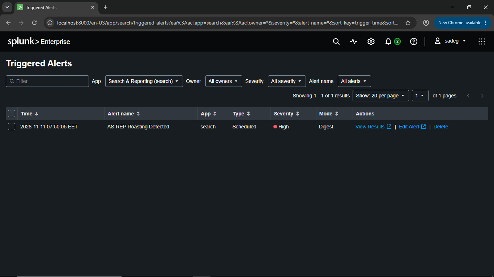
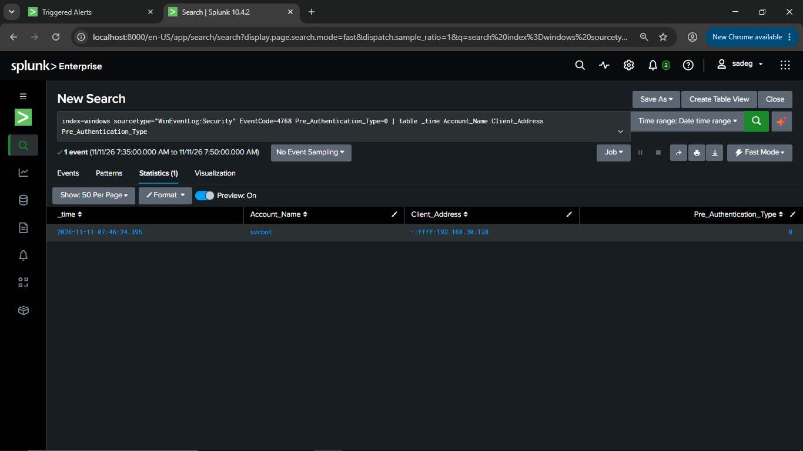
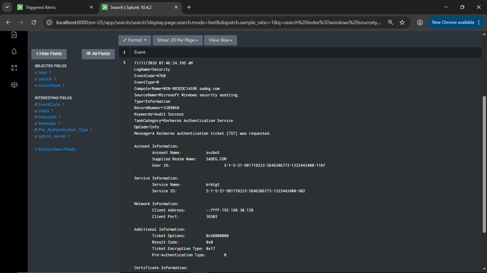
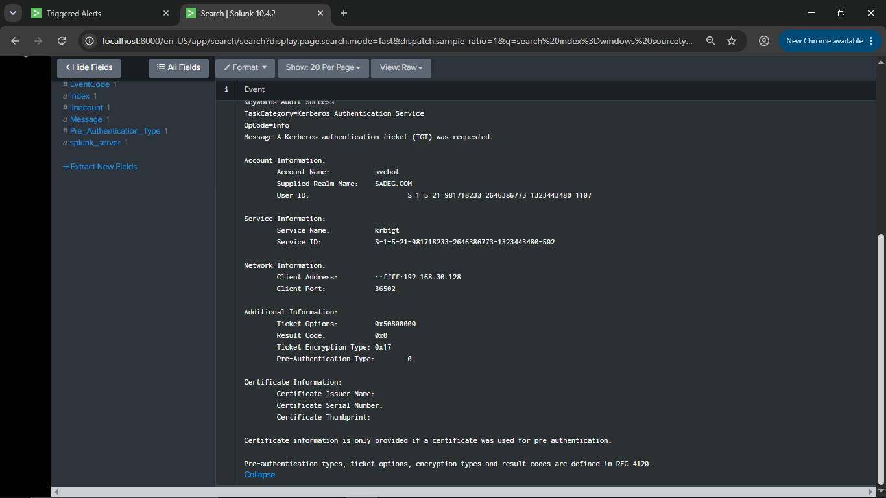
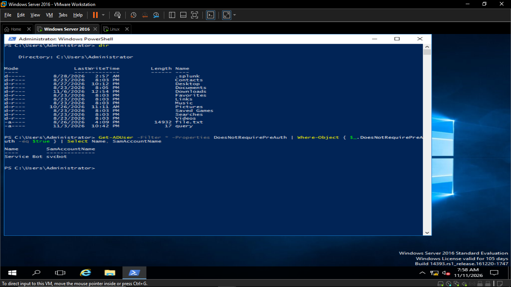
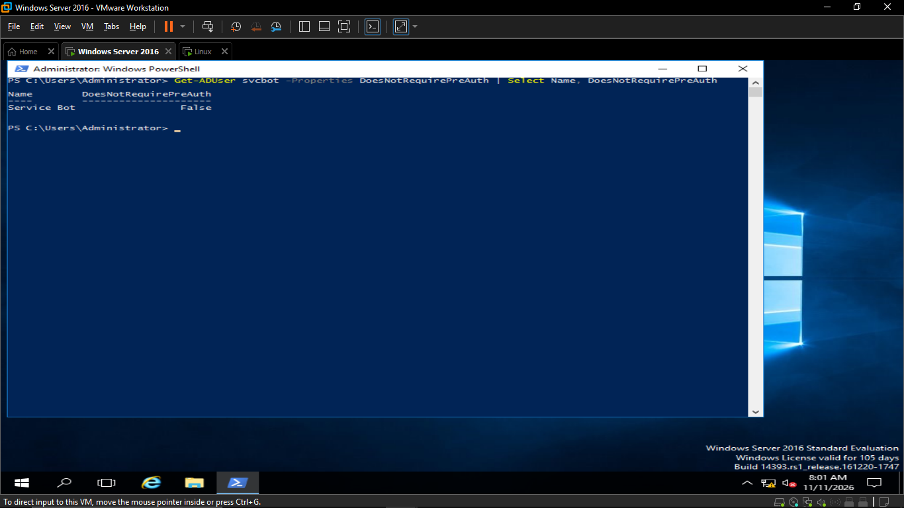
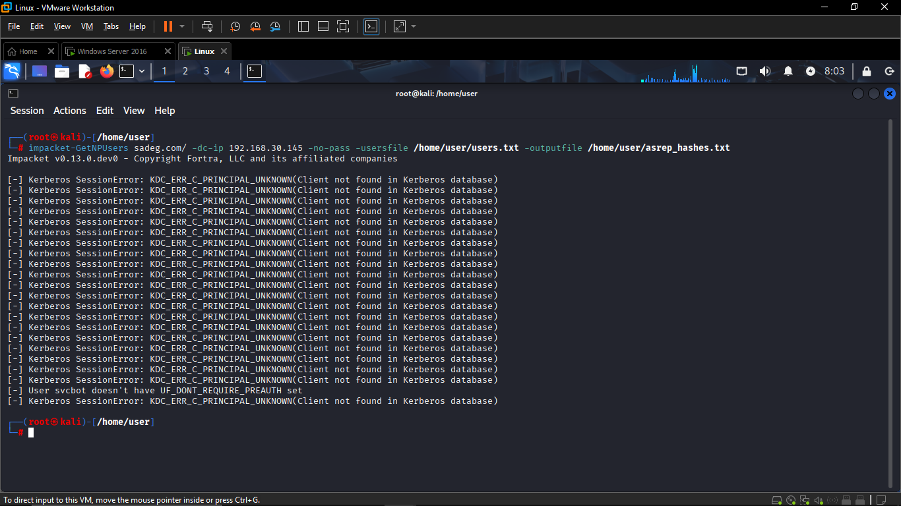

# Investigation — AS-REP Roasting Detected Alert

## 1. Alert Triage



The Splunk alert **"AS-REP Roasting Detected"** fired on **2026-11-11 07:50:05 EET**, visible under **Settings → Triggered Alerts**:

| Time | Alert Name | App | Type | Severity | Mode |
|---|---|---|---|---|---|
| 2026-11-11 07:50:05 EET | AS-REP Roasting Detected | search | Scheduled | High | Digest |

The analyst opens **View Results** to inspect the underlying search and matching event.

---

## 2. Reviewing the Search Results

The underlying SPL search is re-run to confirm the match:

```spl
index=windows sourcetype="WinEventLog:Security" EventCode=4768 Pre_Authentication_Type=0
| table _time Account_Name Client_Address Pre_Authentication_Type
```

**Statistics view (1 matching event):**



This confirms a single Kerberos **TGT request (Event ID 4768)** for account **`svcbot`**, from source IP **192.168.30.128**, with **`Pre_Authentication_Type = 0`** — i.e., no pre-authentication was performed.

---

## 3. Inspecting the Raw Event

Opening the full raw event for deeper context:




### Key findings from the event:
- **Account targeted:** `svcbot@SADEG.COM`
- **Domain Controller:** `WIN-8R2EDC1A59K.sadeg.com`
- **Source IP:** `192.168.30.128` (internal subnet — likely the attacker's Kali Linux machine)
- **Result Code:** `0x0` → the TGT request **succeeded**, confirming the attacker obtained a crackable AS-REP hash.
- **Ticket Encryption Type:** `0x17` (RC4-HMAC) → matches the `$krb5asrep$23$...` hash format captured and later cracked by the attacker.
- **Pre-Authentication Type:** `0` → confirms no pre-authentication was used, the defining signature of AS-REP Roasting.

This directly corroborates the attack activity observed on the Kali Linux host (`impacket-GetNPUsers` request against `svcbot`, followed by offline cracking with `john`).

---

## 4. Root Cause Analysis — Active Directory

The analyst pivots to the Domain Controller (Windows Server 2016) to confirm why the account was exploitable.

### 4.1 Domain-Wide Exposure Check
First, the analyst checks whether other accounts in the domain share the same misconfiguration:

```powershell
Get-ADUser -Filter * -Properties DoesNotRequirePreAuth | Where-Object { $_.DoesNotRequirePreAuth -eq $true } | Select Name, SamAccountName
```



This confirms **`svcbot`** is the only account in the domain with **"Do not require Kerberos preauthentication"** enabled — explaining why it was the only account successfully roasted, while all other usernames in the attacker's list returned `KDC_ERR_C_PRINCIPAL_UNKNOWN`.

### 4.2 Targeted Verification
```powershell
Get-ADUser svcbot -Properties DoesNotRequirePreAuth | Select Name, DoesNotRequirePreAuth
```


This verifies the specific account's `DoesNotRequirePreAuth` flag before remediation, confirming the account was indeed configured as vulnerable (`UF_DONT_REQUIRE_PREAUTH` set).

---

## 5. Remediation

Based on the investigation, the following remediation actions are taken on the `svcbot` account:

1. **Re-enable Kerberos pre-authentication** on the account — i.e., clear the `UF_DONT_REQUIRE_PREAUTH` user account control flag (via Active Directory Users and Computers, or `Set-ADAccountControl -Identity svcbot -DoesNotRequirePreAuth $false`).
2. **Reset the account password**, since the password (`Bot2026!`) was already cracked offline by the attacker and must be considered compromised.
3. **Review the account's privileges** to ensure `svcbot` (a service account) follows least-privilege practices and does not have excessive AD permissions.


### 5.1 Verifying the Fix

After remediation, the analyst re-queries the account to confirm the flag is cleared:

```powershell
Get-ADUser svcbot -Properties DoesNotRequirePreAuth | Select Name, DoesNotRequirePreAuth
```


`DoesNotRequirePreAuth` is now **`False`**, confirming that Kerberos pre-authentication is required again for `svcbot`, closing the AS-REP Roasting exposure.

### 5.2 Validating with a Re-Attack Attempt

To fully validate the fix, the same attack is re-attempted from the Kali Linux host:

```bash
impacket-GetNPUsers sadeg.com/ -dc-ip 192.168.30.145 -no-pass -usersfile /home/user/users.txt -outputfile /home/user/asrep_hashes.txt
```



This confirms that `svcbot` **no longer** has the `UF_DONT_REQUIRE_PREAUTH` flag set — the account can no longer be AS-REP roasted, and **no hash is returned** to the attacker. The remediation is successfully validated.

---

## 6. Investigation Summary

| Item | Finding |
|---|---|
| **Alert** | AS-REP Roasting Detected (High severity, triggered 2026-11-11 07:50:05 EET) |
| **Affected Account** | `svcbot@SADEG.COM` |
| **Source IP** | 192.168.30.128 |
| **Domain Controller** | WIN-8R2EDC1A59K.sadeg.com |
| **Root Cause** | `svcbot` had `UF_DONT_REQUIRE_PREAUTH` (DoesNotRequirePreAuth) enabled |
| **Domain-Wide Scope** | Only `svcbot` was affected; no other accounts misconfigured |
| **Impact** | Attacker captured AS-REP hash and cracked the password (`Bot2026!`) offline |
| **Remediation** | Re-enabled Kerberos pre-authentication requirement; reset password |
| **Validation** | Re-attack attempt confirmed `UF_DONT_REQUIRE_PREAUTH` is no longer set; no hash retrievable |

**MITRE ATT&CK Mapping:** T1558.004 — Steal or Forge Kerberos Tickets: AS-REP Roasting

**Status:** ✅ Resolved — vulnerability remediated and validated.
