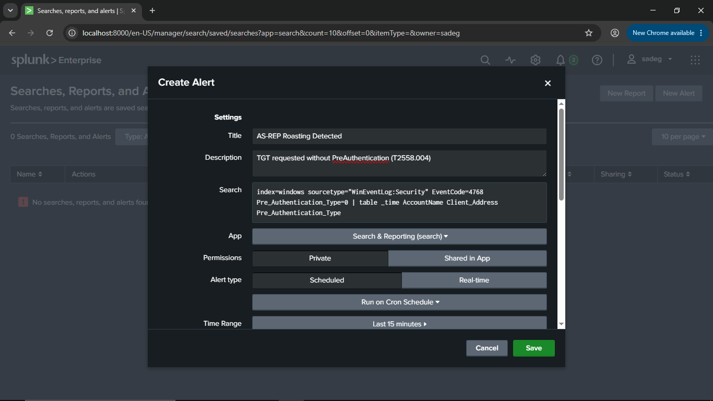
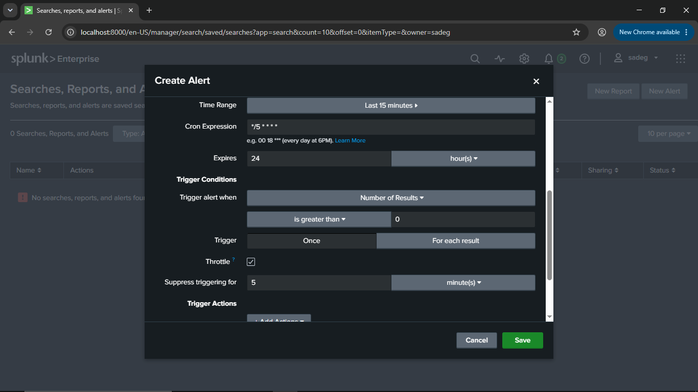
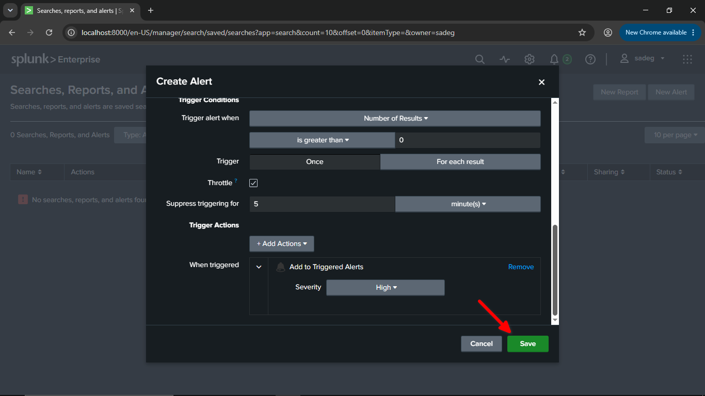
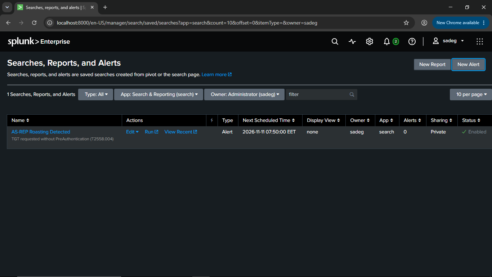

# Splunk Alert — AS-REP Roasting Detected

## 1. Detection Logic

The Domain Controller's Security event log records **Event ID 4768** for every Kerberos TGT (Ticket Granting Ticket) request. The key detection field is **`Pre_Authentication_Type`**:

- `Pre_Authentication_Type = 0` → No pre-authentication data was used in the request. This is characteristic of **AS-REP Roasting** (MITRE ATT&CK **T1558.004**), where an account has "Do not require Kerberos preauthentication" enabled, allowing a TGT to be requested without proving knowledge of the password beforehand.
- Normal authentications typically show a non-zero pre-authentication type (e.g., encrypted timestamp present).

## 2. SPL Search

```spl
index=windows sourcetype="WinEventLog:Security" EventCode=4768 Pre_Authentication_Type=0
| table _time AccountName Client_Address Pre_Authentication_Type
```

## 3. Alert Settings

| Field | Value |
|---|---|
| **Title** | AS-REP Roasting Detected |
| **Description** | TGT requested without PreAuthentication (T1558.004) |
| **Search** | `index=windows sourcetype="WinEventLog:Security" EventCode=4768 Pre_Authentication_Type=0 \| table _time AccountName Client_Address Pre_Authentication_Type` |
| **App** | Search & Reporting (search) |
| **Permissions** | Private |
| **Alert type** | Scheduled — Run on Cron Schedule |
| **Time Range** | Last 15 minutes |
| **Cron Expression** | `*/5 * * * *` (every 5 minutes) |
| **Expires** | 24 hour(s) |

## 4. Trigger Conditions

| Field | Value |
|---|---|
| **Trigger alert when** | Number of Results **is greater than** `0` |
| **Trigger** | For each result |
| **Throttle** | Enabled |
| **Suppress triggering for** | 5 minute(s) |

## 5. Trigger Actions

| Field | Value |
|---|---|
| **Action** | Add to Triggered Alerts |
| **Severity** | High |






## 6. MITRE ATT&CK Mapping

**T1558.004** — Steal or Forge Kerberos Tickets: AS-REP Roasting
