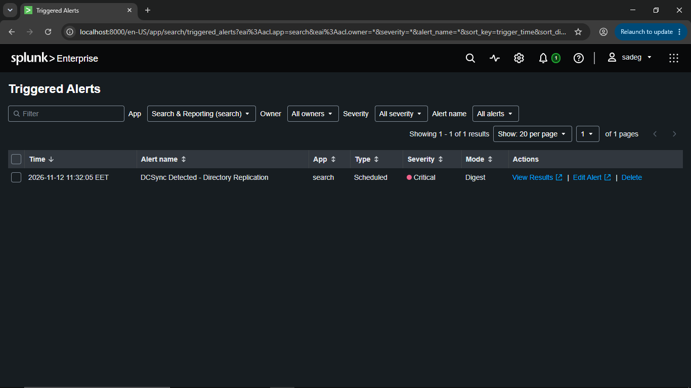
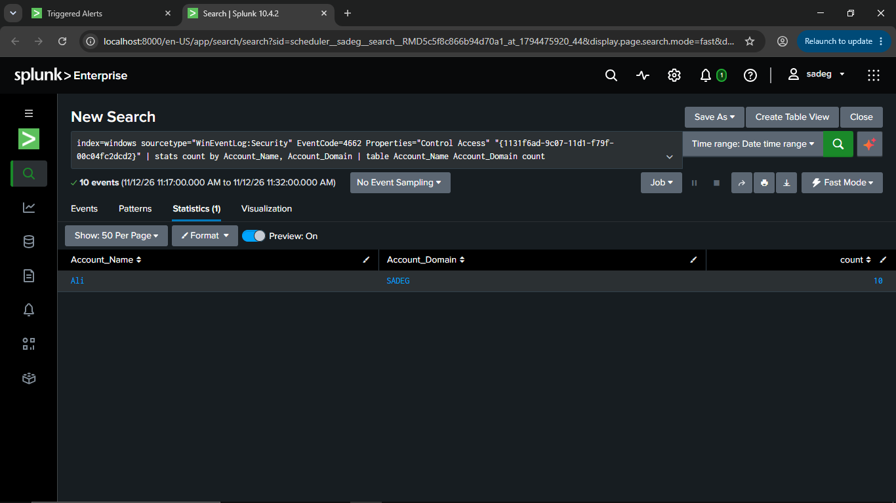
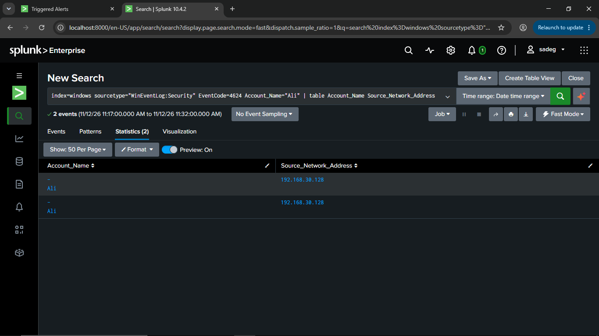
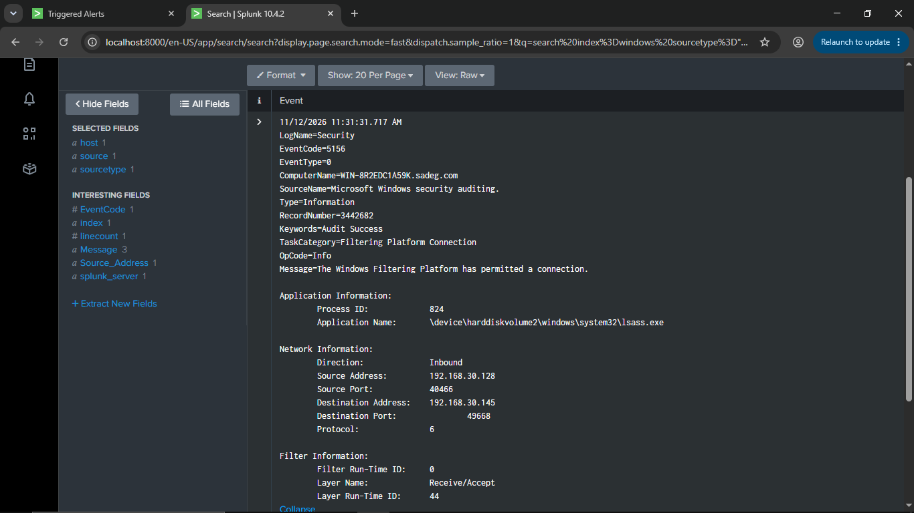

# Investigation Report - DCSync Detected (Directory Replication)

## Alert Summary

| Field | Value |
|-------|-------|
| **Alert Name** | DCSync Detected - Directory Replication |
| **Trigger Time** | 2026-11-12 11:32:05 EET |
| **Severity** | Critical |
| **Type** | Scheduled |
| **Mode** | Digest |
| **App** | search |
| **Status** | Triggered - 1 result shown under Triggered Alerts |

This confirms the alert created and scheduled earlier successfully fired, moving the scenario from "configured" to "actually detected."

## Step 1 - Confirm the Trigger



This lines up with the `impacket-secretsdump` DCSync attempt executed from the Kali attacker host against `192.168.30.145`.

## Step 2 - Review the Alert's Own Search Results



**Result (Time range 11/12/26 11:17:00 AM - 11:32:00 AM):**

- 10 separate Control Access (replication) events were generated by the account `Ali` in a 15-minute window.
- This is consistent with the multiple replication requests Impacket's DRSUAPI/DCSync method issues while pulling NTDS.DIT secrets.

## Step 3 - Pivot to Logon Activity for the Same Account

To confirm how `Ali` authenticated to the Domain Controller, the analyst pivoted to logon events:

```spl
index=windows sourcetype="WinEventLog:Security" EventCode=4624 Account_Name="Ali" | table Account_Name Source_Network_Address
```



- 2 successful logon events (EventCode 4624) for `Ali`, both originating from `192.168.30.128` - the attacker's Kali host, not a known administrative workstation.
- This ties the identity used in the replication requests (Step 2) directly to a specific source IP, reinforcing that the activity originated from an external/unauthorized host rather than a legitimate domain admin workstation.

## Step 4 - Network-Level Correlation (Windows Filtering Platform)

A supporting event was identified to validate the network path between the attacker and the Domain Controller:

```spl
index=windows sourcetype="WinEventLog:Security" EventCode=5156 Source_Address="192.168.30.128"
```



### Why This Event Matters

- The connection was accepted **inbound to `lsass.exe`** on the Domain Controller (`WIN-8R2EDC1A59K`), which is the process responsible for handling authentication and, via DRSUAPI, directory replication requests.
- The destination port `49668` is a dynamic RPC port typically used for DCERPC/DRSUAPI traffic - consistent with the `secretsdump.py` DRSUAPI fallback method observed on the attacker side.
- Source `192.168.30.128` matches the same source IP seen in the `4624` logon events for `Ali` in Step 3, and the destination `192.168.30.145` matches the target host used in the `impacket-secretsdump` command.

## Conclusion

The investigation **confirms true positive**. The alert correctly detected an active DCSync attack:

- Identity involved: `Ali` (SADEG domain)
- Attacker source: `192.168.30.128`
- Target: Domain Controller `WIN-8R2EDC1A59K.sadeg.com` (192.168.30.145)
- Tool: Impacket `secretsdump.py` using the DRSUAPI (DCSync) method
- Result: Full NTDS.DIT hash dump including `krbtgt`, `Administrator`, and multiple user/service accounts

## Recommended Immediate Actions

1. Disable or reset the `Ali` account immediately; treat it as compromised.
2. Reset the `krbtgt` password twice to invalidate any Golden Tickets that may have been forged.
3. Reset passwords for all accounts exposed in the dump (Administrator, Guest, service accounts, all domain users).
4. Block/isolate host `192.168.30.128` from the network.
5. Review how `Ali` obtained `DS-Replication-Get-Changes` / `Get-Changes-All` rights and remove them.
6. Hunt for further lateral movement or Pass-the-Hash attempts using the dumped NT hashes.
7. Preserve logs and alert data for incident documentation and, if required, forensics/legal follow-up.
