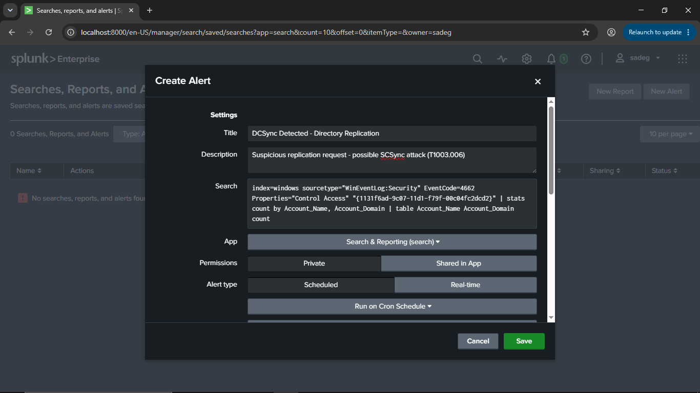
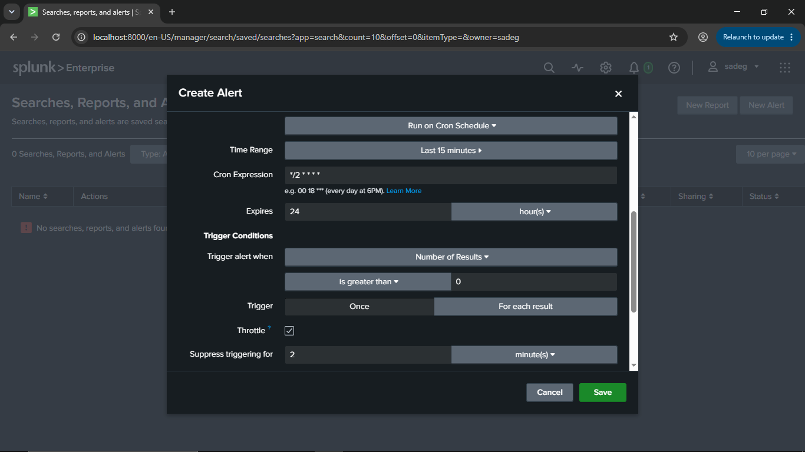
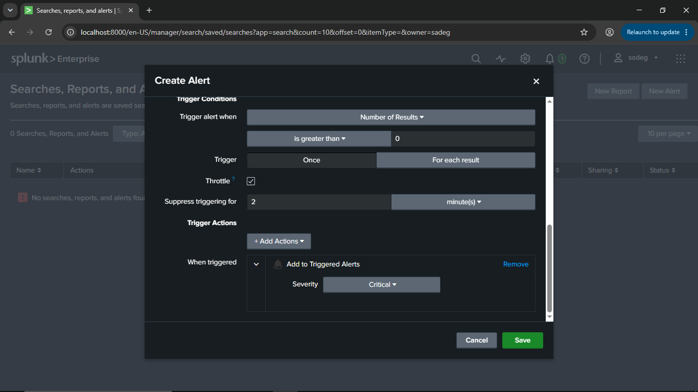
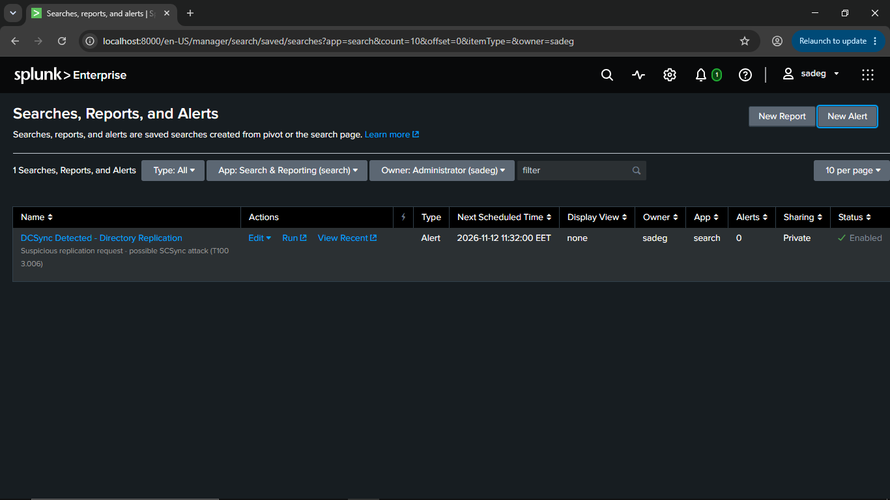

# Splunk Alert Configuration - DCSync Detection

## Overview

| Field | Value |
|-------|-------|
| **Title** | DCSync Detected - Directory Replication |
| **Description** | Suspicious replication request - possible SCSync attack (T1003.006) |
| **MITRE ATT&CK** | T1003.006 - OS Credential Dumping: DCSync |
| **Platform** | Splunk Enterprise 10.4.2 |
| **App** | Search & Reporting (search) |
| **Owner** | sadeg |
| **Permissions** | Private |
| **Status** | Enabled |

## Detection Search (SPL)

### Query Logic

| Element | Purpose |
|---------|---------|
| `index=windows` | Windows event logs index |
| `sourcetype="WinEventLog:Security"` | Windows Security event log |
| `EventCode=4662` | An operation was performed on an Active Directory object |
| `Properties="Control Access"` | Extended right (control access) was exercised |
| `{1131f6ad-9c07-11d1-f79f-00c04fc2dcd2}` | GUID of the `DS-Replication-Get-Changes-All` extended right, required for DCSync |
| `stats count by Account_Name, Account_Domain` | Counts requests per account |
| `table Account_Name Account_Domain count` | Displays the result columns |

## Schedule Settings

## Trigger Conditions

## Trigger Actions

| Action | Setting |
|--------|---------|
| **Add to Triggered Alerts** | Severity: **Critical** |

## Verification

- Saved under **Settings > Searches, Reports, and Alerts**
- Type: Alert, Sharing: Private, Status: Enabled
- Next scheduled run is shown in the list (e.g., `2026-11-12 11:32:00 EET`)
- Alerts fired: `0` at the time of the screenshot (no attack simulated yet)

## Notes

- Domain controller machine accounts (names ending with `$`) legitimately replicate with each other. The current query does not exclude them, so expect false positives. Consider adding `NOT Account_Name="*$"` and excluding known replication/sync service accounts (e.g., Azure AD Connect).
- Event 4662 is only generated when auditing for Directory Service Access is enabled and a SACL is configured on the domain object.
- Any non-DC account performing replication is a strong indicator of DCSync and should be investigated immediately.
