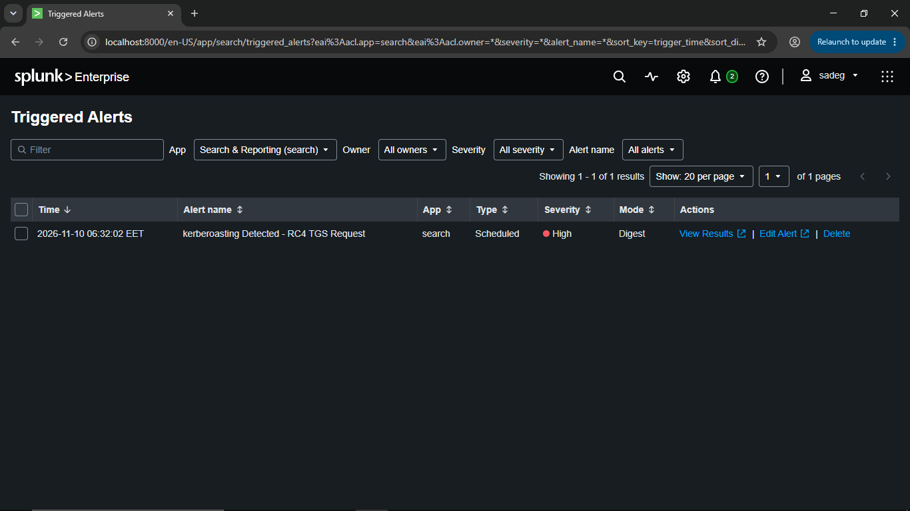
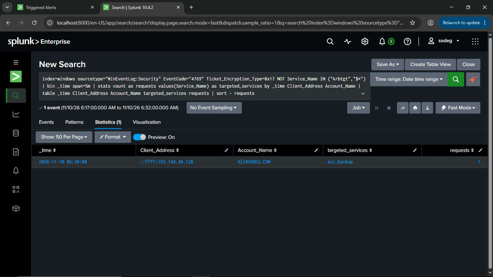
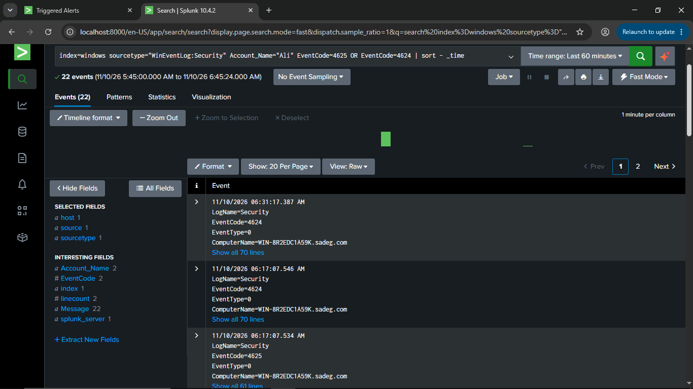
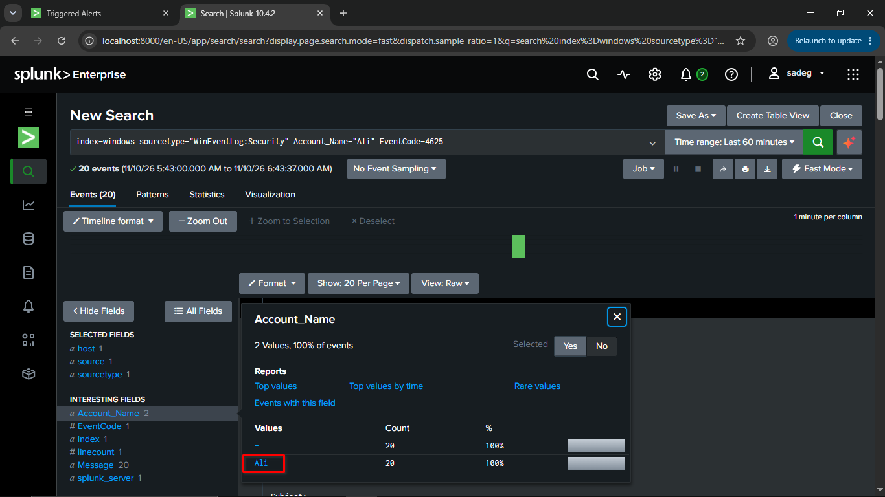
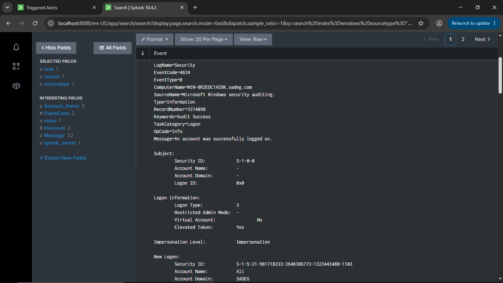
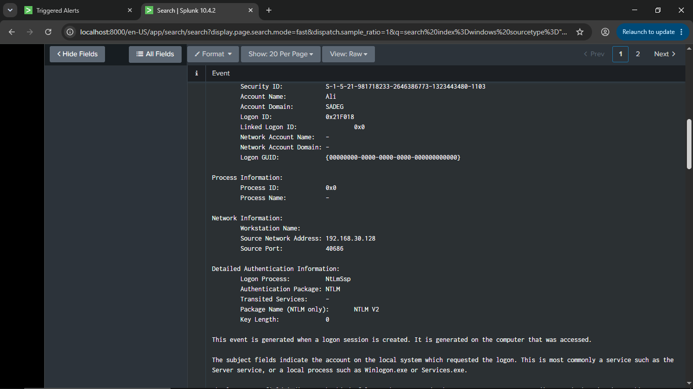

# Kerberoasting Investigation: Triggered Alert Analysis

## 1. Overview

| Item | Value |
|---|---|
| Triggered alert | Kerberoasting Detected - RC4 TGS Request |
| Trigger time | 2026-11-10 06:32:02 EET |
| App | search |
| Type | Scheduled |
| Severity | High |
| Mode | Digest |
| Compromised account (under investigation) | `Ali` |
| Domain Controller | WIN-8R2EDC1A59K.sadeg.com |

This document walks through the analyst's investigation after the Splunk alert fired, from confirming the detection to correlating it with the account's logon history and the source of the activity.

## 2. Step 1 — Confirm the Triggered Alert

**Location:** `Activity > Triggered Alerts`

The alert **"kerberoasting Detected - RC4 TGS Request"** appears in the triggered alerts list:



## 3. Step 2 — Review the Alert Results

The analyst opens the alert's underlying search and reviews the matching event for the trigger window:

```spl
index=windows sourcetype="WinEventLog:Security" EventCode="4769" Ticket_Encryption_Type=0x17
NOT Service_Name IN ("krbtgt","$*")
| bin _time span=5m
| stats count as requests values(Service_Name) as targeted_services by _time Client_Address Account_Name
| table _time Client_Address Account_Name targeted_services requests
| sort - requests
```

**Result (1 event):**



**Analysis:** The account `Ali` requested a Kerberos service ticket encrypted with RC4 (0x17) for the `svc_backup` service account, originating from `192.168.30.128`. This matches the attack performed in `kerberoasting_attack.md` exactly: same account, same source host, and same targeted service.

## 4. Step 3 — Pivot on the Account's Logon Activity

To understand how the account `Ali` was being used around the time of the alert, the analyst searches for all logon-related events (successful and failed) for that account over the last 60 minutes:

```spl
index=windows sourcetype="WinEventLog:Security" Account_Name="Ali" EventCode=4625 OR EventCode=4624
| sort - _time
```

**Result:** 22 events between 11/10/26 5:45:00.000 AM and 11/10/26 6:45:24.000 AM, a mix of:

- `EventCode=4624` — An account was successfully logged on.
- `EventCode=4625` — An account failed to log on.

This mix of successes and failures for the same account in a short window is a strong indicator that the account was targeted before the Kerberoasting step.




## 5. Step 4 — Isolate the Failed Logon Attempts

The analyst narrows the search to failed logons only:

```spl
index=windows sourcetype="WinEventLog:Security" Account_Name="Ali" EventCode=4625
```


**Result:** 20 events (11/10/26 5:43:00.000 AM to 11/10/26 6:43:37.000 AM), all under `Account_Name = Ali` (confirmed in the field summary: value `Ali`, 20 occurrences, 100% of events shown).

**Analysis:** Twenty failed logon attempts against a single account in under an hour is consistent with a **brute force / password guessing attack**, which matches the earlier stage of this scenario documented in `kerberoasting_attack.md` (the attacker obtaining `Ali`'s password, `Password123!`, before performing the Kerberoasting request).

## 6. Step 5 — Examine a Successful Logon Event



The analyst opens one of the `EventCode=4624` events to confirm the account was eventually compromised successfully:

| Field | Value |
|---|---|
| EventCode | 4624 |
| Message | An account was successfully logged on |
| Logon Type | 3 (network logon) |
| Account Name (New Logon) | Ali |
| Account Domain | SADEG |
| Security ID | S-1-5-21-981718233-2646386773-1323443480-1103 |
| Elevated Token | Yes |
| Computer Name | WIN-8R2EDC1A59K.sadeg.com |

**Analysis:** `Ali` successfully authenticated to the Domain Controller using a Type 3 (network) logon — the logon type expected for remote tools such as Impacket, rather than an interactive desktop logon.


## 7. Step 6 — Examine the Network and Authentication Details



Drilling further into the logon event's network information confirms the source of the activity:

| Field | Value |
|---|---|
| Account Name | Ali |
| Logon ID | 0x21F018 |
| Source Network Address | 192.168.30.128 |
| Source Port | 40686 |
| Logon Process | NtLmSsp |
| Authentication Package | NTLM |
| Package Name (NTLM only) | NTLM V2 |

**Analysis:** The logon originated from **192.168.30.128**, the exact same source address recorded against the Kerberoasting request in Step 3 (`::ffff:192.168.30.128` is simply the IPv4-mapped IPv6 notation of the same address). This ties the brute-forced/compromised account, the successful logon, and the Kerberoasting request together as a single, continuous attack chain from one attacker host.

## 8. Correlated Timeline

| Time (approx.) | Event | Source |
|---|---|---|
| 05:43 – 06:17 | ~20 failed logon attempts (EventCode 4625) against account `Ali` | 192.168.30.128 |
| 06:17:07 | Successful logon (EventCode 4624), Logon Type 3, NTLM V2 | 192.168.30.128 |
| 06:30:00 | Kerberos TGS request, `EventCode=4769`, RC4 (`0x17`), targeting `svc_backup` | 192.168.30.128 (`Ali`) |
| 06:31:17 | Additional successful logon (EventCode 4624) for `Ali` | 192.168.30.128 |
| 06:32:02 | Splunk alert **"kerberoasting Detected - RC4 TGS Request"** triggers | Splunk (Scheduled search) |

## 9. Conclusion

The investigation confirms a complete attack chain:

1. The attacker brute-forced the account `Ali` from host `192.168.30.128`, generating ~20 failed logon attempts.
2. The attacker successfully authenticated as `Ali` via NTLM (Logon Type 3).
3. Using `Ali`'s credentials, the attacker requested an RC4-encrypted Kerberos service ticket for the `svc_backup` service account — a Kerberoasting attempt consistent with MITRE ATT&CK T1558.003.
4. The Splunk scheduled alert correctly detected the RC4 TGS request and fired with High severity.

This confirms the detection rule in `splunk_alert.md` works as intended and successfully flagged the attack performed in `kerberoasting_attack.md`.

## 10. Recommended Response Actions

- **Contain:** Disable or force a password reset on the `Ali` account immediately; disable it if not currently in active use.
- **Remediate the target:** Reset the `svc_backup` service account's password to a long, random value (25+ characters) or migrate it to a group Managed Service Account (gMSA).
- **Harden:** Enforce AES-only Kerberos encryption (`msDS-SupportedEncryptionTypes`) on all service accounts to prevent RC4 downgrade.
- **Prevent brute force:** Verify account lockout policy is enabled and tuned to stop sustained password-guessing attempts after a small number of failures.
- **Detect lateral movement:** Review all other activity from `192.168.30.128` and any other accounts it attempted to authenticate as, to rule out broader compromise.


## 11. Related Files

- Detection rule: `splunk_alert.md`
- Attack simulation: `kerberoasting_attack.md`
