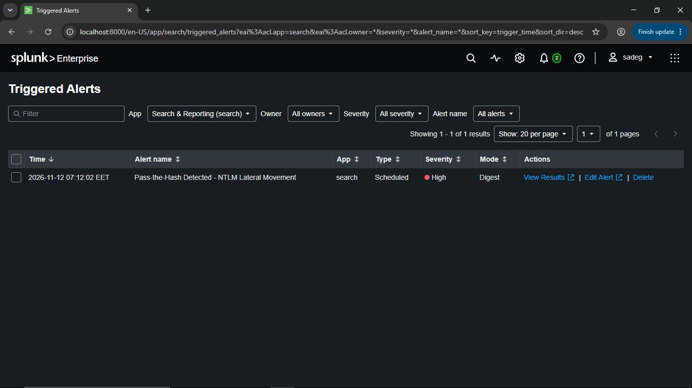
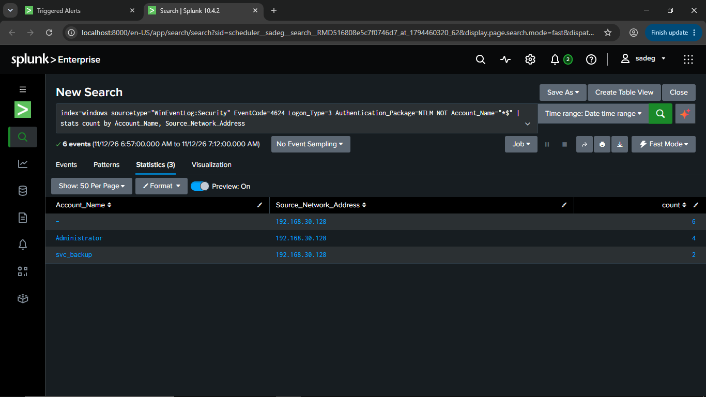
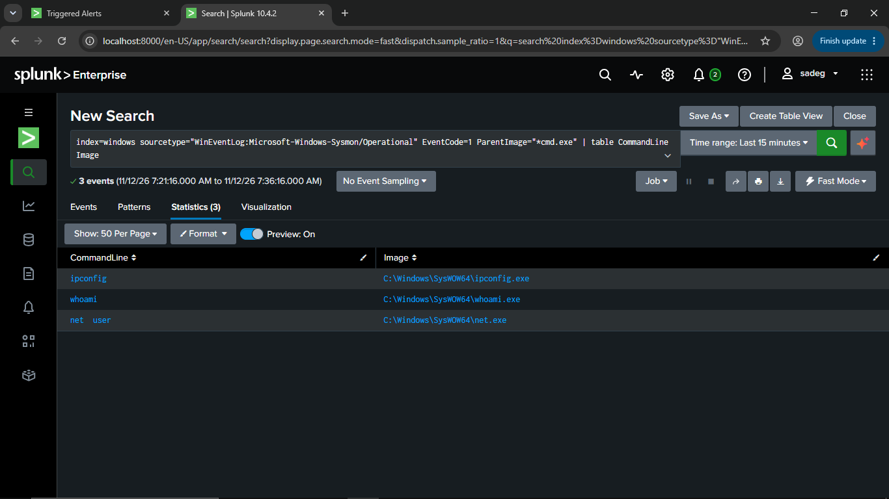

# Investigation Documentation: Pass-the-Hash – NTLM Lateral Movement

## Incident Summary

| Field | Value |
|---|---|
| **Alert Name** | Pass-the-Hash Detected – NTLM Lateral Movement |
| **Alert Triggered** | 2026-11-12 07:12:02 EET |
| **Severity** | 🔴 High |
| **Alert Type** | Scheduled |
| **Mode** | Digest |
| **MITRE ATT&CK** | T1550.002 – Use Alternate Authentication Material: Pass the Hash |

---

## Phase 1 – Alert Triage



The Splunk scheduled alert fired at **07:12:02 EET** and appeared in the **Triggered Alerts** dashboard under the Search & Reporting app. This was the first signal that a Pass-the-Hash attack was in progress or had recently completed.

**Action taken:** Clicked "View Results" to open the alert's search results and begin the investigation.

---

## Phase 2 – Identifying the Attacker



### Key Finding: Attacker IP
> **192.168.30.128** (Kali Linux attacker machine)

All NTLM network logons originated from a single external source IP — `192.168.30.128`. Two accounts were abused:
- **`svc_backup`** – used in the credential dumping phase (impacket-secretsdump)
- **`Administrator`** – used in the Pass-the-Hash lateral movement phase (impacket-psexec)

The blank (anonymous) account row reflects the initial SMB negotiation packets before authentication, also originating from the same attacker IP.

---

## Phase 3 – Command Line Investigation

### Problem: Command Line Logging Was Disabled

After confirming the attacker's IP and the accounts abused, the next investigative step was to determine **what commands the attacker executed** after gaining a shell on the Domain Controller.

Upon checking Windows Security Event logs for **EventCode 4688** (Process Creation), it was found that the **command line arguments were missing** — the events showed process creation but without the actual command used.

**Root Cause:** The Windows Audit Policy setting **"Include command line in process creation events"** was **not enabled** on the Windows Server.

> This setting controls whether Windows appends the full command-line string to EventID 4688 entries in the Security log. Without it, process creation events are logged but analysts cannot see *what arguments* were passed to each process — severely limiting forensic visibility.

**Location of the setting:**
```
Group Policy → Computer Configuration
  → Windows Settings
    → Security Settings
      → Advanced Audit Policy Configuration
        → Detailed Tracking
          → Audit Process Creation → Enable
            + Administrative Templates
              → System → Audit Process Creation
                → "Include command line in process creation events" → Enabled
```

---

## Phase 4 – Enabling Command Line Logging & Re-Running the Attack

After enabling the **"Include command line in process creation events"** policy on the Windows Server and allowing the policy to apply, the attack scenario was **repeated using different commands** to validate that the new configuration was capturing command-line activity correctly.

**New commands executed by the attacker in the second run:**
- `ipconfig`
- `whoami`
- `net user`

> These differ from the first attack (which used `whoami`, `hostname`, `net user`, `net group "Domain Admins"`), confirming this is a separate simulation run done specifically to test command-line visibility.

---

## Phase 5 – Verifying Command Visibility via Sysmon

### Splunk Search Used



### Analysis
The results confirm that after enabling command-line logging, Sysmon's **EventCode 1 (Process Creation)** events now fully capture the commands executed under `cmd.exe`. The parent process filter `ParentImage="*cmd.exe"` correctly scopes results to processes spawned directly from the attacker's interactive shell session.

The binaries running from **`C:\Windows\SysWOW64\`** (32-bit subsystem) rather than `System32` indicates the psexec-dropped payload ran as a 32-bit service process, which is consistent with Impacket's psexec behavior on 64-bit Windows systems.

---

## Investigation Timeline

| Time (EET) | Event |
|---|---|
| `06:57` | Attacker begins NTLM authentication attempts from `192.168.30.128` |
| `07:10` | secretsdump dumps NTLM hashes from DC |
| `07:11` | psexec Pass-the-Hash shell obtained as `NT AUTHORITY\SYSTEM` |
| `07:12:02` | Splunk alert fires: *Pass-the-Hash Detected – NTLM Lateral Movement* |
| `07:12` | Analyst opens alert, reviews results, identifies `192.168.30.128` as attacker |
| `07:12+` | Analyst attempts to review command lines — discovers logging is disabled |
| `~07:15` | Analyst enables **"Include command line in process creation events"** on Windows Server |
| `~07:21` | Analyst re-runs attack simulation with new commands (ipconfig, whoami, net user) |
| `07:21–07:36` | Sysmon EventCode=1 captures all 3 commands with full command-line arguments |

---

## Final Verdict

The investigation confirmed a successful **Pass-the-Hash lateral movement** attack originating from **192.168.30.128**. The attacker used a Domain Admin service account (`svc_backup`) to dump all domain credentials, then authenticated as `Administrator` using only the NTLM hash, gaining full SYSTEM-level control of the Domain Controller without ever knowing the plaintext password. The Splunk alert successfully detected and surfaced the attack within minutes of it occurring.
