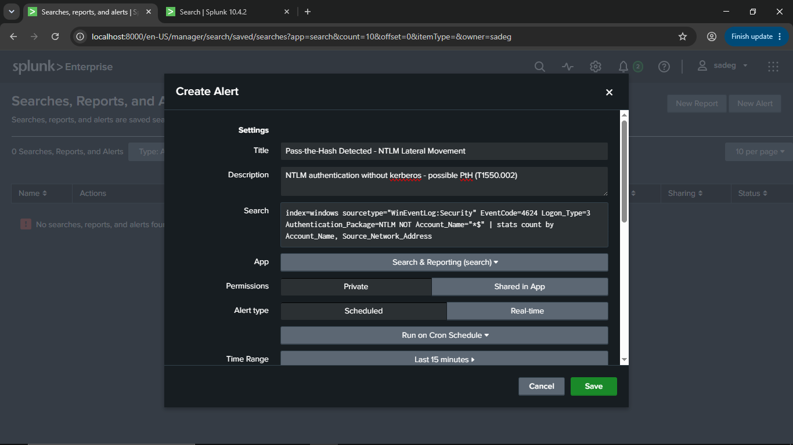
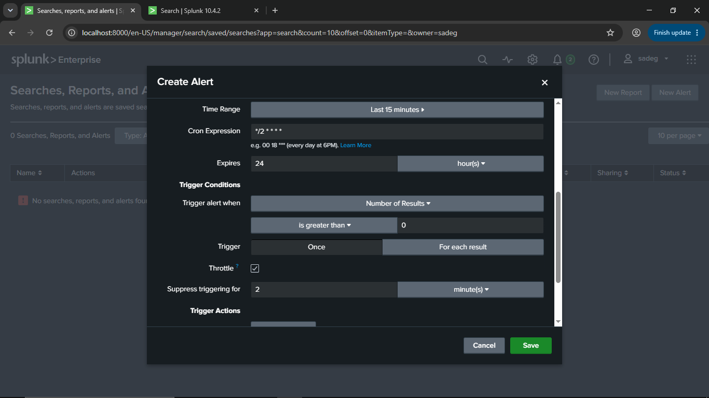
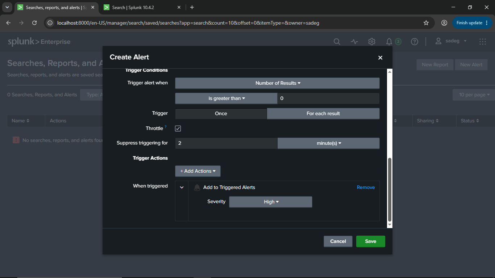
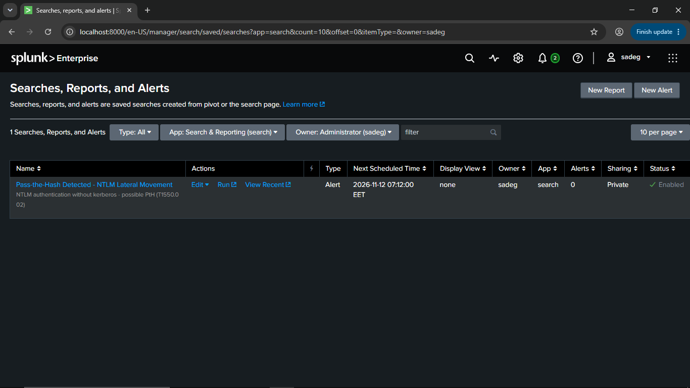

# Splunk Alert: Pass-the-Hash Detected – NTLM Lateral Movement

## Overview
This document describes the Splunk alert configured to detect **Pass-the-Hash (PtH)** activity within the environment. The alert monitors Windows authentication events for signs of NTLM authentication being used in place of Kerberos, which is a strong indicator of lateral movement using stolen or replayed credential hashes (MITRE ATT&CK technique **T1550.002**).

---

## Alert Settings

| Field | Value |
|---|---|
| **Title** | Pass-the-Hash Detected - NTLM Lateral Movement |
| **Description** | NTLM authentication without Kerberos - possible PtH (T1550.002) |
| **App** | Search & Reporting (search) |
| **Owner** | sadeg (Administrator) |
| **Permissions** | Private |
| **Alert Type** | Scheduled (Run on Cron Schedule) |
| **Status** | Enabled |

## Search Query
```spl
index=windows sourcetype="WinEventLog:Security" EventCode=4624 Logon_Type=3 Authentication_Package=NTLM NOT Account_Name="*$"
| stats count by Account_Name, Source_Network_Address
```



### Query Breakdown
- **`index=windows sourcetype="WinEventLog:Security"`** – Searches Windows Security event logs.
- **`EventCode=4624`** – Filters for successful logon events.
- **`Logon_Type=3`** – Restricts to **network logons**, the type typically used in lateral movement (e.g., SMB, WMI, PsExec) rather than interactive console logons.
- **`Authentication_Package=NTLM`** – Flags logons that used NTLM authentication instead of Kerberos. In a properly configured Active Directory domain, NTLM network logons are uncommon and often suspicious.
- **`NOT Account_Name="*$"`** – Excludes machine/computer accounts (which end in `$`), reducing noise from legitimate inter-host service communication.
- **`stats count by Account_Name, Source_Network_Address`** – Aggregates results by user account and source IP, surfacing which accounts are authenticating via NTLM and from where.

## Scheduling
| Field | Value |
|---|---|
| **Time Range** | Last 15 minutes |
| **Cron Expression** | `*/2 * * * *` (runs every 2 minutes) |
| **Expires** | 24 hour(s) |

The search continuously scans the last 15 minutes of logs every 2 minutes, providing near real-time detection coverage.



## Trigger Conditions
| Field | Value |
|---|---|
| **Trigger alert when** | Number of Results is greater than `0` |
| **Trigger** | For each result |
| **Throttle** | Enabled |
| **Suppress triggering for** | 2 minute(s) |

Because the trigger is set to **"For each result"**, a separate alert instance is generated for every unique Account_Name / Source_Network_Address combination. Throttling (suppression) prevents alert flooding by not re-triggering for the same result within a 2-minute window.

## Trigger Actions
| Action | Details |
|---|---|
| **Add to Triggered Alerts** | Severity: **High** |

When the alert fires, it is logged to Splunk's Triggered Alerts list with a **High** severity rating, ensuring it is prioritized for analyst review.




---

## Why This Matters
Pass-the-Hash attacks allow an adversary who has obtained an NTLM password hash (without needing the plaintext password) to authenticate to other systems as a legitimate user. Because this technique bypasses Kerberos, NTLM authentication over the network (Logon Type 3) — especially from non-standard or unexpected source hosts — is a key artifact investigators look for. This alert is designed to surface that activity quickly so it can be triaged before an attacker moves further into the environment.
