# Scenario 01 - Port Scan Detection (Splunk + Sysmon)

> Detecting an Nmap SYN scan against a Windows Server 2016 Domain Controller by building a Splunk scheduled alert on Sysmon Event ID 3 (Network Connection).

| | |
|---|---|
| **Category** | Reconnaissance / Network Service Discovery |
| **MITRE ATT&CK** | [T1046 - Network Service Discovery](https://attack.mitre.org/techniques/T1046/) |
| **Data source** | Sysmon Event ID 3 (`Microsoft-Windows-Sysmon/Operational`) |
| **SIEM** | Splunk Enterprise 10.4.2 |
| **Severity** | Medium |
| **Result** | Alert triggered successfully |

---

## 1. Objective

Build and validate a detection rule that flags a single source IP connecting to many distinct destination ports in a short time window (a typical port scan pattern), then test it end to end by launching a real scan from an attacker machine.

## 2. Lab Environment

| Role | Hostname / OS | IP Address | Notes |
|---|---|---|---|
| Attacker | Kali Linux (VMware) | `192.168.30.128` | Runs Nmap |
| Victim | `WIN-8R2EDC1A59K` - Windows Server 2016 (VMware) | `192.168.30.145` | Domain Controller for `sadeg.com`, Sysmon installed |
| SIEM | Splunk Enterprise 10.4.2 | `localhost:8000` | Index: `windows` |

Logs flow from the Windows Server (Sysmon) into the Splunk `windows` index.

## 3. Attack Flow

```
Kali (192.168.30.128) --Nmap SYN scan--> Windows Server (192.168.30.145)
                                              |
                                        Sysmon Event ID 3
                                              |
                                        Splunk (index=windows)
                                              |
                          Scheduled alert (every 5 min) --> Triggered Alerts
```

## 4. Detection Logic

```spl
index=windows sourcetype="WinEventLog:Microsoft-Windows-Sysmon/Operational" EventCode=3
| bin _time span=1m
| stats dc(DestinationPort) as unique_ports values(DestinationPort) as ports by SourceIp, _time
| where unique_ports > 15
```

**How it works**

1. Filter Sysmon network connection events (`EventCode=3`).
2. Group events into 1-minute buckets with `bin _time span=1m`.
3. Count the distinct destination ports per source IP in each bucket (`dc(DestinationPort)`).
4. Keep only sources that touched more than 15 distinct ports in one minute.

## 5. Alert Configuration

| Setting | Value |
|---|---|
| Title | `SOC - Potential Port Scan Detection` |
| Description | Flags a source IP hitting many distinct ports within 1 minute, based on Sysmon Event ID 3 - indicative of port scanning (MITRE T1046) |
| App | Search & Reporting |
| Permissions | Private |
| Alert type | Scheduled - Run on Cron Schedule |
| Cron expression | `*/5 * * * *` (every 5 minutes) |
| Time range | Last 15 minutes |
| Expires | 24 hours |
| Trigger condition | Number of Results is greater than `0` |
| Trigger | Once |
| Throttle | Enabled - suppress for 30 seconds |
| Trigger action | Add to Triggered Alerts - Severity: **Medium** |

### Creation steps

**Step 1 - Open Searches, Reports, and Alerts and click "New Alert"**

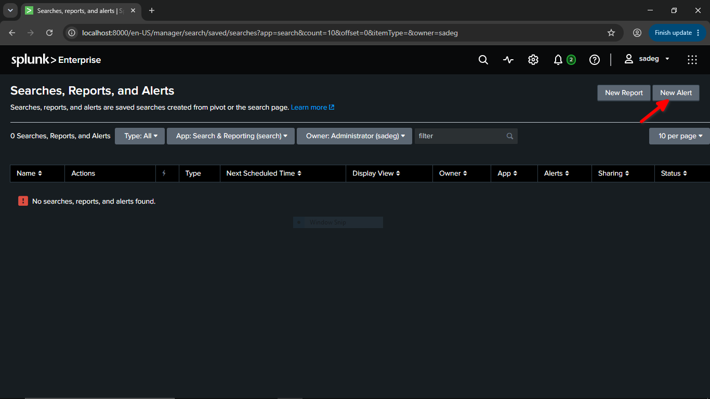

**Step 2 - Set the title, description and search query**

> Note: Splunk showed an `Unbalanced quotes` warning at this stage. It is caused by quotes in the search/description being malformed when pasted. Re-typing the straight quotes `"` fixes it.

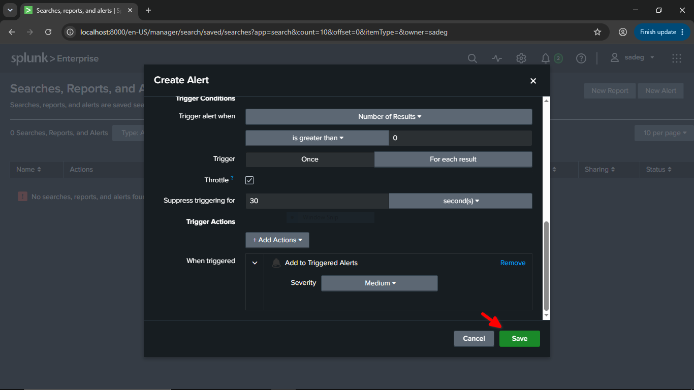

**Step 3 - Configure the schedule (cron `*/5 * * * *`, last 15 minutes) and the trigger condition**

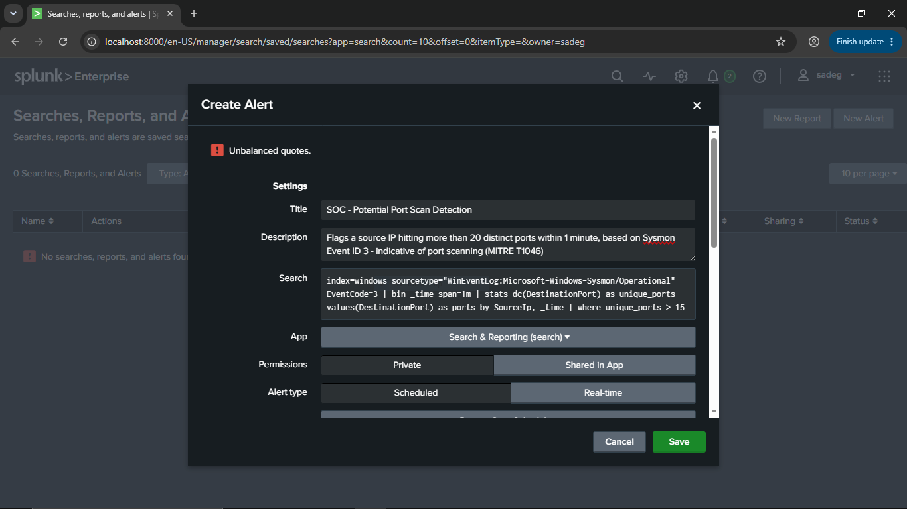

**Step 4 - Configure throttling and the trigger action, then click Save**

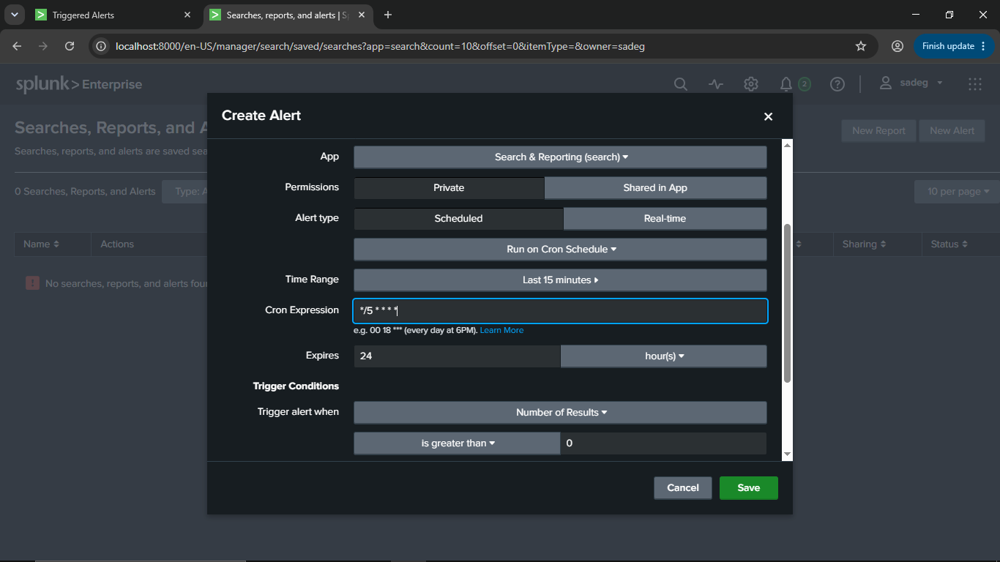

**Step 5 - The alert is saved and enabled**

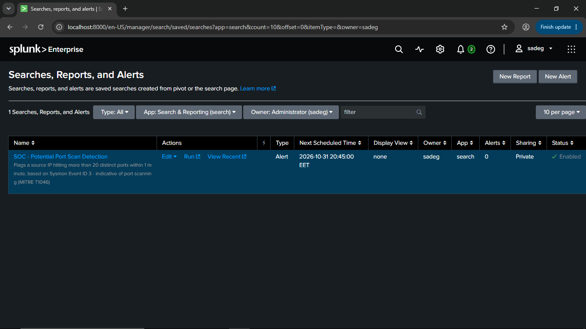

## 6. Attack Simulation

From the Kali machine, open a terminal:


Run a full-range SYN scan with service detection against the Windows Server:

```bash
nmap -sS -sV -p- --min-rate 2000 192.168.30.145
```

| Flag | Meaning |
|---|---|
| `-sS` | TCP SYN (half-open) scan |
| `-sV` | Service/version detection |
| `-p-` | Scan all 65535 ports |
| `--min-rate 2000` | Send at least 2000 packets per second |

**Result:** the host is up, **20 open ports** were found (65,515 filtered), and the scan finished in about 136 seconds. The exposed services (DNS 53, Kerberos 88, RPC 135, LDAP 389/3268, SMB 445, WinRM 5985, AD Web Services 9389, dynamic RPC 496xx, and others) confirm the target is an Active Directory Domain Controller.

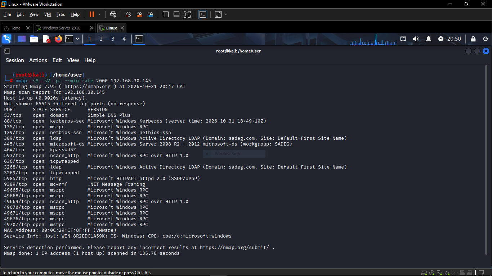

## 7. Evidence

### 7.1 On the victim - Sysmon logs in Event Viewer

A burst of Sysmon **Event ID 3 (Network connection detected)** appears at around 8:49 PM:

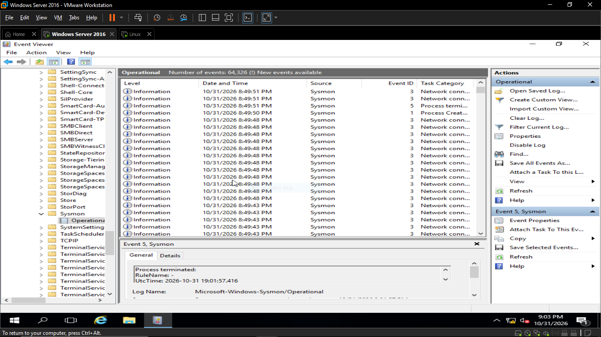

Details of one event:

| Field | Value |
|---|---|
| EventID | 3 |
| UtcTime | 2026-10-31 18:49:47 |
| Image | `C:\Windows\System32\lsass.exe` |
| Initiated | false (inbound connection) |
| SourceIp | `192.168.30.128` |
| SourcePort | 43662 |
| DestinationIp | `192.168.30.145` |
| DestinationPort | 49665 |

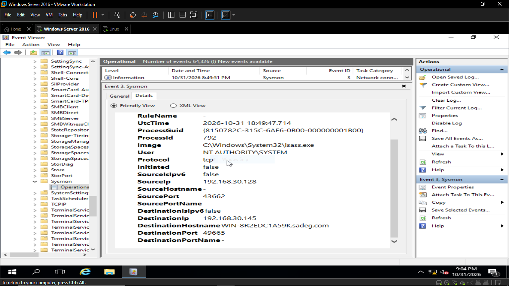

### 7.2 In Splunk - the same events ingested

Filtering on the attacker IP returns **138 events** in the last 15 minutes, all concentrated in a single minute:

```spl
index=windows sourcetype="WinEventLog:Microsoft-Windows-Sysmon/Operational" EventCode=3 SourceIp="192.168.30.128" | bin _time span=1m
```

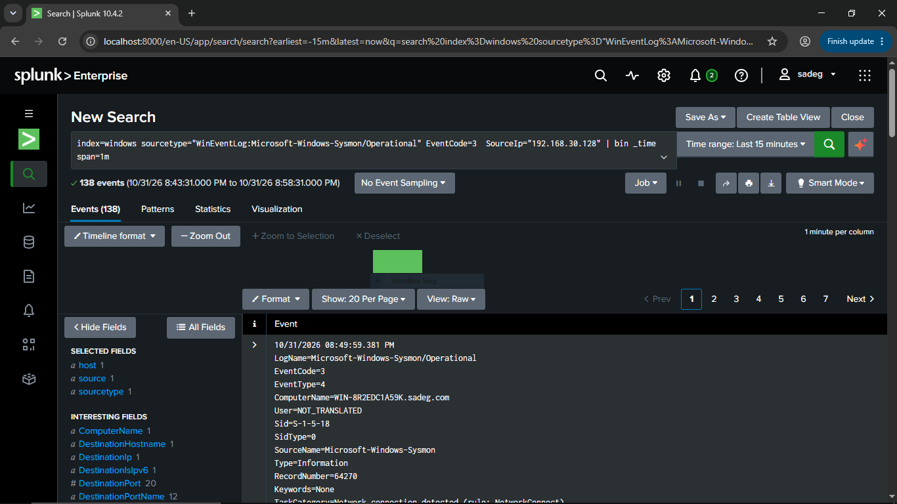

Raw event view (here the connection to port 5985 - WinRM):

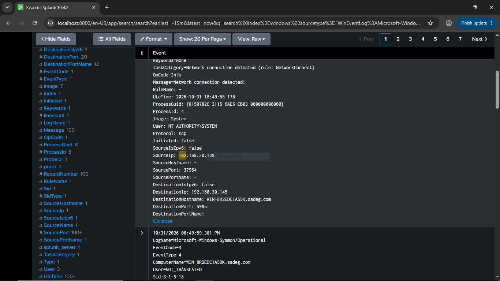

### 7.3 Detection query result

Running the detection query shows the attacker IP hitting **20 unique ports** in the 20:49 minute (`135, 139, 389, 445, 464, 593, 636, 3268, 3269, 5985, 9389, 49665-49707, 53, 88`), which matches the open ports reported by Nmap:

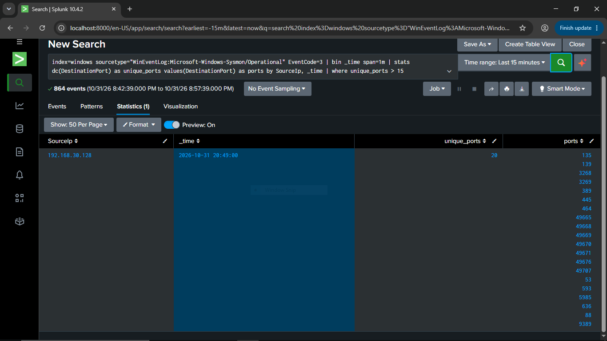

### 7.4 Alert triggered

The scheduled alert fired at **2026-10-31 20:50:18 EET** with Medium severity:

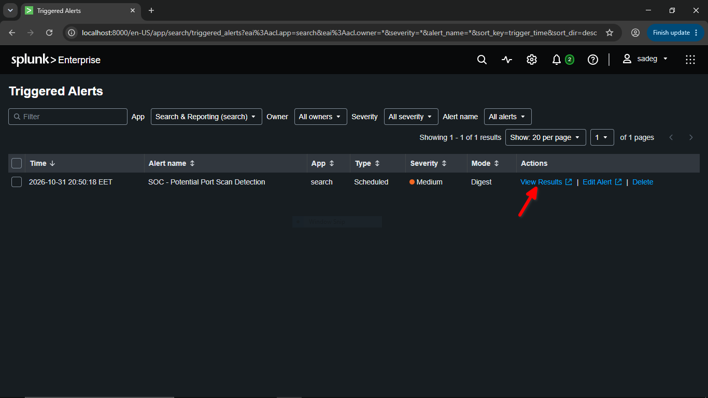

## 8. Timeline

| Time (EET) | Event |
|---|---|
| 20:45 | Alert saved and scheduled (`*/5 * * * *`) |
| 20:47 | Nmap scan started from Kali |
| ~20:49 | Burst of Sysmon Event ID 3 on the Windows Server |
| 20:49 | Splunk bucket shows 20 unique ports from `192.168.30.128` |
| 20:50:18 | **Alert "SOC - Potential Port Scan Detection" triggered** |

## 9. Analysis (Analyst Perspective)

**Indicators observed**

- Single source IP `192.168.30.128` connecting to 20 distinct ports on one host within one minute.
- Connections were inbound (`Initiated=false`) and logged against several processes (`lsass.exe`, `System`, etc.), which is expected when a scan touches different listening services.
- The ports belong to a Domain Controller service profile, so the attacker gained a clear map of the AD attack surface (Kerberos, LDAP, SMB, WinRM).

**Suggested triage steps**

1. Identify the source host and owner (authorized scanner such as a vulnerability scanner, or unknown).
2. Check whether the same source later authenticated (Event IDs 4624/4625) or connected to SMB/WinRM.
3. Look for follow-up activity on the discovered services (LDAP queries, Kerberos requests, WinRM sessions).
4. If unauthorized: isolate or block the source and escalate.


## 10. Lessons Learned

- Sysmon Event ID 3 is a useful source for detecting network reconnaissance on endpoints.
- `stats dc()` combined with `bin _time` is a simple and effective pattern for volume-based detections.
- Testing a rule with a real attack simulation is the only way to confirm that logging, ingestion, the query, and the alert pipeline all work together.

> **Disclaimer:** All activity was performed in an isolated home lab on systems I own, for educational purposes only.
