# Detecting SMB Brute Force with Splunk (Windows Event 4625)

A hands-on detection engineering lab: simulate an SMB password-guessing attack from Kali Linux against a Windows Server 2016 host, then build, schedule, and validate a Splunk alert that catches it.

| | |
|---|---|
| **Detection** | Password Spray / Brute Force Detected |
| **MITRE ATT&CK** | [T1110 – Brute Force](https://attack.mitre.org/techniques/T1110/) |
| **Data source** | Windows Security log – Event ID 4625 (An account failed to log on) |
| **SIEM** | Splunk Enterprise 10.4.2 |
| **Severity** | High |

---

## 1. Lab Environment

| Role | Host | IP |
|---|---|---|
| Attacker | Kali Linux (VMware Workstation) | `192.168.30.128` |
| Victim / log source | Windows Server 2016 (`WIN-8R2EDC1A59K.sadeg.com`) | `192.168.30.145` |
| SIEM | Splunk Enterprise (localhost:8000), index `windows` | – |

Prerequisite on the Windows host: enable auditing for **Logon** failures so that Event 4625 is generated, and forward the Security log to Splunk (`sourcetype=WinEventLog:Security`).

## 5. Alert Configuration

Created from **Settings → Searches, Reports, and Alerts → New Alert**.

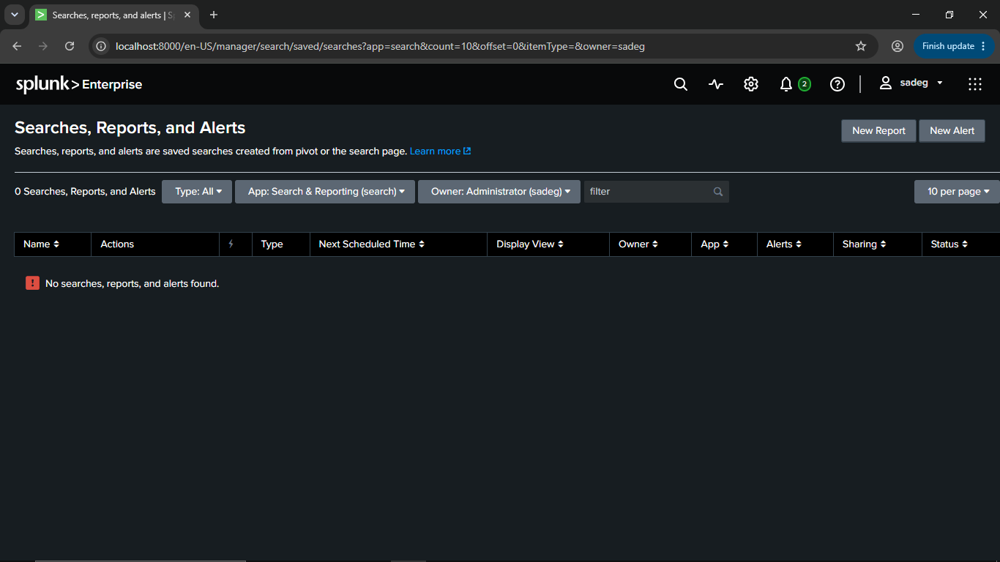

| Setting | Value |
|---|---|
| Title | Password Spray / Brute Force Detected |
| Description | Multiple failed logon attempts from single source (T1110) |
| Permissions | Shared in App |
| Alert type | Scheduled – Run on Cron Schedule |
| Cron expression | `*/5 * * * *` (every 5 minutes) |
| Time range | Last 15 minutes |
| Expires | 24 hours |
| Trigger condition | Number of Results is greater than 0 |
| Trigger | For each result |
| Throttle | Suppress for 2 minutes |
| Action | Add to Triggered Alerts – Severity: **High** |


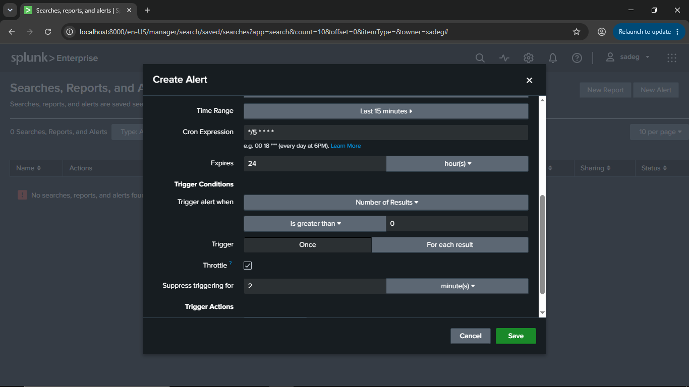
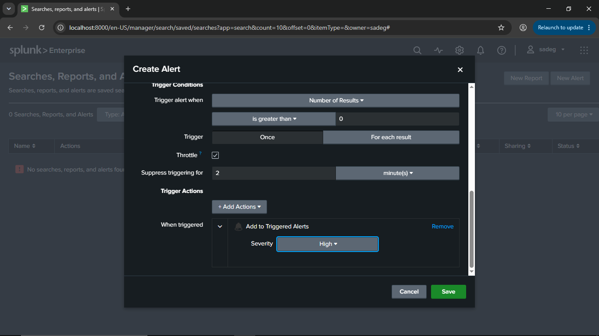

After saving, the alert appears in the saved searches list as **Enabled**:

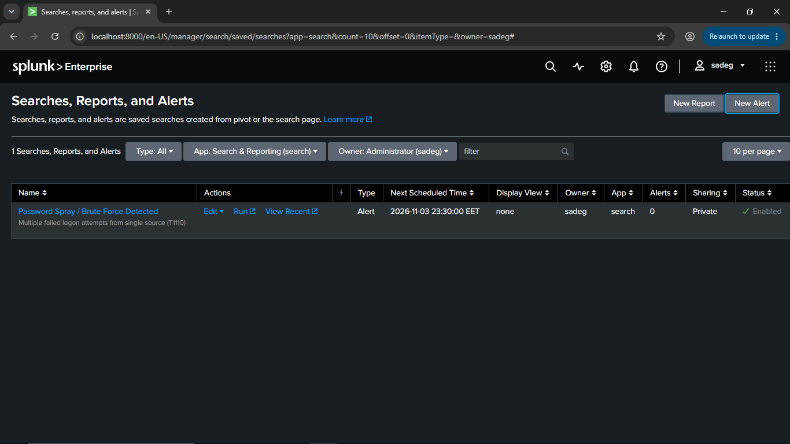

---

## 2. Attack Simulation

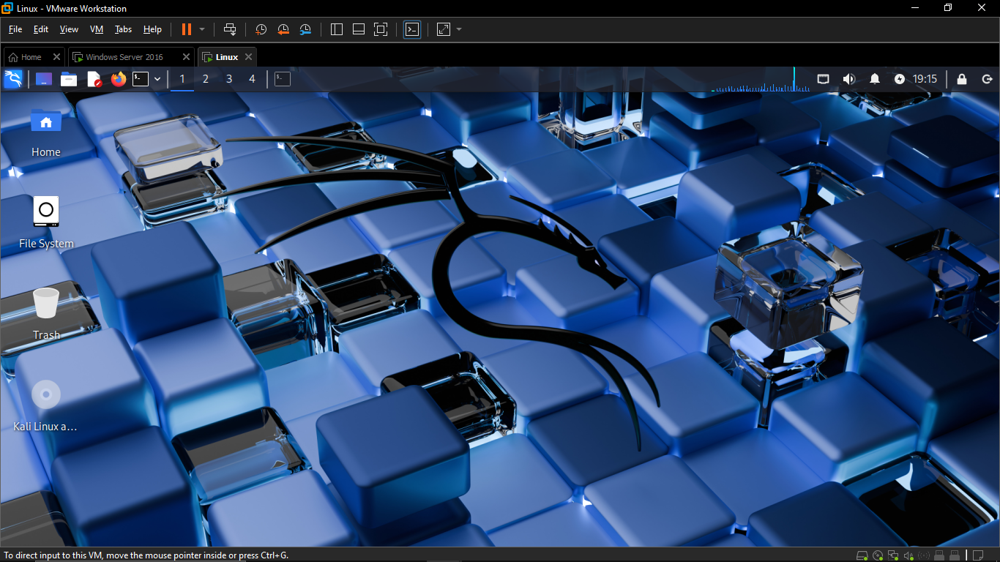

From the Kali machine, [Hydra](https://github.com/vanhauser-thc/thc-hydra) was used to guess the `Administrator` password over SMB using a wordlist (`password.txt`):

```bash
hydra -l Administrator -P password.txt smb://192.168.30.145
```

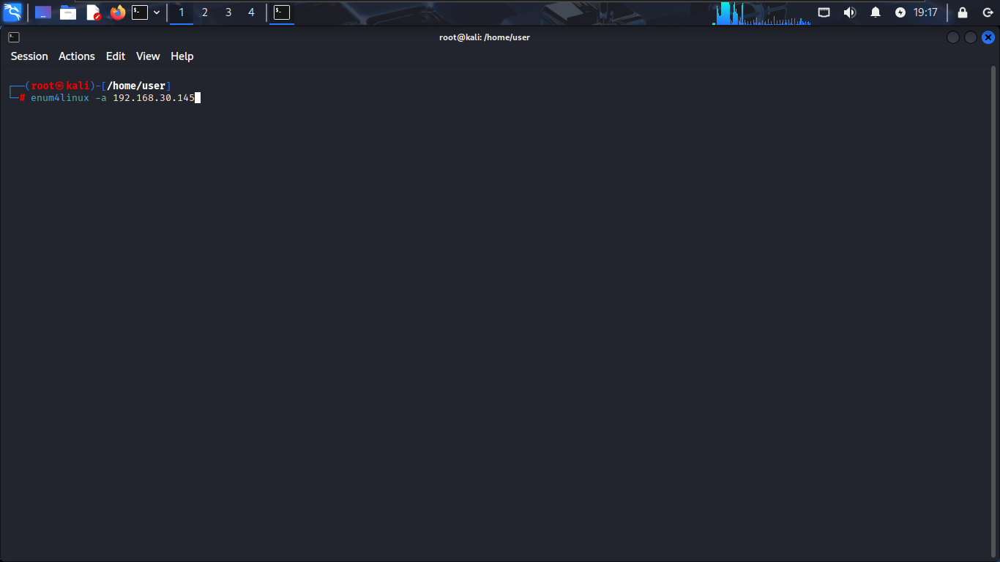

> ⚠️ Run this only in your own isolated lab or on systems you are authorized to test.

---

## 6. Alert Triage

After running the attack, the alert fired at **2026-11-03 23:30:02** and appeared under **Activity → Triggered Alerts** with **High** severity. **View Results** opens the underlying events for investigation.


## 4. Detection Logic

Hydra fires many logon attempts quickly. The detection groups failed logons into 5-minute windows per source IP and counts the failures and the distinct account names tried.

```spl
index=windows sourcetype="WinEventLog:Security" EventCode=4625
| bin _time span=5m
| stats count as failures, dc(Account_Name) as accounts_tried by _time, Source_Network_Address
| where failures > 5
```

**Validation:** running the search over the attack window returned a hit.

| _time | Source_Network_Address | failures | accounts_tried |
|---|---|---|---|
| 2026-11-03 23:25:00 | 192.168.30.128 | 21 | 2 |

21 failed logons from a single source within one 5-minute window.

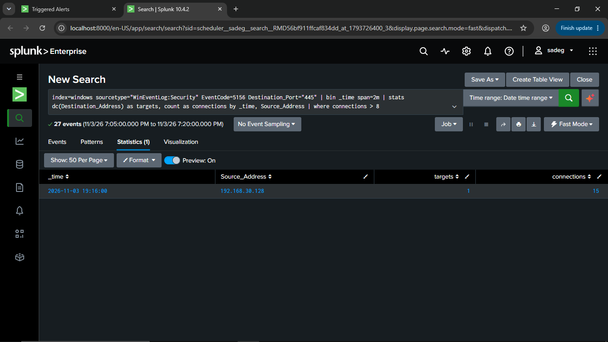


## 3. Log Analysis

Every failed attempt generates a **Event 4625** on the server. Filtering on the attacker's IP returned **21 events** within about a minute:

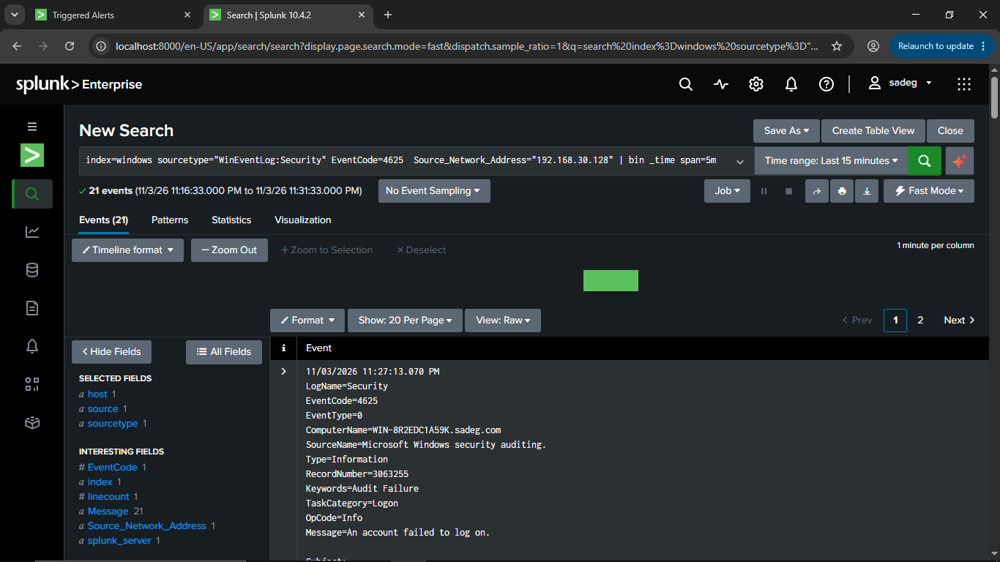

Looking at a single event:

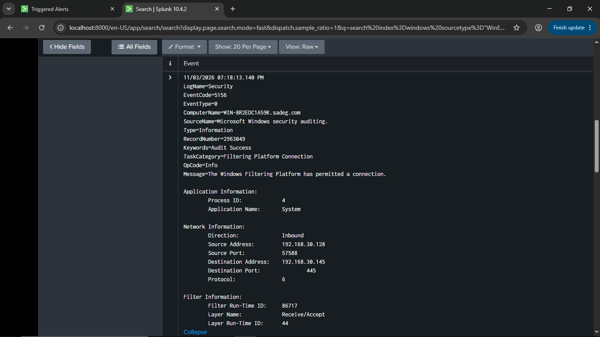

Key fields in the event:

| Field | Value | Meaning |
|---|---|---|
| EventCode | 4625 | Failed logon |
| Logon Type | 3 | Network logon (SMB) |
| Account Name | Administrator | Targeted account |
| Failure Reason / Status | Unknown user name or bad password / `0xC000006D` | Logon failure |
| Sub Status | `0xC000006A` | Wrong password for an existing account |
| Source Network Address | 192.168.30.128 | Attacker |
| Workstation Name | `\\192.168.30.128` | Origin of the request |
| Authentication Package | NTLM (`NtLmSsp`) | Protocol used |

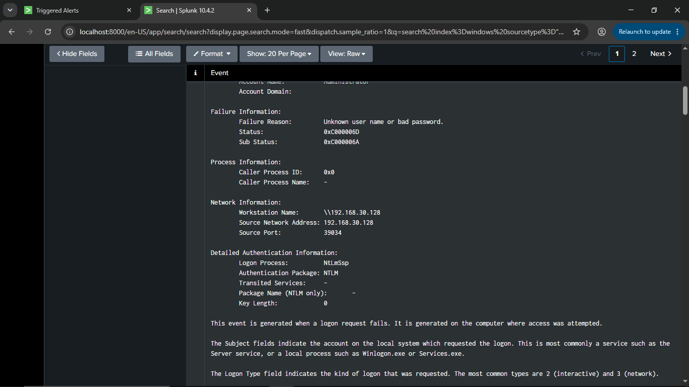
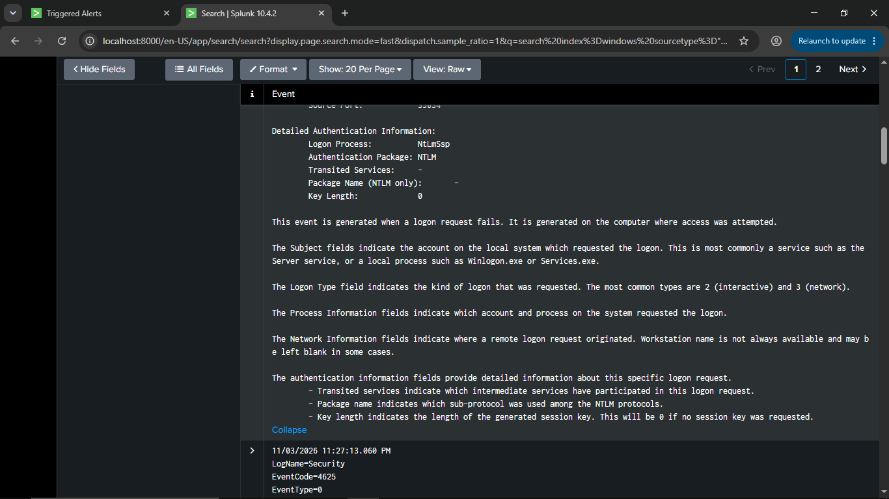

---

**Suggested analyst steps:**
1. Identify the source (`192.168.30.128`): known host, scanner, or unknown?
2. Check the targeted account(s) and whether any **4624** (successful logon) from the same source follows the failures. A success after many failures means likely compromise.
3. Look for lockouts (**4740**) and for activity from the same source on other hosts.
4. If malicious: block the source, reset the targeted account's password, and review what the account accessed.

---

## 9. Skills Demonstrated

Detection engineering · SPL · Windows event analysis · MITRE ATT&CK mapping · Alert tuning · SOC triage
