# Detecting SMB Enumeration with Splunk (Windows Event 5156)

A hands-on detection engineering lab: simulate SMB/RPC enumeration from a Kali Linux machine against a Windows Server 2016 host, then build, schedule, and validate a Splunk alert that catches it.

| | |
|---|---|
| **Detection** | SMB Enumeration Detected |
| **MITRE ATT&CK** | [T1135 – Network Share Discovery](https://attack.mitre.org/techniques/T1135/), [T1087 – Account Discovery](https://attack.mitre.org/techniques/T1087/) |
| **Data source** | Windows Security log – Event ID 5156 (Windows Filtering Platform permitted a connection) |
| **SIEM** | Splunk Enterprise 10.4.2 |
| **Severity** | Medium |

---

## 1. Lab Environment

| Role | Host | IP |
|---|---|---|
| Attacker | Kali Linux (VMware Workstation) | `192.168.30.128` |
| Victim / log source | Windows Server 2016 (`WIN-8R2EDC1A59K.sadeg.com`) | `192.168.30.145` |
| SIEM | Splunk Enterprise (localhost:8000), index `windows` | – |

Prerequisite on the Windows host: enable auditing for **Filtering Platform Connection** (Success) so that Event 5156 is generated, and forward the Security log to Splunk (`sourcetype=WinEventLog:Security`).

## 2. Alert Configuration

Created from **Settings → Searches, Reports, and Alerts → New Alert**.

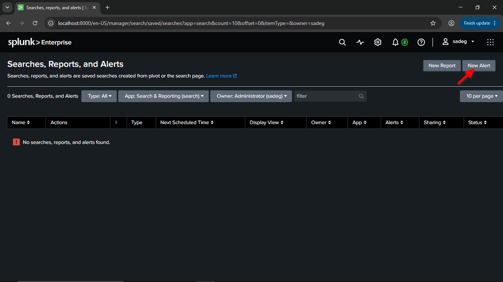

| Setting | Value |
|---|---|
| Title | SMB Enumeration Detected |
| Description | Multiple SMB (445) connections from single source - possible enumeration (T1135/T1087) |
| Permissions | Shared in App |
| Alert type | Scheduled – Run on Cron Schedule |
| Cron expression | `*/5 * * * *` (every 5 minutes) |
| Time range | Last 15 minutes |
| Expires | 24 hours |
| Trigger condition | Number of Results is greater than 0 |
| Trigger | For each result |
| Throttle | Suppress for 5 minutes |
| Action | Add to Triggered Alerts – Severity: Medium |


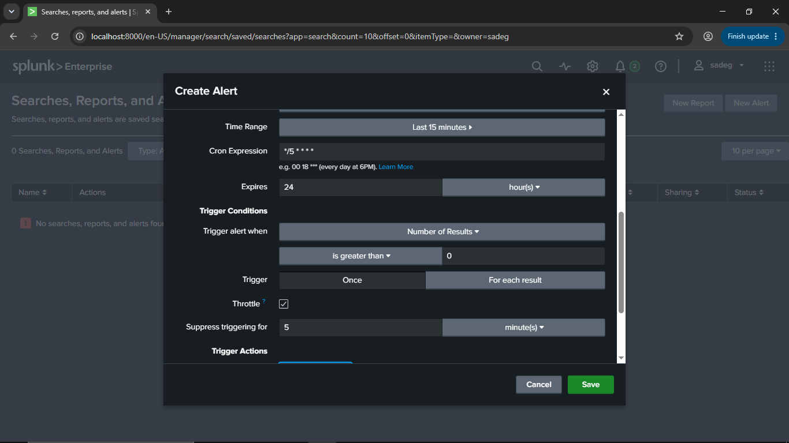
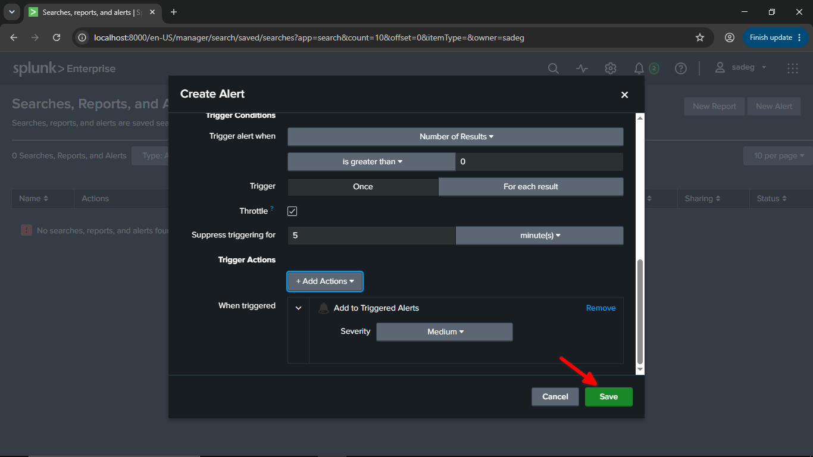

After saving, the alert appears in the saved searches list as **Enabled**:

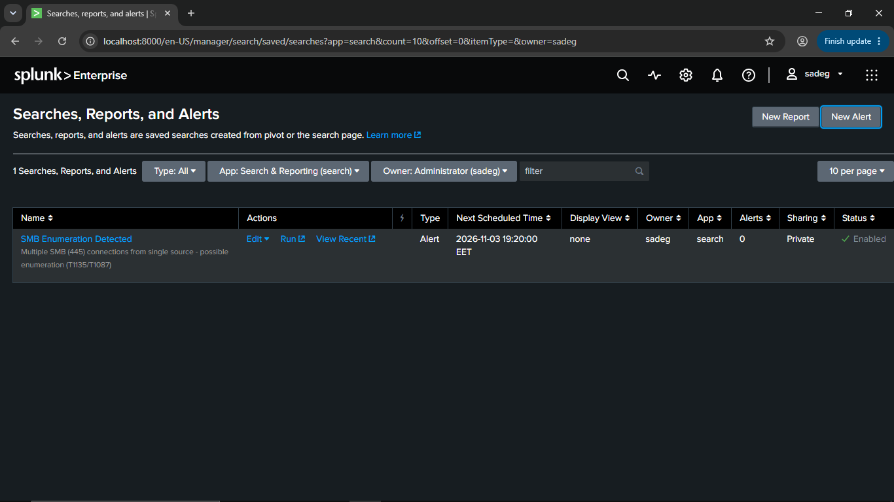

---

## 3. Attack Simulation

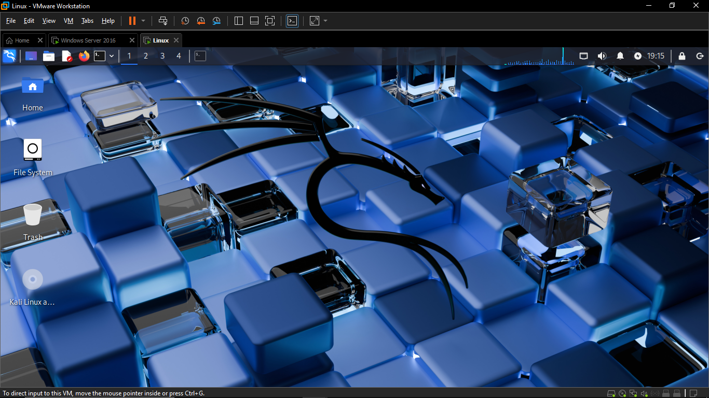

From the Kali machine, three common enumeration tools were run against the Windows server over SMB/RPC (port 445), using null sessions:

**enum4linux** – full enumeration
```bash
enum4linux -a 192.168.30.145
```
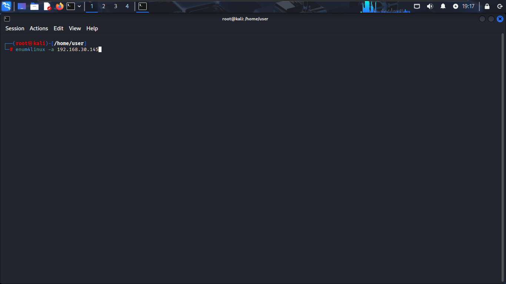

**smbclient** – list available shares
```bash
smbclient -L //192.168.30.145/ -N
```
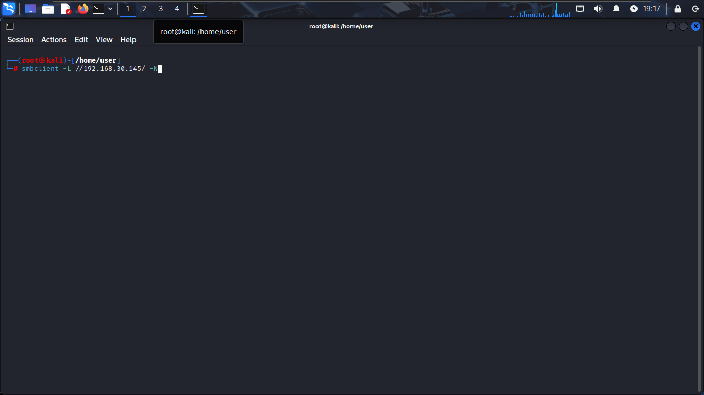

**rpcclient** – enumerate domain users
```bash
rpcclient -U "" -N 192.168.30.145 -c "enumdomusers"
```
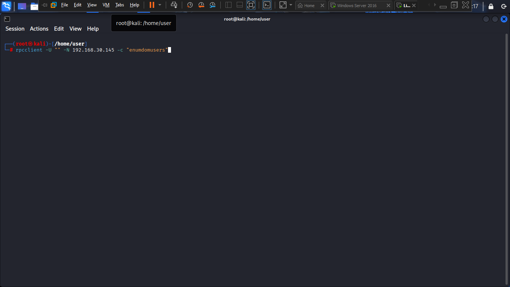

> ⚠️ Run these only in your own isolated lab or on systems you are authorized to test.

---

## 4. Alert Triage

After re-running the attack, the alert fired at **2026-11-03 19:20:01** and appeared under **Activity → Triggered Alerts** with Medium severity. From there, **View Results** opens the underlying events for investigation.

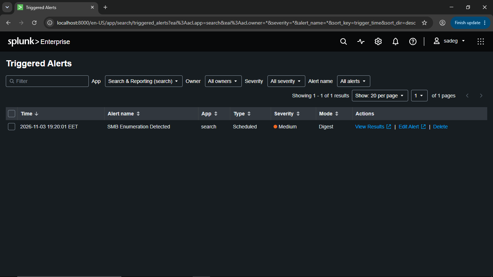


## 5. Detection Logic

The tools above open many short-lived SMB connections in a short time. The detection groups 445 connections into 2-minute windows per source IP and flags any source exceeding 8 connections.

```spl
index=windows sourcetype="WinEventLog:Security" EventCode=5156 Destination_Port="445"
| bin _time span=2m
| stats dc(Destination_Address) as targets, count as connections by _time, Source_Address
| where connections > 8
```

**Validation:** running the search over the attack window returned a hit.

| _time | Source_Address | targets | connections |
|---|---|---|---|
| 2026-11-03 19:16:00 | 192.168.30.128 | 1 | 15 |

15 SMB connections from a single source in 2 minutes, well above the threshold of 8.

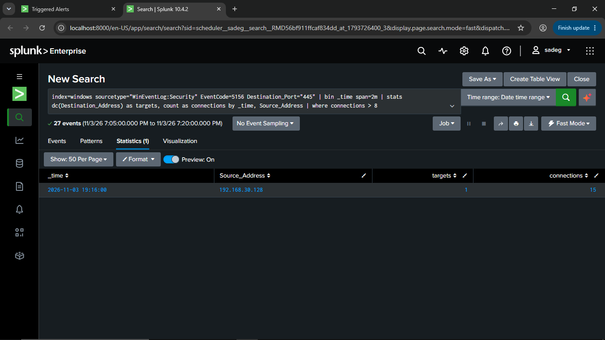


## 6. Log Analysis

Each connection attempt generates a Windows **Event 5156** on the server. The raw events show inbound traffic from the attacker (`192.168.30.128`) to the server (`192.168.30.145`) on destination port **445**, with a new ephemeral source port for every connection:

| Time | Source Port | Screenshot |
|---|---|---|
| 07:18:13 PM | 57588 | 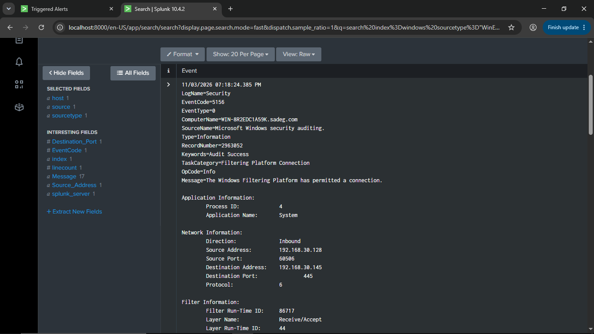 |
| 07:18:24 PM | 60506 | 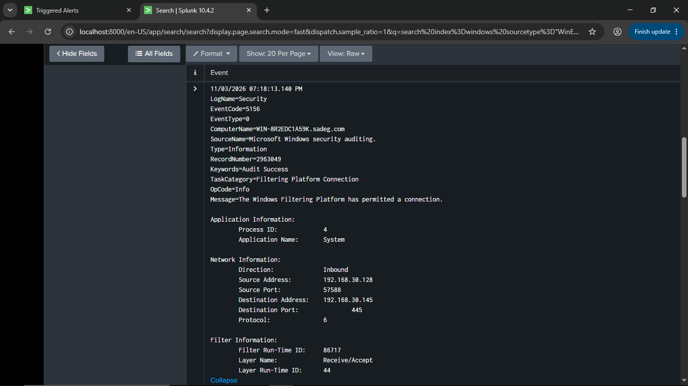 |


---

**Suggested analyst steps:**
1. Identify the source host (`192.168.30.128`) and check whether it is a known scanner or admin workstation.
2. Review what the source touched on the target (shares, RPC calls) and any authentication events (4624/4625/4776) around the same time.
3. Check whether the source later authenticated successfully or accessed files.
4. If malicious, isolate the host and reset exposed credentials.

---

## 7. Skills Demonstrated

Detection engineering · SPL · Windows event analysis · MITRE ATT&CK mapping · Alert tuning · SOC triage
