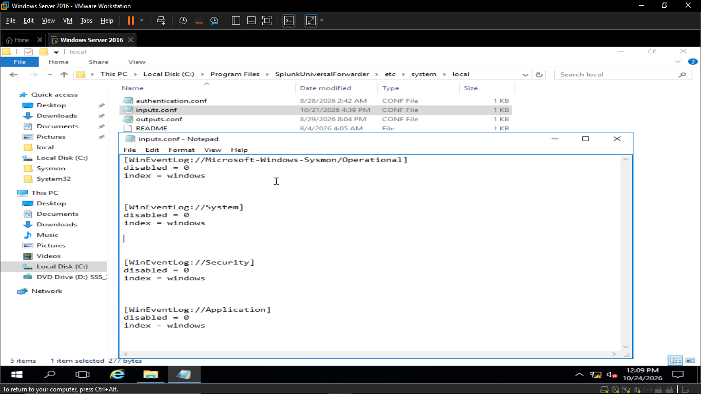
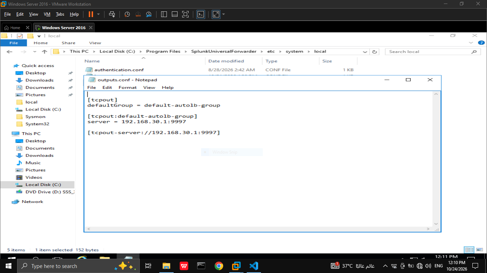
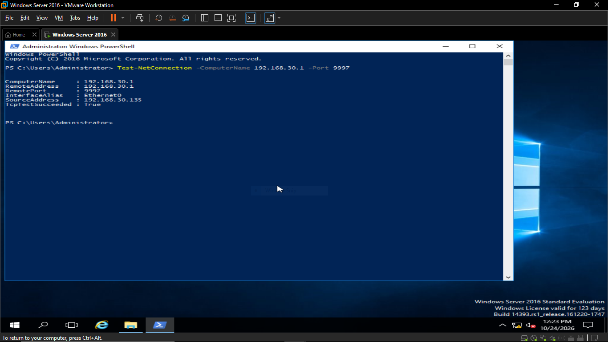

# Splunk Universal Forwarder Setup

This document covers installing and configuring the Splunk Universal Forwarder (UF) on Windows Server 2016 to ship logs (Windows Event Logs + Sysmon logs) to Splunk Enterprise.

## 1. Purpose of the Universal Forwarder
The Splunk Universal Forwarder (UF) is a lightweight agent installed on the monitored machine (Windows Server 2016 in this lab). Its only job is to collect local data — in this case Windows Event Logs and Sysmon logs — and forward it to the Splunk Enterprise indexer over the network (port 9997). Unlike Splunk Enterprise, the UF does not parse, index, or let you search data locally; it simply reads the logs and ships them, which keeps resource usage on the monitored machine minimal. This makes it the standard way to get endpoint telemetry from a victim machine into a central SIEM in a SOC environment.

## 2. Version Installed
- Universal Forwarder version: `10.4.2`
- Downloaded from the official Splunk site: [Splunk Universal Forwarder 10.4.2 (Windows x64)](https://download.splunk.com/products/universalforwarder/releases/10.4.2/windows/splunkforwarder-10.4.2-33c3bf42cd73-windows-x64.msi) — installed on Windows Server 2016.

## 3. Installation Steps
- Installed using the GUI installer.
- During setup, entered the receiving host IP and port for Splunk Enterprise: `192.168.30.1:9997`.
- Configured the local account used to run the Universal Forwarder service during installation.

## 4. Configuring Data Inputs
- Logs configured to be forwarded:
  - Windows Event Logs (Security, System, Application)
  - Sysmon Operational log (Microsoft-Windows-Sysmon/Operational)
- These inputs were configured in the `inputs.conf` file.
- By default, Splunk forwards Windows Event Log data in XML format (producing sourcetypes like `XmlWinEventLog:...`). In this lab, `renderXml = false` was set globally across all input stanzas in `inputs.conf`, so every forwarded log (Security, System, Application, and Sysmon Operational) is sent in plain, non-XML format instead — hence the `WinEventLog:...` sourcetypes shown in Section 7.

## 5. Configuring Output (Forwarding Destination)
- Configured in `outputs.conf` to forward data to the Splunk Enterprise indexer at `192.168.30.1:9997`.

## 6. Verifying Data Is Being Received
- Verified network connectivity between the Universal Forwarder and Splunk Enterprise using PowerShell (`Test-NetConnection`), confirming the connection was successful.

- Ran `index=windows | stats count by sourcetype | sort - count` in Splunk Search, which returned the expected sourcetypes, confirming data was being received and indexed correctly.

## 7. Sourcetypes Observed
- `WinEventLog:Microsoft-Windows-Sysmon/Operational`
- `WinEventLog:Security`
- `WinEventLog:Application`
- `WinEventLog:System`

## 8. Next Step Reference
- Continue to [sysmon-installation.md](sysmon-installation.md) for details on the Sysmon configuration generating the events forwarded above.
