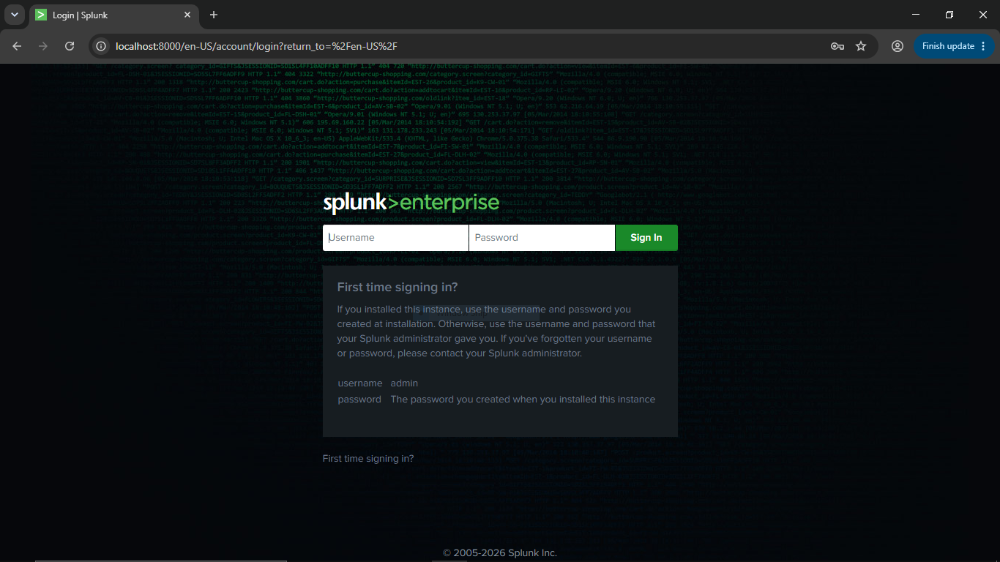
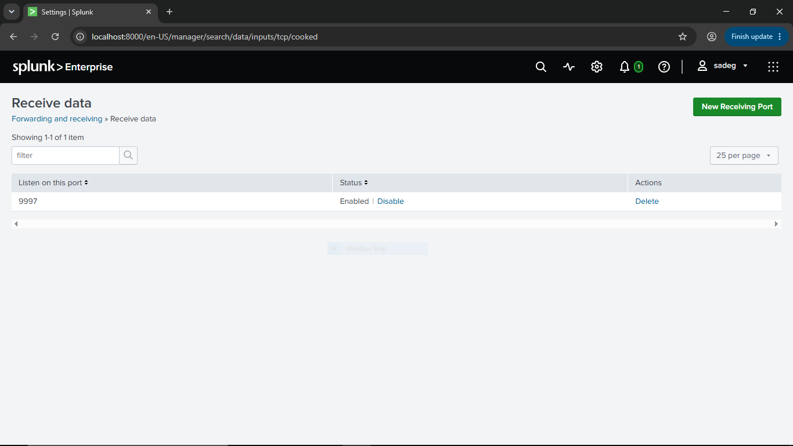

# Splunk Enterprise Installation & Configuration

This document covers the installation and initial configuration of Splunk Enterprise as the central SIEM server for this SOC Home Lab.

## 1. Environment Details
- Host OS: Windows 10 Home (the physical host machine running VMware, where Splunk Enterprise itself is installed natively — not inside a VM)
- Splunk Enterprise version: 10.4.2
- Network: Host-Only network (VMnet) — subnet `192.168.30.0/24`

## 2. Prerequisites
- Verified system requirements (RAM/CPU) against Splunk's official documentation before installing.
- OS-level preparation: Disabled the Windows Firewall on the host machine to allow the connection with the Splunk Forwarder.
- Created a Splunk account on splunk.com to download the installer, and selected the **Free** license.

## 3. Download & Installation
- Downloaded Splunk Enterprise from the official Splunk website: [Splunk Enterprise 10.4.2 (Windows x64)](http://download.splunk.com/products/splunk/releases/10.4.2/windows/splunk-10.4.2-33c3bf42cd73-windows-x64.msi)
- Ran the `.msi` installer and completed the setup wizard.
- After installation finished, logged into Splunk Web through a browser (Chrome) at `http://localhost:8000`.

## 4. Initial Configuration
- Completed the first login and initial setup screen in Splunk Web.

## 5. Receiving Configuration (for Forwarders)
- Enabled the receiving port (9997) under **Settings > Forwarding and receiving > Configure receiving**.

- The listener will be verified once the Universal Forwarder is installed on Windows Server 2016 (see [forwarder-setup.md](forwarder-setup.md).

## 6. Index Creation
- Created a custom index named `windows` to store logs coming from the Windows Server (Sysmon + Windows Event Logs), instead of using the default `main` index.

## 7. Next Step Reference
- Continue to [forwarder-setup.md](forwarder-setup.md) to configure the Universal Forwarder on Windows Server 2016.
