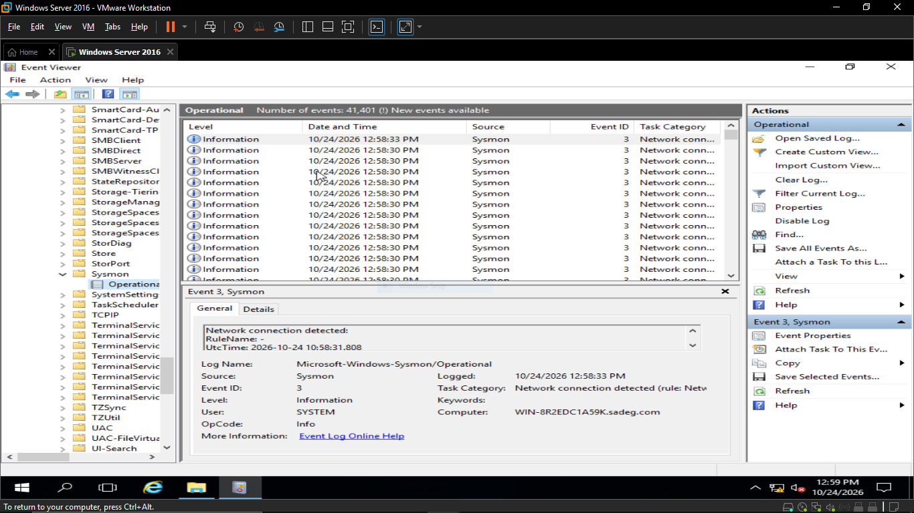

# Sysmon Installation & Configuration

This document covers installing Sysmon on Windows Server 2016 and the configuration used to control what gets logged.

## 1. What Sysmon Is and Why It's Used
Sysmon (System Monitor) is a Windows system service and device driver from Microsoft Sysinternals that logs detailed information about system activity to the Windows Event Log — including process creation with full command lines, network connections, file creation, and registry changes. Default Windows Event Logs record high-level events (such as logons or service changes) but do not capture this level of detail — for example, the native Security log can show *that* a process ran, but not its full command line, parent process, or hash. For a SOC lab focused on detecting attacker behavior (e.g., credential dumping, lateral movement, suspicious process execution), this missing detail is exactly what's needed, which is why Sysmon was installed alongside the default Windows Event Logs rather than relying on them alone.

## 2. Sysmon Version
- Version of Sysmon installed: `15.21.0.0`
- Downloaded from here: [Sysmon](https://download.sysinternals.com/files/Sysmon.zip)

## 3. Configuration File Used
- Sysmon was installed with its **default configuration** — no external/custom config file (such as SwiftOnSecurity's or Olaf Hartong's) was applied.
- This means Sysmon is logging its built-in default event set, without the extra filtering/noise-reduction rules a custom config normally provides.

## 4. Installation Steps
- Sysmon was installed from an elevated PowerShell/Command Prompt
- The exact install command: `sysmon64.exe -accepteula -i`.

## 5. Verifying Sysmon Is Running
- Confirmed the Sysmon service was active using PowerShell, by running `sc.exe query sysmon64` and `Get-Service -Name "*Sysmon*"`.

- Confirmed in Event Viewer by browsing to **Applications and Services Logs > Microsoft > Windows > Sysmon > Operational** and viewing live events.

## 6. Key Event IDs Being Logged
- Event ID 1 – Process Creation
- Event ID 3 – Network Connection
- Event ID 10 – Process Access
- Event ID 11 – File Created
- Event ID 13 – Registry Value Set

## 7. Integration with Splunk
- Confirmed Sysmon events appear correctly in Windows Event Viewer (Section 5) before forwarding.
- By default, Windows Event Log inputs are forwarded in XML format (`sourcetype=XmlWinEventLog:...`). In this lab, the Sysmon input stanza in `inputs.conf` on the Universal Forwarder was configured with `renderXml = false`, so events are forwarded in plain (non-XML) format instead.
- As a result, Sysmon events are searchable in Splunk using: `index=windows sourcetype=WinEventLog:Microsoft-Windows-Sysmon/Operational`
- This is consistent with the sourcetypes confirmed in `forwarder-setup.md`.

## 8. Next Step Reference
- Reference to [forwarder-setup.md](forwarder-setup.md) for how these logs get shipped to Splunk Enterprise.
