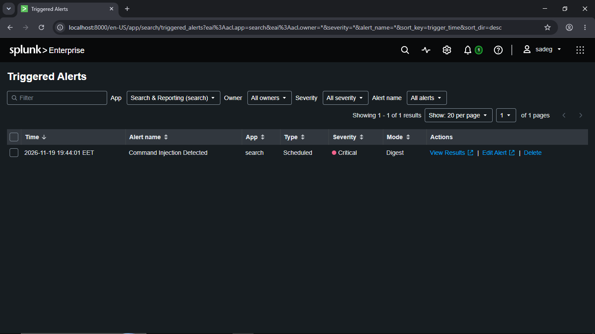
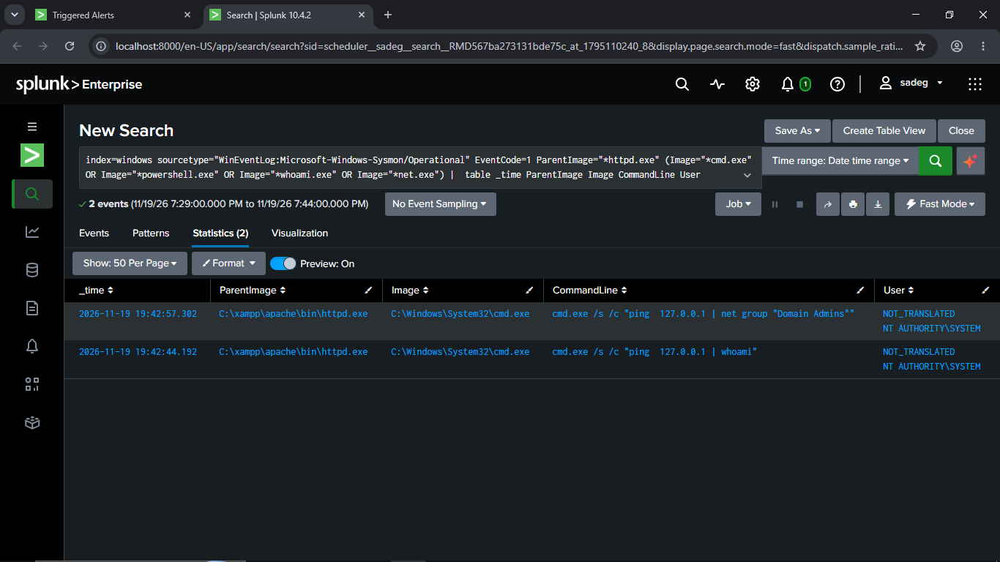
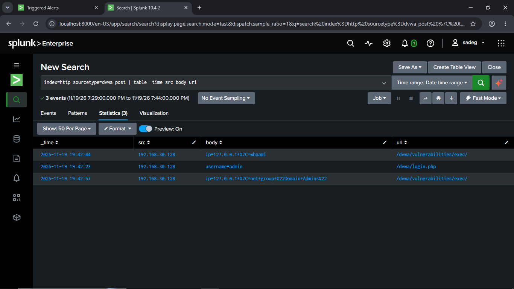
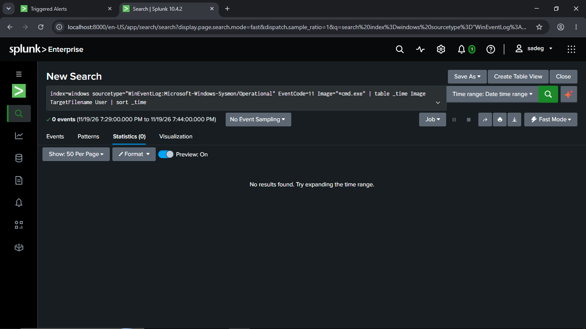

# Command Injection Scenario – Part 3: Investigation

**Analyst:** sadeg
**Alert:** Command Injection Detected (Critical)

## 1. Triggered Alert

The "Command Injection Detected" alert fired on 2026-11-19 at 19:44:01 EET, severity Critical.

## 2. Alert Results (Sysmon)

Viewing the alert results shows Apache (`httpd.exe`) spawning `cmd.exe` twice, running as **NT AUTHORITY\SYSTEM**:

| Time | CommandLine |
|---|---|
| 19:42:44 | `cmd.exe /s /c "ping 127.0.0.1 \| whoami"` |
| 19:42:57 | `cmd.exe /s /c "ping 127.0.0.1 \| net group "Domain Admins""` |

## 3. Correlating Web Logs

Searching the HTTP logs (`index=http sourcetype=dvwa_post`) confirms the same activity from the web application side, from source IP `192.168.30.128`:

This confirms the injected commands came through the DVWA Command Injection form.

## 4. Checking for File Drops

A follow-up search for file creation activity (Sysmon EventCode=11) from `cmd.exe` returned no results, indicating the attacker only ran recon commands and did not drop any files.

## 5. Conclusion

| Item | Finding |
|---|---|
| Root cause | Command Injection in DVWA "Ping a device" form |
| Attacker IP | 192.168.30.128 |
| Privilege level | NT AUTHORITY\SYSTEM |
| Commands run | `whoami`, `net group "Domain Admins"` |
| Impact | Reconnaissance only, no persistence/file drop detected |

