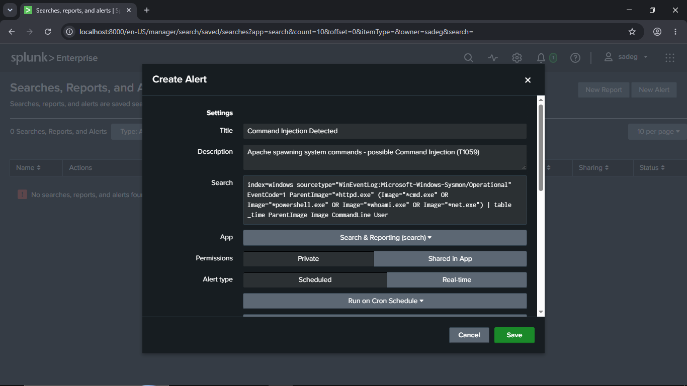
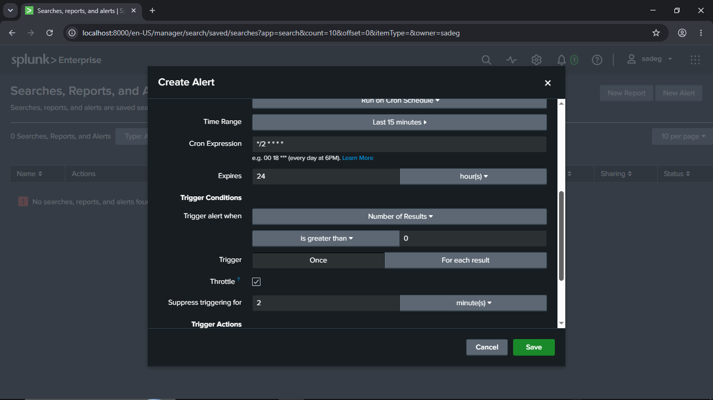
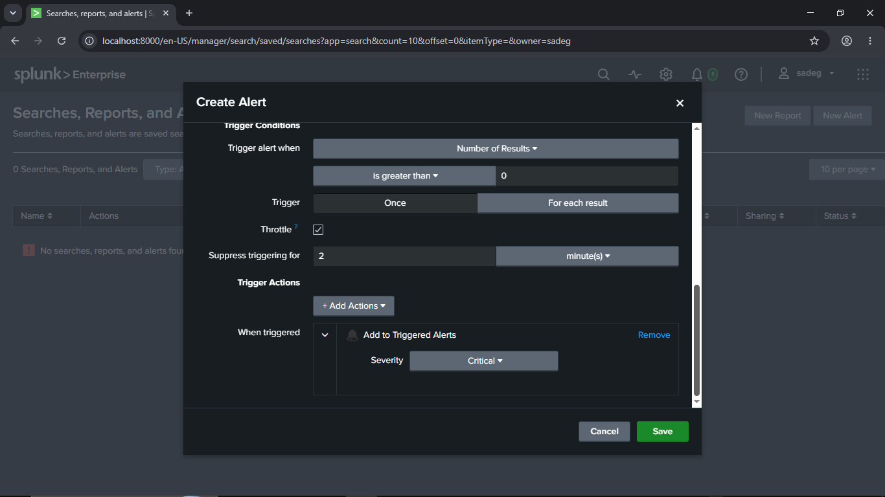
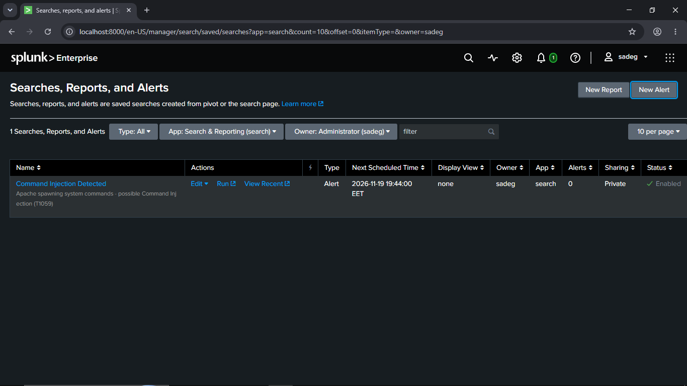

# Command Injection Scenario (DVWA on Windows Server) – Part 1: Splunk Alert

| | |
|---|---|
| **Document** | 1 of 3 (Splunk Alert → Attacker → Investigation) |
| **Attack type** | Web attack – OS Command Injection |
| **Platform** | Splunk Enterprise (Search & Reporting app) |
| **Owner** | sadeg (Administrator) |
| **MITRE ATT&CK** | T1059 – Command and Scripting Interpreter |

---

## 1. Overview

This document covers the detection layer of the command injection scenario. DVWA (Damn Vulnerable Web Application) is hosted on a Windows Server running Apache. Before any attack is launched, a Splunk alert is created to detect command injection against the web application.

The alert looks for the Apache web server process (`httpd.exe`) spawning system command interpreters or reconnaissance utilities. This is a strong indicator that user input was passed to the operating system shell.


## 2. Objective

Detect command injection against DVWA in near real time by monitoring Sysmon process creation events where the parent process is Apache (`httpd.exe`) and the child process is a command shell or a common discovery tool.

## 3. Environment

| Component | Details |
|---|---|
| Vulnerable application | DVWA (Command Injection module) |
| Web server host | Windows Server (Apache, `httpd.exe`) |
| Log source | Sysmon (`WinEventLog:Microsoft-Windows-Sysmon/Operational`) |
| Splunk index | `windows` |
| SIEM | Splunk Enterprise (local instance, `localhost:8000`) |
| App | Search & Reporting (`search`) |


## 4. Detection Logic

The alert is based on the following SPL query:

```spl
index=windows sourcetype="WinEventLog:Microsoft-Windows-Sysmon/Operational" EventCode=1 ParentImage="*httpd.exe" (Image="*cmd.exe" OR Image="*powershell.exe" OR Image="*whoami.exe" OR Image="*net.exe") | table _time ParentImage Image CommandLine User
```

| Part of the query | Purpose |
|---|---|
| `index=windows` | Searches the index that holds the Windows and Sysmon logs. |
| `sourcetype="WinEventLog:Microsoft-Windows-Sysmon/Operational"` | Limits results to Sysmon events. |
| `EventCode=1` | Sysmon Event ID 1 – Process Creation. |
| `ParentImage="*httpd.exe"` | The parent process is Apache. A web server normally does not launch shells. |
| `Image="*cmd.exe" OR "*powershell.exe" OR "*whoami.exe" OR "*net.exe"` | The child process is a command interpreter or a common post-exploitation discovery tool. |
| `table _time ParentImage Image CommandLine User` | Shows only the fields an analyst needs: when it happened, the process chain, the exact command, and the account used. |

**Why this works:** when DVWA's command injection vulnerability is exploited, the injected command is executed by the web server process. Sysmon records this as `httpd.exe` creating a child process such as `cmd.exe` or `whoami.exe`, which is rarely seen in legitimate activity.

## 5. Alert Configuration

### 5.1 General Settings

| Setting | Value |
|---|---|
| Title | Command Injection Detected |
| Description | Apache spawning system commands - possible Command Injection (T1059) |
| App | Search & Reporting (search) |
| Permissions | Private |
| Alert type | Scheduled |
| Schedule | Run on Cron Schedule |



*Figure 2 – Create Alert: title, description, search, and alert type.*

### 5.2 Schedule and Time Range

| Setting | Value | Meaning |
|---|---|---|
| Time Range | Last 15 minutes | Each run searches the most recent 15 minutes of data. |
| Cron Expression | `*/2 * * * *` | The search runs every 2 minutes. |
| Expires | 24 hours | Triggered alert records are kept for 24 hours. |



*Figure 3 – Create Alert: time range, cron expression, and expiration.*

### 5.3 Trigger Conditions

| Setting | Value | Meaning |
|---|---|---|
| Trigger alert when | Number of Results is greater than 0 | Any matching event fires the alert. |
| Trigger | For each result | A separate alert is raised for every matching event. |
| Throttle | Enabled | Limits repeated triggers. |
| Suppress triggering for | 2 minutes | Prevents duplicate alerts for the same results within the window. |

### 5.4 Trigger Actions

| Action | Setting |
|---|---|
| Add to Triggered Alerts | Severity: **Critical** |



*Figure 4 – Create Alert: trigger conditions, throttling, and trigger action.*

## 6. Verification



The alert counter of 0 is the expected baseline: no malicious activity has been generated yet, and the alert is enabled and scheduled to run every 2 minutes.


*Figure 5 – "Command Injection Detected" alert saved and enabled.*


