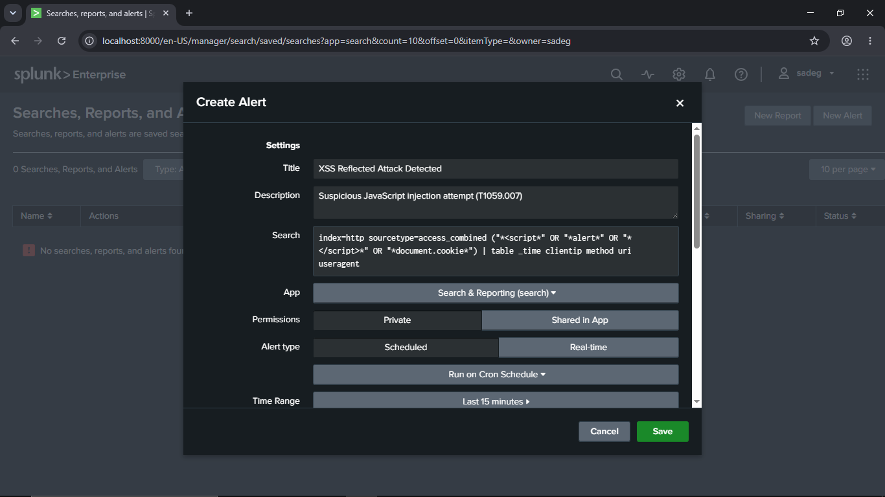
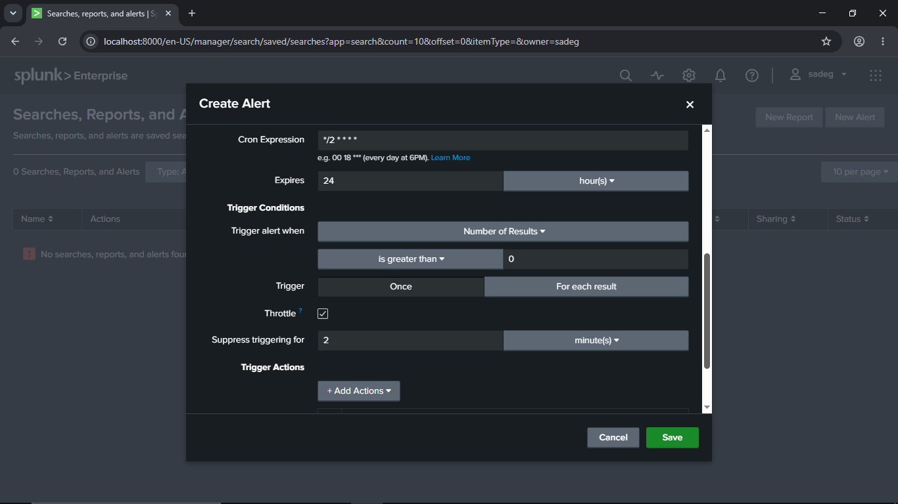
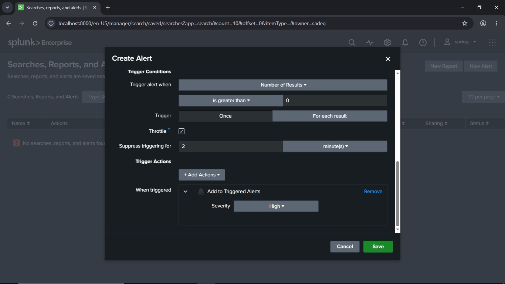
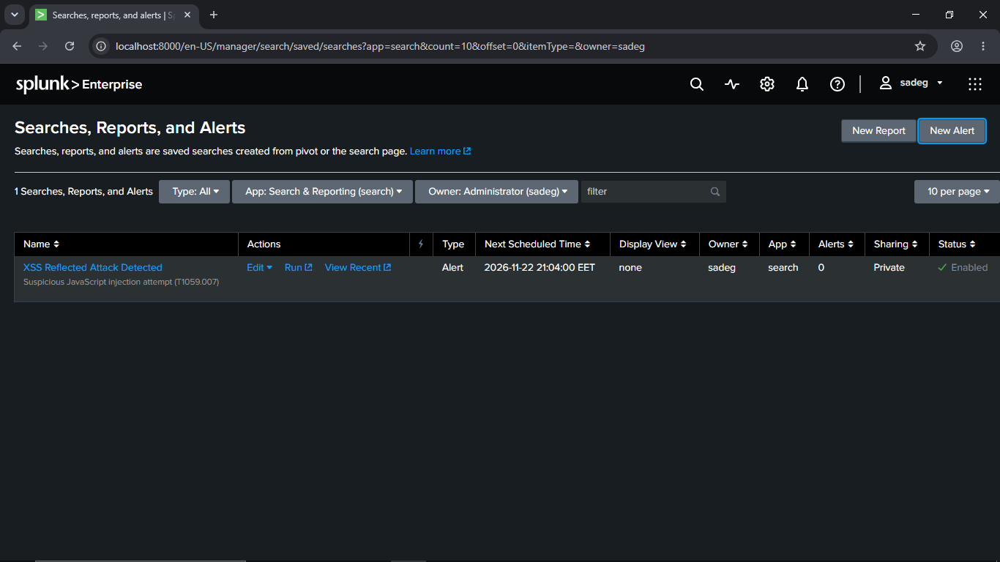

# Splunk Alert: Reflected XSS Attack Detection

**Scenario:** Reflected Cross-Site Scripting (XSS)
**Platform:** Splunk Enterprise (`localhost:8000`)
**Owner:** `sadeg`
**App:** Search & Reporting (`search`)

---

## 1. Objective

Create a scheduled Splunk alert that detects Reflected XSS attempts by looking for common JavaScript injection patterns in web server access logs, and raises a **High** severity entry in *Triggered Alerts* whenever a match is found.

---

## 2. Alert Configuration 





---

## 3. Detection Search (SPL)

```spl
index=http sourcetype=access_combined ("*<script*" OR "*alert*" OR "*</script>*" OR "*document.cookie*")
| table _time clientip method uri useragent
```
---

## 4. MITRE ATT&CK Mapping

| Field | Value |
|---|---|
| **Technique** | T1059.007 - Command and Scripting Interpreter: JavaScript |
| **Tactic** | Execution |

---

## 6. Verification



