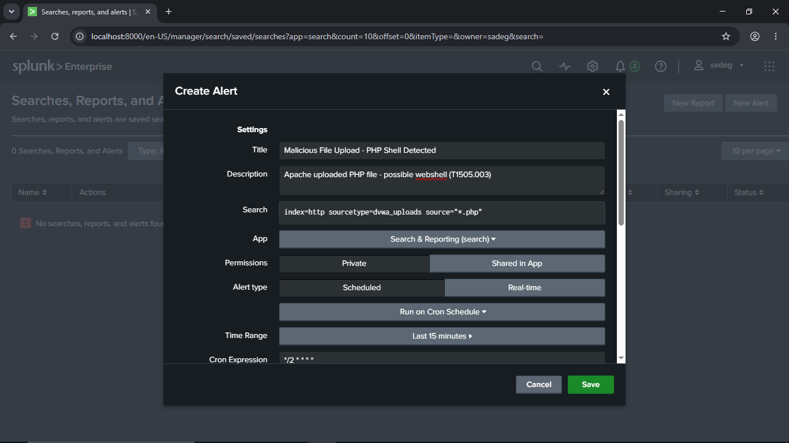
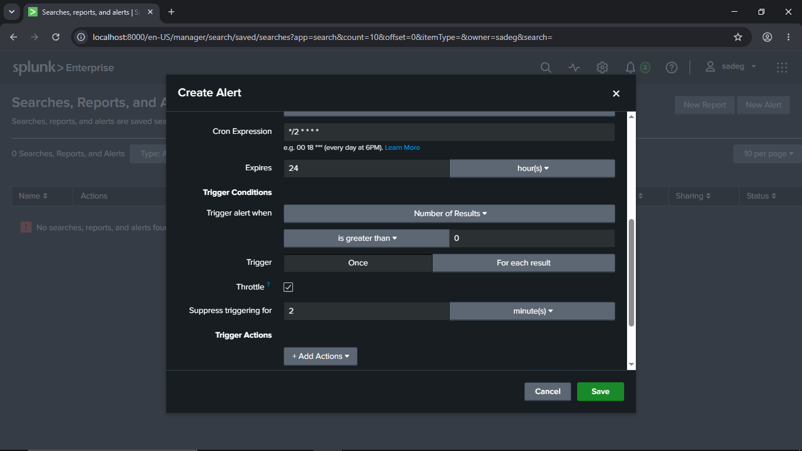
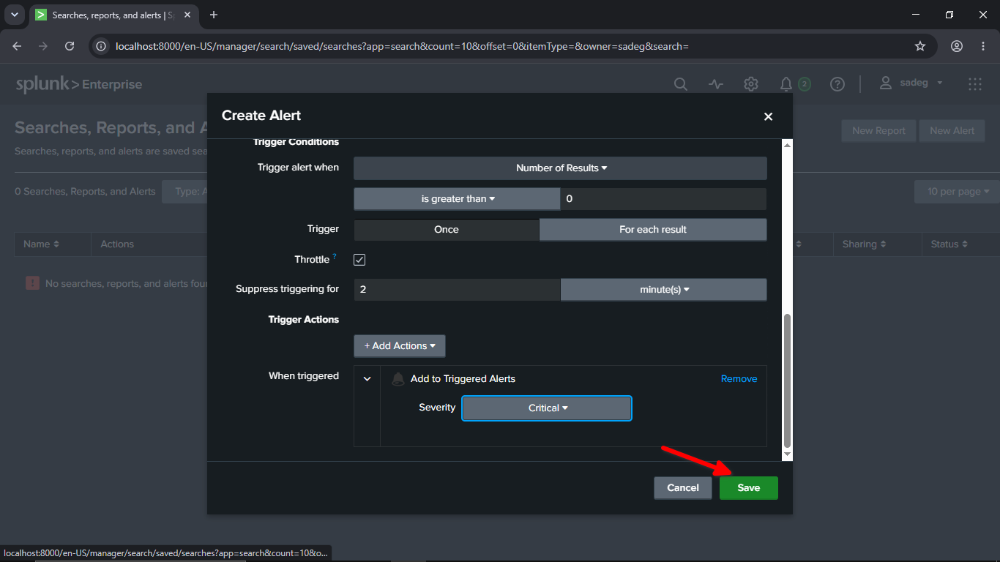
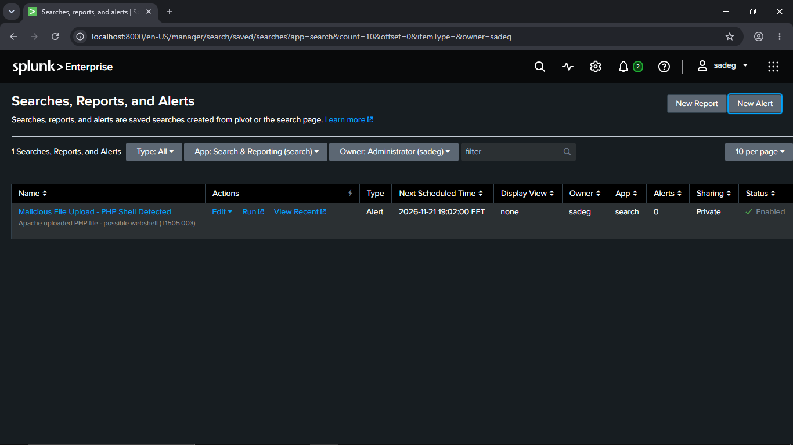

# Splunk Alert – Malicious File Upload (PHP Shell Detected)

## 1. Overview

This document describes the Splunk alert created to detect **malicious file upload attempts** against a vulnerable web application (DVWA) hosted on Apache. The alert fires when a `.php` file appears in the upload directory, which may indicate that an attacker has uploaded a **web shell**.

| Item | Value |
|------|-------|
| **Alert Name** | Malicious File Upload - PHP Shell Detected |
| **Description** | Apache uploaded PHP file - possible webshell (T1505.003) |
| **Platform** | Splunk Enterprise |
| **App** | Search & Reporting (`search`) |
| **Owner** | `sadeg` |
| **Permissions** | Private |
| **Alert Type** | Scheduled |
| **Severity** | Critical |
| **Status** | Enabled |

---

## 2. MITRE ATT&CK Mapping

| Tactic | Technique | ID |
|--------|-----------|----|
| Persistence | Server Software Component: Web Shell | [T1505.003](https://attack.mitre.org/techniques/T1505/003/) |

---

## 3. Detection Logic

### Search Query (SPL)

```spl
index=http sourcetype=dvwa_uploads source="*.php"
```

## 4. Alert Configuration

### 4.1 Settings



### 4.2 Trigger Conditions



### 4.3 Trigger Actions





---

## 5. How the Alert Works

1. Every **2 minutes**, Splunk runs the search over the **last 15 minutes** of data.
2. If **at least one** `.php` upload is found (results > 0), the alert triggers.
3. The alert is added to **Triggered Alerts** with **Critical** severity.
4. Throttling suppresses duplicate alerts for **2 minutes** to reduce noise.

---

## 6. Possible False Positives

- Administrators or developers legitimately placing `.php` files in the upload directory.
- Testing or deployment activity in a lab environment.

## 7. Recommended Response Actions

1. Identify the uploaded file name, source IP, and time of upload.
2. Check Apache access logs for requests to the uploaded file (command execution).
3. Isolate the affected host if execution is confirmed.
4. Remove the malicious file and fix the upload validation flaw.
