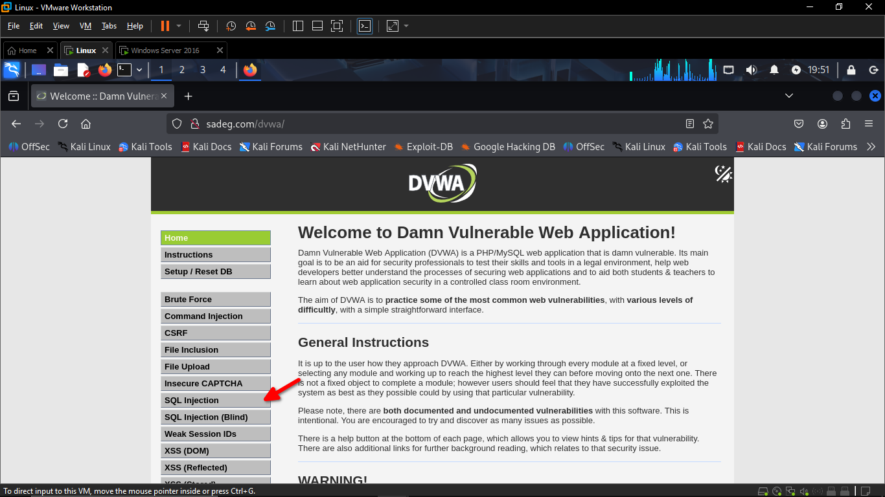
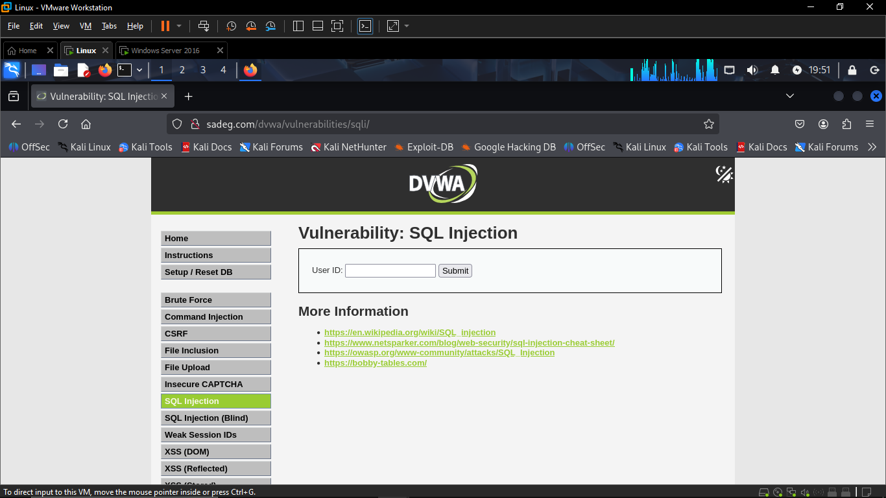
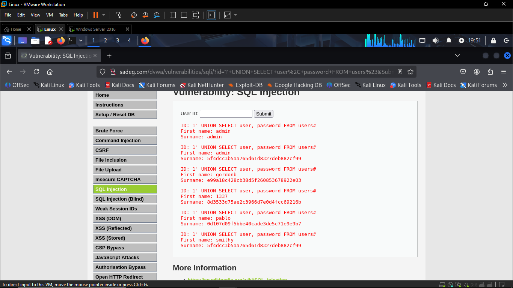

# Attacker Perspective: Exploiting SQL Injection in DVWA


## 1. Overview

This document describes the attack that triggers the Splunk alert defined in [splunk_alert.md](splunk_alert.md). The attacker uses a **Kali Linux** to exploit the **SQL Injection** module of **DVWA (Damn Vulnerable Web Application)**, a deliberately vulnerable PHP/MySQL training application, to extract usernames and password hashes directly from the `users` table.

| Field | Value |
|---|---|
| **Target application** | DVWA (Damn Vulnerable Web Application) |
| **Target URL** | `sadeg.com/dvwa/` |
| **Vulnerable module** | SQL Injection |
| **Attacker platform** | Kali Linux (VMware Workstation) |
| **Attack technique** | UNION-based SQL Injection |
| **Goal** | Extract credentials (usernames + password hashes) from the `users` table |
| **MITRE ATT&CK** | [T1190 - Exploit Public-Facing Application](https://attack.mitre.org/techniques/T1190/) |

---

## 2. Attack Walkthrough

### Step 1 — Locate the Vulnerable Module

The attacker logs into DVWA and lands on the **Home** page, which lists all available vulnerability modules. The **SQL Injection** module is selected from the left-hand navigation menu.



### Step 2 — Reach the Injection Point

The **SQL Injection** page presents a single input field, **User ID**, which is used to look up a user's first name and surname. This field is the injection point: it is expected to accept only a numeric ID, but it does not validate or sanitize its input before using it in a SQL query.



### Step 3 — Craft and Submit the Payload

Instead of submitting a normal numeric ID, the attacker submits a **UNION-based SQL Injection payload**:

```sql
1' UNION SELECT user, password FROM users#
```

Submitted through the browser, this becomes the following URL:

```
sadeg.com/dvwa/vulnerabilities/sqli/?id=1'+UNION+SELECT+user%2C+password+FROM+users%23&Submit=Submit
```

**How the payload works:**

| Fragment | Purpose |
|---|---|
| `1'` | Closes the original string-quoted value expected by the backend query, breaking out of the intended `WHERE id = '1'` clause. |
| `UNION SELECT user, password FROM users` | Appends a second query that selects the `user` and `password` columns from the `users` table, returned in place of the normal first/last name columns. |
| `#` | Comments out the rest of the original SQL query (the trailing quote), so the modified query remains syntactically valid. |

This is a textbook example of **UNION-based SQL Injection**: the attacker aligns the column count and types of the injected `SELECT` with the original query so the results are returned on the same page.

### Step 4 — Extract the Data

The application returns the results of the injected query directly in the page body, disclosing the full contents of the `users` table — usernames and their corresponding password hashes:




> Note: the hashes shown are unsalted MD5 hashes, a known weakness of DVWA's default configuration, which would allow the attacker to crack them offline (e.g. `5f4dcc3b5aa765d61d8327deb882cf99` is the MD5 hash of `"password"`).

---

## 4. Why This Attack Works

| Weakness | Explanation |
|---|---|
| **No input validation** | The `id` parameter is never checked to ensure it is numeric. |
| **No parameterized queries** | User input is concatenated directly into the SQL query string instead of being bound as a parameter. |
| **Verbose error/output handling** | The application happily renders the output of an attacker-controlled `UNION SELECT`, with no generic error page to hide the injection. |

