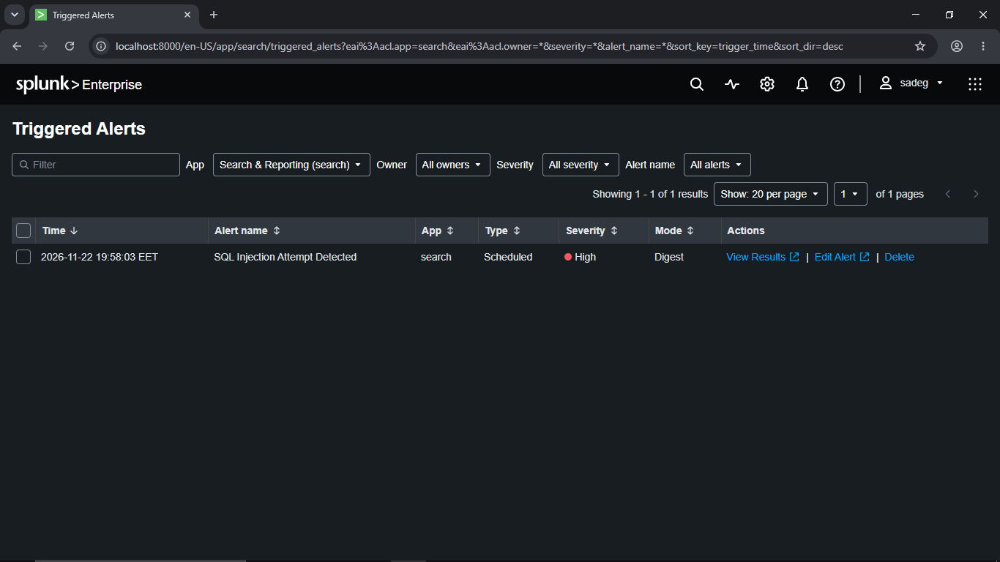
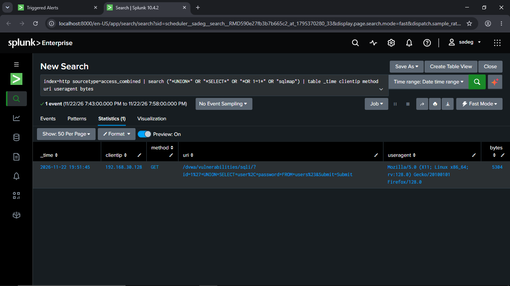
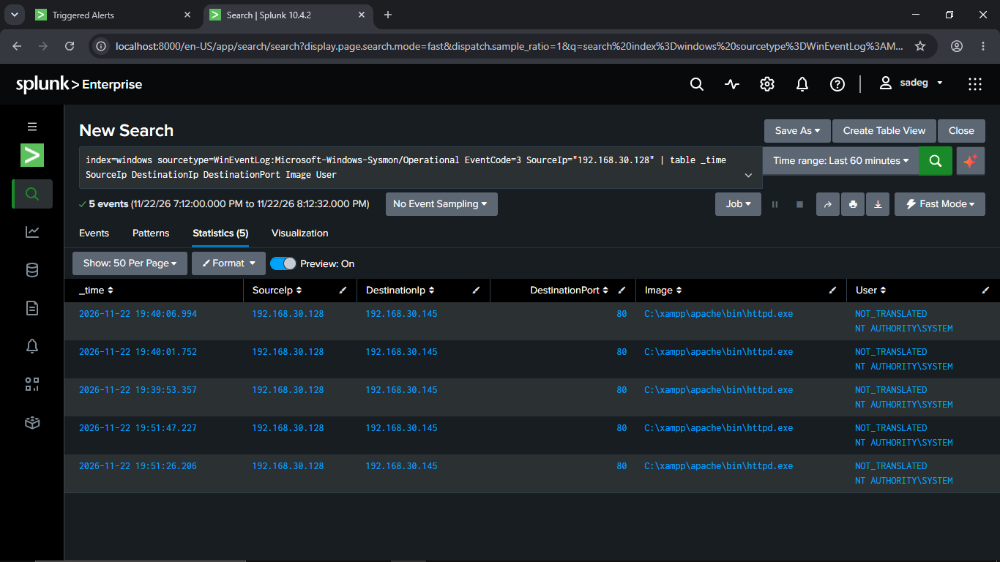

# SOC Investigation: SQL Injection Attempt Detected


## 1. Overview

This document walks through the analyst-side investigation that follows the detection described in [splunk_alert.md](splunk_alert.md) and the attack performed in [attacker.md](attacker.md). It covers triage, validation, scope assessment, indicators of compromise (IOCs), and recommended remediation.

| Field | Value |
|---|---|
| **Alert Name** | SQL Injection Attempt Detected |
| **Triggered** | 2026-11-22 19:58:03 EET |
| **Severity** | High |
| **Analyst** | sadeg (SOC) |
| **MITRE ATT&CK** | [T1190 - Exploit Public-Facing Application](https://attack.mitre.org/techniques/T1190/) |

---

## 2. Triage

### 2.1 Alert Queue

I opened the **Triggered Alerts** page in Splunk and sees a single hit for **SQL Injection Attempt Detected**, fired at **19:58:03 EET**, with **High** severity and **Scheduled / Digest** mode.




The analyst clicks **View Results** to inspect the underlying search that caused the alert to fire.

### 2.2 Validating the Alert

```spl
index=http sourcetype=access_combined
| search ("*UNION*" OR "*SELECT*" OR "*OR 1=1*" OR "sqlmap")
| table _time clientip method uri useragent bytes
```




**Assessment:** This is not a benign match. The `uri` contains a textbook UNION-based SQL Injection payload (`UNION SELECT user, password FROM users`) targeting DVWA's `users` table, and the response size (5304 bytes) is noticeably larger than a normal single-record lookup — consistent with a successful data dump.

**Verdict: True Positive.** The alert correctly identified an exploitation attempt against the public-facing DVWA application.

---

## 3. Scope and Impact Assessment

With the malicious request confirmed, the analyst pivots from the web logs to endpoint telemetry (Sysmon) to confirm which process actually served the request and to check for any follow-on activity from the same source IP.

### 3.1 Pivoting to Sysmon Network Telemetry

```spl
index=windows sourcetype=WinEventLog:Microsoft-Windows-Sysmon/Operational EventCode=3 SourceIp="192.168.30.128"
| table _time SourceIp DestinationIp DestinationPort Image User
```




**Findings:**

- All five connections in the last 60 minutes from `192.168.30.128` terminate at `192.168.30.145:80`, served by **`httpd.exe`** (Apache, bundled with XAMPP) running as **NT AUTHORITY\SYSTEM** — confirming the target is the DVWA web server identified in the alert.
- The timestamps **19:51:26** and **19:51:47** bracket the malicious request logged at **19:51:45**, showing the attacker made several requests in quick succession around the time of exploitation — consistent with an analyst manually testing and refining a payload (as opposed to a single, isolated request).
- No connections are seen to any other destination IP or port from this source, indicating the activity was contained to the web application and did not pivot further into the network during this window.
- No `httpd.exe` child process creation (e.g. `cmd.exe`, `powershell.exe`) is present in the Sysmon data reviewed, suggesting this was data exfiltration via SQL Injection only, with no remote code execution achieved at this stage.


---

## 4. Indicators of Compromise (IOCs)

| Type | Value |
|---|---|
| Source IP (attacker) | `192.168.30.128` |
| Destination IP (victim) | `192.168.30.145` |
| Destination port | `80` |
| Target process | `C:\xampp\apache\bin\httpd.exe` |
| Malicious URI pattern | `vulnerabilities/sqli/?id=1'+UNION+SELECT+user,password+FROM+users#` |
| User-Agent | `Mozilla/5.0 (X11; Linux x86_64; rv:128.0) Gecko/20100101 Firefox/128.0` |
| Technique | UNION-based SQL Injection (T1190) |

---

## 5. Timeline

| Time (EET) | Event |
|---|---|
| 19:39:53 – 19:40:06 | Initial reconnaissance requests from `192.168.30.128` to the DVWA server. |
| 19:51:26 – 19:51:47 | Attacker submits crafted SQL Injection payloads to the `id` parameter. |
| 19:51:45 | Malicious request with `UNION SELECT user, password FROM users` payload logged in `access_combined`. |
| 19:52:00 | Scheduled Splunk search run (next cycle) picks up the matching event. |
| 19:58:03 | Alert **SQL Injection Attempt Detected** fires with High severity. |

---

## 6. Remediation and Recommendations

| Priority | Recommendation |
|---|---|
| **Immediate** | Reset all exposed credentials; assume all five accounts are compromised. |
| **Immediate** | Block/restrict source IP `192.168.30.128` at the network perimeter if this traffic was unauthorized. |
| **High** | Replace string-concatenated SQL queries with **parameterized queries / prepared statements**. |
| **High** | Enforce strict input validation on the `id` parameter (expect integer only). |
| **High** | Migrate password storage to a salted, slow hashing algorithm (e.g. bcrypt, Argon2). |
| **Medium** | Deploy a Web Application Firewall (WAF) in front of the application to catch injection patterns before they reach the backend. |
| **Medium** | Tune the Splunk detection to also decode URL-encoded payloads (`urldecode(uri)`) and include additional patterns (`--`, `DROP TABLE`, `information_schema`, `SLEEP(`).

