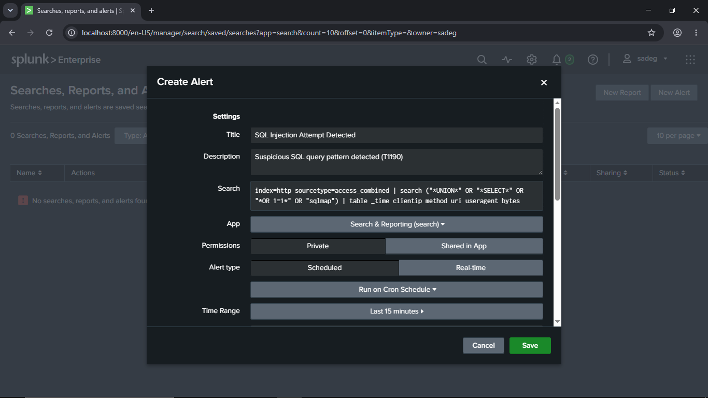
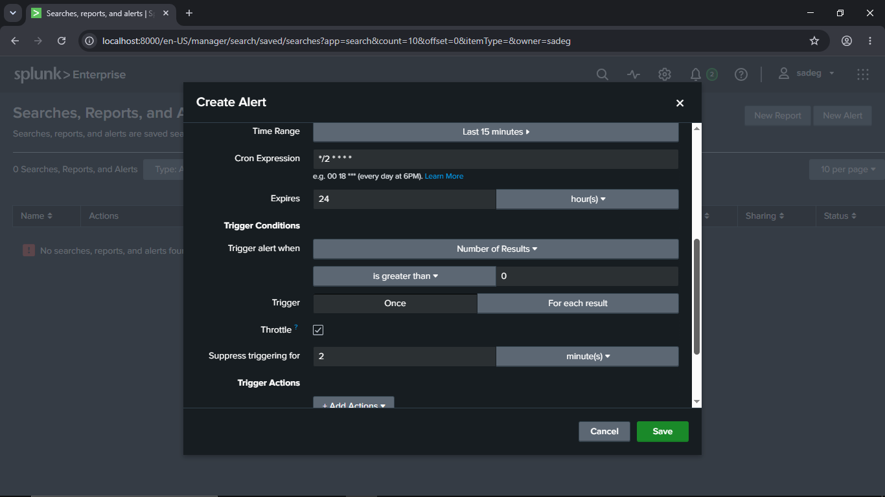
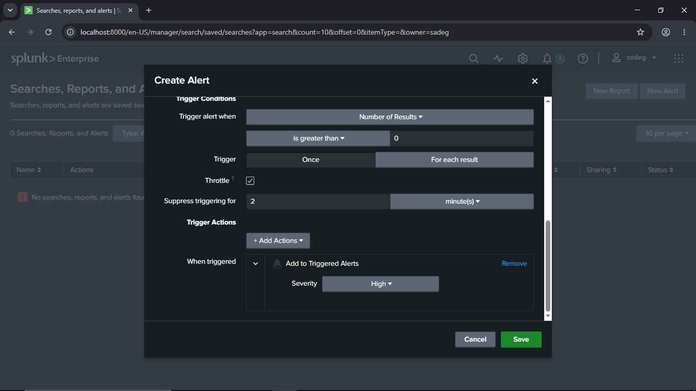
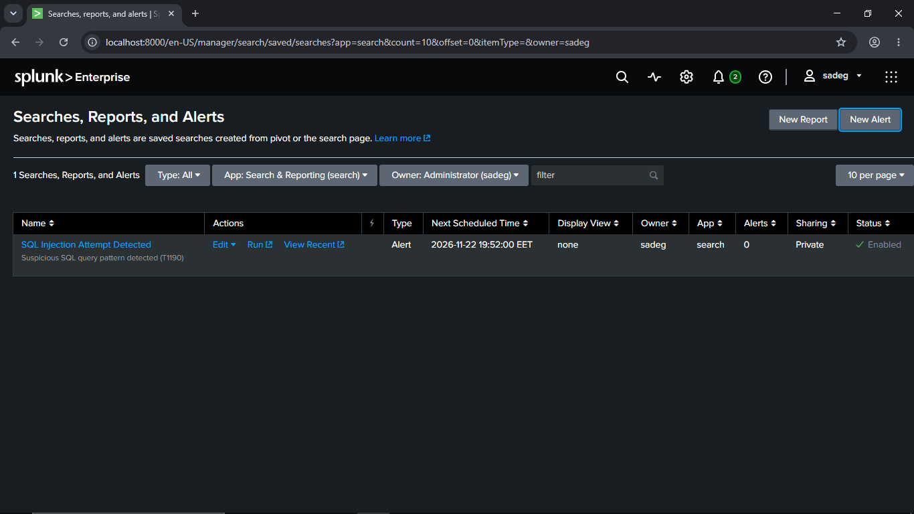

# Splunk Alert: SQL Injection Attempt Detection


## 1. Overview

This document describes the detection rule built in **Splunk Enterprise** to identify SQL Injection (SQLi) attempts against a web application. The alert monitors web server access logs and fires whenever a request contains common SQL injection patterns.

| Field | Value |
|---|---|
| **Alert Name** | SQL Injection Attempt Detected |
| **Description** | Suspicious SQL query pattern detected (T1190) |
| **MITRE ATT&CK** | [T1190 - Exploit Public-Facing Application](https://attack.mitre.org/techniques/T1190/) |
| **Platform** | Splunk Enterprise (local instance) |
| **App** | Search & Reporting (`search`) |
| **Owner** | `sadeg` (Administrator) |
| **Severity** | High |
| **Permissions** | Private |

---

## 2. Detection Logic

### SPL Query

```spl
index=http sourcetype=access_combined
| search ("*UNION*" OR "*SELECT*" OR "*OR 1=1*" OR "sqlmap")
| table _time clientip method uri useragent bytes
```

---

## 3. Alert Configuration

### 3.1 Settings



### 3.2 Trigger Conditions



### 3.3 Trigger Actions





---

## 4. Limitations and Tuning

| Limitation | Recommendation |
|---|---|
| Wildcard `*SELECT*` may match legitimate requests (e.g. a URL containing the word "select"). | Whitelist known-good URIs and tune based on false positives. |
| URL-encoded payloads (`%20OR%201%3D1`, `%27`) are not matched. | Apply `urldecode()` before searching, e.g. `\| eval decoded=urldecode(uri)`. |
| Only four patterns are covered. | Extend with `' OR '`, `--`, `DROP TABLE`, `information_schema`, `SLEEP(`, `BENCHMARK(`. |
| Attackers can change the User-Agent to hide sqlmap. | Do not rely on the User-Agent alone; keep payload-based detection. |
| Detection only, no blocking. | Pair with a WAF or firewall rule to block offending IPs. |

